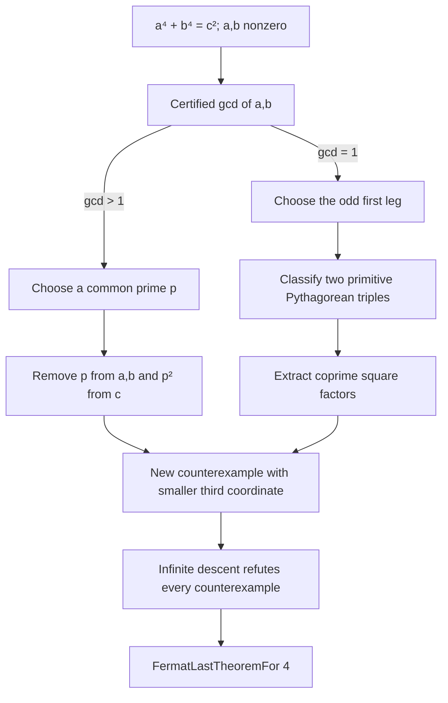

# FLT source-port map for Lim

## Scope and provenance

This is a source-level port plan for Lean repository revision
`6e837e75355538c7f80bab5b956861e86c4eacc2` (`/tmp/lim-flt-upstream`). It
describes declarations and proof flow visible in that revision; it does not
claim a complete dependency audit or a completed FLT proof. Source locations
below use repository-relative paths and one-based line
numbers. The upstream theorem files contain large `attribute [-instance]`
blocks; these are environment adjustments, not the mathematical argument.

The port target is Lim source with explicit proofs for the individual
mathematical lemmas. Lean's checked/exported proof object is not a Lim proof
and importing such an object is unnecessary. Keep standard foundations and
the provenance of imported mathematical results explicit. The final theorem
must prove any FLT-specific intermediate statements it uses; it must not take
major FLT lemmas as assumptions. Every mathematical result used as evidence
must have a Lim-checked proof from the explicitly authorized foundational
rules. A literature citation or an upstream theorem name supplies no proof
authority.

The native port closes the natural-number reductions, the required Euclidean
and primitive-triple mathematics, and the complete exponent-three and
exponent-four cases. The generalized Eisenstein cubic descent is proved,
including the actual smaller solution and its strict exact-order decrease.
Strong induction closes that statement; the primitive and signed reductions
then give the original unbounded natural-number proposition `fermat-for 3`.
The small-prime split supplies both closed cases to the original reduction.
Every alleged natural counterexample at a prime at least five now constructs
an actual normalized signed Frey package. The exact original FLT statement
is reduced to refuting those packages. The irreducibility, modularity,
level-lowering and vanishing argument remains open; full FLT is not proved.
The current native library contains 4,397 theorem declarations in 803 modules.
It also supplies exact integral models and local valuations, and exhaustive
nonsingular point counts with signed `apOfModel` for positive/prime moduli.
The sections below record the successive constructions. Conditional bridge
interfaces remain useful lemmas; the final cubic descent now supplies their
previously open generalized-cubic hypothesis.

## Checked native port

The modules under [theorems/flt](../theorems/flt/) use the existing recursive
addition, multiplication and power definitions in `fermat_statement.lim`.
Lim's recursors use the first operand, so the structural induction arguments
are adapted from the source proof while preserving the unbounded statements.

| Native module | Checked mathematical content |
| --- | --- |
| `equality.lim` | Symmetry, transitivity, congruence and predicate substitution, proved by equality elimination |
| `logic-exists.lim`, `logic-false.lim` | Constructive existential quantification and False elimination |
| `logical-connectives.lim`, `logical-decision.lim`, `decidable-logic.lim` | Conjunction, disjunction and decisions carrying either a proof or a refutation |
| `natural-decision.lim`, `decidable-order.lim`, `decidable-divisibility.lim` | Total constructive equality, order and divisibility decisions on mathematical naturals |
| `bounded-existence.lim`, `bounded-search.lim` | Prefix search, witness extraction and proof that the search exhausts its arbitrary natural bound |
| `least-witness.lim`, `least-divisor.lim` | Least witnesses of decidable predicates, and least divisors above one |
| `natural-prime.lim` | The least nontrivial divisor is prime; every natural number greater than one has a prime divisor |
| `natural-addition.lim` | Right zero/successor laws, commutativity and associativity |
| `natural-successor.lim`, `natural-cancellation.lim` | Constructor injectivity and both addition cancellations |
| `natural-multiplication.lim` | Left identity, distribution over addition, and associativity |
| `natural-multiplication-right.lim`, `natural-multiplication-commutative.lim` | Right zero/identity/successor, interchange of addition and multiplication commutativity |
| `natural-small-cases.lim`, `natural-parity.lim` | Zero/one/larger cases, decrease on dividing a positive double, parity and oddness of primes other than two |
| `natural-powers.lim` | Addition of exponents and `a^(m*k) = (a^k)^m` |
| `natural-nonzero.lim` | Successors are nonzero; addition, multiplication and powers preserve the required nonzero hypotheses |
| `natural-strong-induction.lim`, `natural-order.lim` | Strong induction derived from Nat induction; strict order via positive addition gaps, irreflexivity and transitivity |
| `natural-divisibility-defs.lim`, `natural-divisibility.lim` | Constructive divisibility, reflexivity, one/zero/product witnesses and transitivity |
| `exponent-reduction.lim` | Regroup a hypothetical equation at exponent `m*k` into one at exponent `m` |
| `fermat-for.lim` | Direct Nat port of `FermatLastTheoremFor.mono` |
| `two-power-reduction.lim` | Four divides `2^k` whenever `2^k > 2` |
| `two-factor-classification.lim` | Every positive natural is a power of two or has a prime divisor different from two |
| `divisor-dichotomy.lim` | For every `n > 2`, either four divides `n` or an odd prime divides `n` |
| `odd-prime-reduction.lim` | Transport explicit exponent-four and odd-prime proofs to every exponent above two and the exact local FLT proposition |
| `infinite-descent.lim` | A predicate whose every witness has a strictly smaller witness has no witnesses; derived from strong induction without decidability assumptions |
| `natural-discrete-order.lim`, `natural-multiplication-order.lim` | Trichotomy, discrete successor order, positive multiplication order and cancellation |
| `natural-division.lim` | A quotient/remainder certificate exists for every natural dividend and positive divisor |
| `natural-divisibility-addition.lim`, `natural-divisibility-bounds.lim` | Additive divisibility cancellation, including divisor zero; divisor bounds, antisymmetry and divisors of one |
| `natural-gcd.lim`, `natural-gcd-scaling.lim` | Gcd specification, Euclidean existence and scaling, including scale zero |
| `natural-coprime.lim`, `natural-euclid.lim` | Gcd uniqueness and gcd-one equivalence; Euclid cancellation, coprime products/powers and coprimality of square sums |
| `natural-prime-divisibility.lim` | Prime divisors are one or self; primes dividing products or powers divide a factor or the base |
| `natural-square-arithmetic.lim`, `natural-square-factors.lim` | Nonzero-factor algebra and unbounded square extraction from coprime natural factors |
| `natural-semiring-identities.lim` | Explicit checked polynomial identities, with checked auxiliary definitions generated by an authoring tool |
| `natural-prime-two.lim`, `natural-parity-arithmetic.lim` | Primality of two, witnessed parity, square residues and the parity of Pythagorean triples |
| `natural-square-order.lim`, `natural-descent-bounds.lim` | Square injectivity, positive square order and explicit strict descent bounds |
| `natural-pythagorean-halves.lim`, `natural-pythagorean-classification.lim` | Positive primitive triples with an odd first leg, including all parameter equations, coprimality and parity |
| `fermat-four-defs.lim` | Fourth-power/square counterexamples and correspondence to the original power definition |
| `fermat-four-primitive-descent.lim`, `fermat-four-factor-descent.lim` | Smaller counterexamples in both primitive and common-prime cases |
| `fermat-four.lim` | Closed unbounded exponent-four theorem and reduction of the original FLT proposition to odd-prime proofs |
| `natural-division-unique.lim`, `natural-small-remainders.lim` | Uniqueness of arbitrary natural division certificates and exhaustive small remainders |
| `natural-cube-identities.lim` | Explicit checked cube identities and modulo-nine carry identities, with compact coefficients |
| `natural-ninth-residues.lim`, `natural-ninth-exclusion.lim` | Witnessed cube residues for nonmultiples of three, uniqueness, and exclusion of all four residue sums |
| `fermat-three-first-case.lim` | Unbounded natural first case: `3 ∤ a*b*c` rules out `a³+b³=c³`, using the original power definition |
| `integer-defs.lim`, `integer-equality.lim` | Formal differences, equivalence, faithful natural embedding and operation congruence |
| `integer-addition.lim`, `integer-multiplication.lim` | Checked additive-group and commutative-ring identities, signs and cube congruence |
| `integer-*-identities.lim` | Explicit Nat polynomial proofs for integer components, authored from the checked semiring laws |
| `integer-normal-form.lim`, `integer-natural-bridge.lim` | Witnessed positive/negative normal forms and reflection of natural divisibility |
| `integer-divisibility.lim` | Explicit signed factors, congruence, composition, zero and sign invariance |
| `integer-cube-normalization.lim`, `integer-three-sign-cases.lim` | Representation transport and all eight signed first-case branches |
| `fermat-three-first-case-integers.lim` | Signed first case with the source nondivisible-product hypothesis and recursively defined integer powers |
| `integer-magnitude.lim`, `integer-magnitude-products.lim` | Unique signed magnitudes, congruence, sign invariance, product/cube/power magnitudes and divisibility bridges |
| `integer-gcd.lim`, `integer-gcd-three.lim` | Binary and triple gcd certificates universal over all signed divisors; existence, uniqueness, permutations, signs and associativity |
| `natural-prime-three.lim` | Closed proof of primality of three and the required small nondivisibility facts |
| `integer-divisibility-addition.lim` | Additive divisibility and cancellation for every signed divisor, including zero; zero-divisor and cube-negation laws |
| `integer-prime-divisibility.lim` | Signed product/power prime divisibility and propagation to the third coordinate of a cubic equation |
| `integer-cubic-gcd.lim` | A primitive signed cubic equation has gcd one for each pair whose selected first coordinate is nonzero |
| `integer-bezout-defs.lim`, `integer-bezout-algebra.lim`, `integer-bezout.lim` | Explicit signed coefficients, Euclidean coefficient update, sign/representation transport and common-divisor consequence |
| `natural-bezout.lim`, `integer-gcd-bezout.lim` | Constructive Bezout witnesses for every certified natural/signed gcd; equivalence of signed gcd one and the Bezout coprimality equation |
| `eisenstein-defs.lim`, `eisenstein-equality.lim` | Concrete pairs representing `a+bω`, componentwise integer equivalence and operation congruence |
| `eisenstein-embedding.lim`, `eisenstein-bezout.lim` | Faithful signed scalar embedding preserving operations, powers, divisibility and actual Bezout coprimality witnesses |
| `eisenstein-constants.lim` | Checked cubic-root identities, `λ²=-3ω`, explicit units and a factor witnessing `λ` dividing three |
| `integer-linear-identities.lim`, `eisenstein-lambda.lim` | `λ` divides an embedded integer exactly when three divides that integer, proved with explicit factors |
| `eisenstein-cubic-bridge.lim` | Conditional transfer of the generalized Eisenstein cubic statement to the signed residual case, with proved scalar/divisibility/coprimality transport |
| `fermat-three-defs.lim`, `fermat-three-factor-descent.lim` | Actual positive cubic solutions, common-prime propagation, factor cancellation and strict decrease of the third coordinate |
| `fermat-three-primitive.lim` | Construct a coprime cubic solution from any positive counterexample by strong induction; reduce the original exponent-three proposition to that primitive case |
| `integer-divisibility-decision.lim` | Constructive proposition-valued signed divisibility decisions and nonzero/sign consequences |
| `fermat-three-residual.lim`, `fermat-three-primitive-orientation.lim` | Explicit power/cube/sign transport, and orientation of every nonzero primitive signed cubic equation into the residual case |
| `fermat-three-signed-bridge.lim` | Actual signed triple-gcd-one and nonzero evidence for a natural primitive solution; full `fermat-for 3` follows from the generalized Eisenstein statement as an explicit hypothesis |
| `eisenstein-product-*.lim`, `eisenstein-scalar-*.lim` | Explicit checked integer polynomial proofs for the pair multiplication and coordinate-divisibility formulas |
| `eisenstein-ring.lim` | Commutative ring, sign, cancellation and power-congruence laws for the concrete Eisenstein operations |
| `eisenstein-lambda-prime.lim` | Constructive coordinate-sum divisibility criterion, nonunit and primality of lambda, prime-power divisibility and proposition-valued divisibility decisions |
| `integer-domain.lim`, `integer-nonnegative.lim` | Constructive signed equality cases, nonzero products and cancellation, natural nonnegativity certificates, square positivity and positive-scale reflection |
| `eisenstein-norm-defs.lim`, `eisenstein-norm-scalar-*.lim` | Explicit conjugation, signed norm and ordinary checked integer identities for the norm calculations |
| `eisenstein-conjugate.lim`, `eisenstein-norm-multiply.lim` | Conjugation preserves the ring operations; multiplying by the conjugate embeds the norm, and the norm is multiplicative |
| `eisenstein-norm-basic.lim`, `eisenstein-norm-squares.lim`, `eisenstein-norm-symmetries.lim` | Norm congruence, completed squares, signs, conjugation, scalar embedding and the zero/one/lambda values |
| `eisenstein-norm-nonnegative.lim`, `eisenstein-norm-nondegenerate.lim`, `eisenstein-domain.lim` | Nonnegative norm with a unique natural representative; norm zero exactly at zero; no zero divisors and both multiplicative cancellations |
| `eisenstein-natural-norm-*.lim`, `eisenstein-norm-unit.lim` | Natural norm certificates for products/powers and nonzero elements; units exactly at norm one, with the conjugate constructing the inverse |
| `natural-power-growth.lim` | Explicit induction proving `k < 3^k` for every natural exponent |
| `eisenstein-norm-divisibility.lim`, `eisenstein-lambda-multiplicity.lim` | Norm divisibility and a proved finite lambda-power bound for every nonzero Eisenstein value |
| `eisenstein-divisibility.lim`, `eisenstein-power-divisibility.lim`, `eisenstein-domain-powers.lim` | Witnessed ring divisibility, structural powers, nonzero powers and common-factor cancellation |
| `eisenstein-lambda-cancellation.lim`, `eisenstein-lambda-decision-core.lim` | Direct cancellation through the witnessed factorization of three, and the focused coordinate-sum decision argument |
| `eisenstein-norm-scalar-lambda-multiply.lim`, `eisenstein-lambda-norm-descent.lim` | Direct checked `N(lambda*x)=3*N(x)` and strict decrease of an actual nonzero quotient's norm |
| `eisenstein-lambda-power-decision.lim`, `eisenstein-lambda-order.lim` | Constructive power decisions; existence and uniqueness of the exact maximal lambda exponent, representation congruence and successor laws |
| `eisenstein-lambda-factor.lim` | Cancel arbitrary lambda powers and extract actual lambda-free residual factors from exact orders |
| `eisenstein-lambda-order-arithmetic.lim` | Orders add on products, scale on arbitrary natural powers and are unchanged by multiplication by units |
| `eisenstein-lambda-order-bounds.lim` | A lambda power divides exactly when its exponent is at most the certified order |
| `eisenstein-lambda-cubic-divisibility.lim` | For nonzero `c`, a proof that `lambda^4` divides `c^3` gives a proof that `lambda^2` divides `c` |
| `integer-three-residues.lim`, `eisenstein-three-residues.lim` | Constructive signed residues zero/one/minus-one modulo three and their transport modulo lambda |
| `eisenstein-additive-divisibility.lim` | Explicit additive factors, cancellation and reflection through an actual unit inverse |
| `eisenstein-cube-scalar-*.lim`, `eisenstein-cube-algebra.lim` | Bounded scalar proofs, cube factorization and the shifted three-factor identity |
| `eisenstein-cube-congruences.lim` | For every `x` not divisible by lambda, its cube is one or minus one modulo lambda to the fourth power |
| `eisenstein-cubic-solution-algebra.lim` | Additive residue cancellation and the proved impossibility of lambda dividing two |
| `eisenstein-cubic-solution-congruences.lim` | The actual generalized solution forces opposite cube residues and `lambda^4` dividing `c^3` |
| `eisenstein-cubic-solution-order.lim` | The solution hypotheses imply `lambda^2` dividing nonzero `c` and exact lambda order at least two |
| `eisenstein-cubic-factor-expansion.lim`, `eisenstein-cubic-factorization.lim` | Checked ring expansion, the sum-of-two-cubes factorization, cube products and cubic-root unit rotations |
| `eisenstein-cubic-factor-choice.lim` | A fourth-power divisor of three factors forces a square divisor of one; apply this to the actual cubic solution |
| `eisenstein-cubic-unit-rotation.lim`, `eisenstein-cubic-orientation.lim` | Explicit inverse and Bezout witnesses preserve the equation and coprimality when choosing an oriented pair |
| `eisenstein-cubic-shifts.lim`, `eisenstein-cubic-rotated-orders.lim` | Actual unit shifts give exact order-one certificates for both rotated factors |
| `eisenstein-cubic-order-balance.lim` | Construct the primary order `m` and prove `m+1+1=3*k` from the actual cubic equation |
| `eisenstein-cubic-power-factors.lim`, `eisenstein-cubic-residual-equation.lim` | Checked power scaling and four constructed lambda-free residuals with `x*y*z=u*w^3` |
| `eisenstein-bezout-linear-expansion.lim`, `eisenstein-bezout-linear-algebra.lim`, `eisenstein-bezout-linear-change.lim` | Explicit linear changes of the two Bezout coefficients, with actual unit inverses |
| `eisenstein-cubic-bezout-shifts.lim`, `eisenstein-cubic-residual-coprime.lim`, `eisenstein-cubic-packet-coprime.lim` | The constructed residuals have three actual pairwise Bezout witnesses; positive primary order is derived |
| `natural-unit-bound-polynomial.lim`, `natural-unit-bound.lim`, `integer-unit-bound.lim` | Constructive natural and signed coordinate bounds from `4=3*x*x+r*r` |
| `eisenstein-unit-coordinate-bounds.lim`, `eisenstein-unit-coordinate-cases.lim`, `eisenstein-unit-classification.lim` | Exhaustive six-unit classification from norm one, with actual unit proofs for every representative |
| `eisenstein-unit-kummer.lim` | A unit congruent to an integer modulo lambda squared is one or negative one, proved using actual coordinate divisors |
| `natural-remainder-complement.lim`, `integer-division-defs.lim`, `integer-division-existence.lim` | Actual signed division by a positive natural divisor, including negative quotient adjustment and noncanonical inputs |
| `eisenstein-coordinate-division.lim` | Arbitrary pairs have an exact quotient and two bounded natural-coordinate remainders for any positive natural scalar divisor |
| `natural-rectangle-norm-bound.lim`, `eisenstein-coordinate-norm-bound.lim` | Actual natural norm certificates imply a strict rectangular remainder norm bound |
| `natural-product-order-reflection.lim`, `eisenstein-natural-norm-transport.lim` | Strict multiplier-order reflection and actual norm certificates under conjugation, equivalence and products |
| `eisenstein-euclidean-algebra.lim`, `eisenstein-euclidean-norm.lim`, `eisenstein-euclidean-division.lim` | Constructive Euclidean quotient/remainder and actual norm witnesses for every nonzero Eisenstein divisor |
| `eisenstein-bezout-gcd-defs.lim`, `eisenstein-bezout-gcd-algebra.lim`, `eisenstein-bezout-gcd-euclidean.lim` | Actual gcd divisibility and coefficient certificates, with the exact Euclidean backward update |
| `eisenstein-bezout-gcd-induction.lim`, `eisenstein-bezout-gcd.lim`, `eisenstein-gcd.lim` | Strong norm induction constructs gcd and Bezout witnesses for every pair and derives the universal common-divisor property |
| `eisenstein-unit-divisibility.lim`, `eisenstein-coprime-factors.lim` | Actual unit inverses and gcd/Bezout coefficients prove the common-divisor unit criterion and Euclid cancellation |
| `eisenstein-divisibility-cases.lim` | Constructive divisibility cases for nonzero divisors and unit/nonunit cases for every value |
| `eisenstein-irreducible-prime.lim` | Irreducible and prime are equivalent in the concrete domain, with a closed irreducibility proof for lambda |
| `natural-coordinate-search-bound.lim`, `integer-coordinate-search-bound.lim`, `eisenstein-coordinate-search-bound.lim` | Actual norm certificates bound both signed coordinate magnitudes below `4*n+1` |
| `eisenstein-finite-coordinates.lim`, `eisenstein-finite-norm-search.lim` | Proved finite signed coverage and both search/witness directions for equivalence-preserving properties |
| `proposition-minimum.lim`, `eisenstein-nonunit-divisors.lim`, `eisenstein-least-nonunit-divisor.lim` | Constructive proposition-valued least witnesses supply an actual minimal nonunit divisor |
| `eisenstein-nonunit-factor-norm.lim`, `eisenstein-prime-divisor.lim` | Strict factor norms prove the minimal divisor irreducible, giving a prime divisor of every nonzero nonunit |
| `eisenstein-prime-cube-laws.lim` | Actual prime-power divisibility and coprimality witnesses force a prime divisor of `x` into `z` in `x*y=u*z³` |
| `eisenstein-coprime-power-factor.lim`, `eisenstein-cube-factor-algebra.lim`, `eisenstein-cube-factor-removal.lim` | Witnessed power cancellation and complete prime-cube removal preserve both quotient equations and coprimality |
| `eisenstein-associated-cube.lim`, `eisenstein-cube-extraction-norm.lim` | Explicit root/unit certificates, zero/unit/representation cases, and strictly smaller quotient norms |
| `eisenstein-coprime-cube-induction.lim`, `eisenstein-coprime-cube.lim` | Strong norm induction constructs associated cubes for both factors of every coprime unit-cube product |
| `eisenstein-coprime-cube-triple.lim`, `eisenstein-cubic-packet-cubes.lim` | Product coprimality and the actual constructed residual packet supply all three root/unit witnesses at `FLT/Three.lean:567-578` |
| `eisenstein-associated-cube-properties.lim`, `eisenstein-descent-unit-laws.lim` | Actual cube equations transmit root properties; unit operations construct their two-sided inverses |
| `eisenstein-cubic-linear-algebra.lim`, `eisenstein-cubic-root-linear.lim` | Explicit omega algebra and the actual factor/cube equations prove the weighted zero sum |
| `eisenstein-cubic-normalization-algebra.lim`, `eisenstein-cubic-normalizing-scales.lim` | Nonzero lambda cancellation and witnessed inverse rescaling construct the normalized coefficients and their unit proofs |
| `eisenstein-normalized-cubic-equation.lim`, `eisenstein-cubic-normalization-orders.lim` | Actual order balance constructs the predecessor order and the normalized cubic equation at `FLT/Three.lean:640-656` |
| `eisenstein-weighted-residue-algebra.lim`, `eisenstein-normalized-cubic-sign.lim` | Four actual cube-residue cases and Kummer congruence force the normalized coefficient to one or negative one |
| `eisenstein-cubic-square-divisor.lim`, `eisenstein-cubic-signed-coefficient.lim` | Construct the required square divisor and absorb the signed coefficient, retaining nondivisibility and coprimality |
| `eisenstein-cubic-descent-orders.lim`, `eisenstein-cubic-descent-defs.lim` | Exact predecessor order, positivity, strict decrease, and fully witnessed generalized solution data |
| `eisenstein-cubic-normalized-descent.lim`, `eisenstein-cubic-packet-descent.lim`, `eisenstein-cubic-solution-descent.lim` | Construct the smaller solution from the original solution through actual orientation, factors, cube roots, inverses and normalization |
| `eisenstein-cubic-descent.lim`, `fermat-three.lim` | Strong induction proves the generalized cubic theorem; the checked scalar and primitive bridges close unbounded exponent three |
| `large-prime-reduction.lim` | Primality and oddness exclude two and four; the closed three-case and four-case leave exactly the explicit prime-at-least-five obligation |
| `natural-power-products.lim`, `fermat-power-defs.lim`, `fermat-power-factor-descent.lim`, `fermat-power-primitive.lim` | Arbitrary positive exponents have witnessed common-prime removal, strict third-coordinate decrease and actual primitive counterexamples |
| `integer-power-laws.lim`, `fermat-power-coprimality.lim`, `frey-signed-power-equations.lim` | Signed odd-power laws, pairwise coprimality, parity and exact coordinate equation transport |
| `frey-even-power-packet.lim` | Keep even second coordinates, swap an even first coordinate, or reorder `(a,-c,-b)`, retaining every certificate |
| `natural-four-remainders.lim`, `integer-mod-four-normalization.lim`, `frey-normalized-power-packet.lim` | Actual signed division supplies all four remainders; non-evenness selects a sign with first coordinate congruent to three |
| `frey-package.lim` | Construct the full native Frey package from the original natural counterexample; reduce the exact FLT statement to an explicit package-refutation parameter |
| `integer-cross-products.lim`, `integer-fraction-sums.lim`, `integer-fraction-distributive.lim` | Explicit common-denominator identities and nonzero cancellation for exact fractions |
| `rational-defs.lim`, `rational-equality.lim`, `rational-congruence.lim` | Fractions carry nonzero denominator proofs; cross multiplication is an equivalence respected by each operation |
| `rational-ring.lim`, `rational-fractions.lim`, `integer-power-products.lim` | Ring laws, faithful integer embedding, actual fraction cancellation and nonzero products/powers |
| `rational-weierstrass-defs.lim`, `frey-rational-curve.lim` | Exact pinned rational coefficients/invariant definitions; prove b2, b4, b6 and fourth-coefficient nonvanishing |
| `rational-embedding-laws.lim` | Preserve integer negation and powers; cancel actual natural denominator multiples, including a zero multiplier |
| `frey-c4-cross-identity.lim`, `frey-c4-integer-identity.lim`, `frey-rational-c4.lim` | Prove the exact rational Frey c4 identity through explicit Nat and signed polynomial certificates |
| `rational-sign-laws.lim`, `rational-power-laws.lim`, `rational-discriminant-algebra.lim`, `weierstrass-zero-b6.lim` | Explicit sign/power identities and discriminant factorization with actual zero-b6 evidence |
| `frey-discriminant-factor.lim`, `frey-discriminant-square-cross.lim`, `frey-discriminant-square-integer.lim`, `frey-discriminant-square.lim` | Compute b8, retain the actual fourth coefficient and prove the inner square `(A+B)^2` |
| `rational-fraction-products.lim`, `integer-power-sums.lim`, `frey-discriminant-fraction.lim`, `frey-discriminant.lim` | Preserve denominators and the coordinate equation to prove exactly `(a*b*c)^(2*p)/2^8` and nonvanishing |
| `frey-package-discriminant.lim`, `rational-units.lim`, `frey-elliptic.lim` | Extract package certificates; construct actual two-sided inverse witnesses and the rational Frey ellipticity certificate |
| `integer-power-difference-step-cross.lim`, `integer-frey-a2-rearrange-cross.lim`, `integer-integral-identities.lim`, `integer-power-divisibility.lim`, `integer-power-differences.lim` | Actual signed power factors, exponent gaps and modulo-power differences |
| `frey-coefficient-divisibility.lim`, `frey-package-coefficients.lim` | Construct divisibility by four and sixteen from the retained package witnesses |
| `integer-weierstrass-defs.lim`, `weierstrass-model-equivalence.lim`, `weierstrass-invariant-congruence.lim`, `integer-weierstrass-map.lim` | Integer curves, coefficient equivalence, and all seven rational invariant congruence/embedding laws |
| `integer-frey-model.lim`, `integer-frey-invariants.lim`, `frey-package-integral-model.lim` | Actual quotient-model existence and coefficient uniqueness; integral c4 and discriminant identities and nonvanishing |
| `frey-c4-alternate-cross.lim`, `frey-c4-alternate.lim` | Both alternate c4 identities from the actual coordinate equation, including the exact doubled exponent |
| `integer-prime-coprimality.lim`, `frey-c4-prime-divisibility.lim` | Prime-coprimality of coordinate pairs and c4 nondivisibility through all three coordinate-divisor cases |
| `integer-frey-c4-primes.lim`, `frey-package-c4-primes.lim` | Integral/package prime nondivisibility and the implication from a discriminant prime divisor to a coordinate-product divisor |
| `integer-weierstrass-evaluation.lim` | Discriminant evaluation from four explicit invariant equations for bounded, checked concrete certificates |
| `integer-prime-away-two.lim`, `integer-frey-away-two.lim` | Denominator nondivisibility for every exponent and exact discriminant/coordinate-product prime-divisor equivalence away from two |
| `natural-prime-order-*.lim` | Construct finite valuations with an actual cofactor; prove existence, uniqueness, excluded higher powers, product and power laws |
| `integer-prime-order-*.lim` | Lift finite valuations through actual magnitudes, preserve integer equivalence and construct signed cofactors |
| `frey-local-valuations.lim`, `frey-local-valuations-two.lim` | Construct both valuation witnesses for every actual package and prove the exact discriminant formulas away from two and at two |
| `natural-valuation-divisibility.lim`, `frey-valuation-divisibility.lim` | Actual exponent-divisor witnesses away from two and nondivisibility at two, retaining the source prime and exponent-bound certificates |
| `integer-model-prime-defs.lim`, `integer-model-primes.lim`, `frey-semistable-model.lim` | Exact source good-prime and semistable-model predicates, coefficient-equivalence transport and construction of a certified Frey model satisfying the source predicate |

In `fermat-for-monotone`, `fermat-for m` is a bound proof parameter. The theorem
proves the implication from that checked exponent case and a divisibility
witness to `fermat-for n`; no exponent case of FLT is admitted as a global
fact. The eventual final theorem must supply the necessary exponent cases.
The source lemma is in pinned Mathlib `Mathlib/NumberTheory/FLT/Basic.lean`,
lines 77-86. Exact source hashes, declaration mappings and copyright notices
are in [provenance.json](../theorems/flt/provenance.json).

Check the complete native dependency chain without Lean or an export:

```sh
lim --check-theorem theorems/flt/fermat-for.lim fermat-for-monotone
lim --check-theorem theorems/flt/natural-prime.lim exists-prime-divisor
lim --check-theorem theorems/flt/odd-prime-reduction.lim fermat-statement-from-four-and-odd-primes
lim --check-theorem theorems/flt/natural-square-factors.lim coprime-product-square
lim --check-theorem theorems/flt/fermat-four.lim fermat-for-four
lim --check-theorem theorems/flt/fermat-three-first-case.lim fermat-three-first-case
lim --check-theorem theorems/flt/fermat-three-first-case-integers.lim fermat-three-first-case-integers
lim --check-theorem theorems/flt/integer-cubic-gcd.lim integer-cubic-gcd-one-first-pair
lim --check-theorem theorems/flt/integer-gcd-bezout.lim integer-gcd-bezout
lim --check-theorem theorems/flt/eisenstein-bezout.lim eisenstein-coprime-of-integer-gcd-one
lim --check-theorem theorems/flt/eisenstein-lambda.lim integer-three-divides-of-lambda
lim --check-theorem theorems/flt/eisenstein-cubic-bridge.lim integer-fermat-three-residual-gcd-of-eisenstein
lim --check-theorem theorems/flt/fermat-three-primitive.lim natural-cubic-has-primitive
lim --check-theorem theorems/flt/fermat-three-signed-bridge.lim fermat-for-three-from-eisenstein
lim --check-theorem theorems/flt/eisenstein-ring.lim eisenstein-multiply-associative
lim --check-theorem theorems/flt/eisenstein-lambda-prime.lim eisenstein-lambda-prime
lim --check-theorem theorems/flt/eisenstein-domain.lim eisenstein-multiply-cancel-first
lim --check-theorem theorems/flt/eisenstein-norm-unit.lim eisenstein-unit-natural-norm-one
lim --check-theorem theorems/flt/eisenstein-lambda-order.lim eisenstein-lambda-order-exists --proof-total-bytes 536870912
lim --check-theorem theorems/flt/eisenstein-lambda-cubic-divisibility.lim eisenstein-lambda-square-divides-from-cube --proof-total-bytes 536870912
lim --check-theorem theorems/flt/eisenstein-cube-congruences.lim eisenstein-lambda-four-cube-congruence --proof-total-bytes 1073741824
```

All 1,292 native theorems across 357 modules check with an empty global foundation
inventory. The larger order-library checks explicitly allow 512 MiB of
cumulative transformation traffic; the cube-congruence library allows
1 GiB of cumulative traffic. Per-theorem work and phase limits retain
their defaults; the compiler defaults are unchanged. Tests also reject a false exponent identity, missing
counterexample evidence, reversed divisibility and an unrelated conclusion
exponent. New controls reject reversed order/divisibility, an induction
history that includes the current case, and removal of the power-size premise.
Additional controls check both computed branches of the arithmetic decisions,
reject replacing a search bound with zero, reject making an arbitrary upper
bound the minimum, and reject concluding that the original number is prime
merely because it has a prime divisor. Other controls reject discarding either
divisor alternative, assigning all naturals the same parity, and removing the
four-case or odd-prime-case evidence from the final reduction. A descent
control rejects weakening strict decrease to returning the same witness.
The mathematical source port has 505 tests across `flt_source_port` (74),
`flt_norm` (three), `flt_multiplicity` (nine), `flt_order_arithmetic` (six),
`flt_cube_congruences` (six), `flt_cubic_solution` (six),
`flt_cubic_factorization` (two), `flt_cubic_orientation` (eight),
`flt_rotated_orders` (four), `flt_cubic_residuals` (six),
`flt_bezout_linear` (five), `flt_residual_coprime` (six),
`flt_unit_bounds` (seven), `flt_unit_classification` (four),
`flt_unit_kummer` (four), `flt_signed_division` (eleven),
`flt_rectangle_norm` (six), `flt_euclidean_components` (three),
`flt_euclidean_division` (ten), `flt_bezout_gcd_components` (three),
`flt_bezout_gcd` (eleven), `flt_coprime_units` (two),
`flt_irreducible_prime` (ten), `flt_coordinate_search` (four),
`flt_prime_factor_matrices` (six), `flt_finite_prime_divisor` (eight),
`flt_prime_cube_laws` (one), `flt_prime_cube_certificates` (three),
`flt_cube_factor_components` (nine), `flt_cube_extraction` (nine),
`flt_cubic_normalization_components` (eight), `flt_cubic_normalization` (nine),
`flt_cubic_descent_components` (eleven), `flt_cubic_descent` (nine) and
`flt_large_prime_reduction` (four), `flt_frey_components` (eleven), and
`flt_frey_normalization` (sixteen), `flt_rational_components` (nine), and
`flt_rational_arithmetic` (nineteen), `flt_frey_c4` (eleven),
`flt_discriminant_components` (fifteen), `flt_discriminant` (twenty-one),
`flt_integral_components` (thirteen), `flt_integral` (twenty-two),
`flt_c4_prime_components` (seven), `flt_c4_primes` (sixteen), and
`flt_away_two` (twelve, including two matrices),
`flt_valuation_components` (eleven), `flt_valuations` (seventeen),
`flt_valuation_consequences_components` (four), and
`flt_valuation_consequences` (fourteen).
One hundred and seventy-nine mandatory matrices enumerate all 1,292 declarations.
The cubic closure checks 32 added declarations and nine regressions; the
subsequent small-prime split checks two declarations and three regressions.
The Frey normalization checks 43 declarations and sixteen regressions.
The exact rational library and Frey coefficient formulas check 47 declarations
and nineteen regressions. The following primary c4 proof checks seven more
declarations in four matrices and seven regressions. The exact discriminant
and ellipticity proof checks 44 further declarations in fifteen matrices
and twenty-one regressions. The integral-model construction checks another
48 declarations in thirteen matrices and twenty-two regressions. The
alternate c4 and prime-nondivisibility proofs add 23 declarations in seven
matrices and sixteen regressions. The denominator/prime-equivalence step
adds six declarations in two matrices and ten regressions. Actual local
valuation construction and both discriminant formulas add 33 declarations
in eleven matrices and seventeen regressions. The exponent consequences
and exact source model predicates add eighteen declarations in four
matrices and fourteen regressions. The earlier
1,274 theorems retain their validated results: all 352 previous
native source modules and the production compiler remain byte-for-byte
unchanged.

Euclidean regression certificates check the unique gcd for zero inputs and
nontrivial inputs, including `(84, 30)`. They also reject incorrect quotient
equations, a remainder equal to the divisor and a zero divisor. Square-factor
tests cover zero, one, `(4, 9)` and `(9, 4)`; the counterexample `2*2 = 2²`
is rejected because the factors are not coprime. Candidate proof terms built
by test code are checked by the same kernel as authored source.

Larger concrete test constants use the existing `#pt-numeral` abbreviation.
A separate over-deep unary-numeral test checks a budget diagnostic on an
ordinary Rust test-worker stack. File-name resolution now separates simple
term spines from its larger scope/family dispatcher, fixing a stack overflow
before the kernel could report that syntax limit. No stack, proof-budget or
host resource limit was increased.

The search lemmas quantify over arbitrary natural bounds. Their algorithms
are implemented by structural Nat induction and need explicit pointwise
decisions. For positive divisibility, the proof derives a sufficient bound
from the multiplication witness; no arbitrary finite cutoff is assumed.
The least-witness theorem combines that search with a proof that a witness
exists, and proves that every earlier candidate is excluded.

`natural-prime.lim` uses the no-proper-nonunit-divisor characterization of
primality from pinned `Mathlib/Data/Nat/Prime/Defs.lean:114-122`
(`Nat.prime_def_lt'`). It adapts the minimal-divisor argument of
`Nat.minFac_prime` at lines 290-293. The native result specializes
`Nat.exists_prime_and_dvd` (407-408) to numbers greater than one; the source
also covers zero under its weaker hypothesis `n ≠ 1`. The native proof uses
the simpler exhaustive search proved here, rather than porting Mathlib's
optimized square-root factor search. No source theorem name is admitted as
evidence.

The positive factor classification uses strong induction: a prime divisor
different from two closes that branch; a divisor equal to two gives a
strictly smaller positive factor, to which induction applies. This is a
direct mathematical adaptation of the classification, avoiding Mathlib's
prime-factor-list infrastructure. Structural induction also proves that
each natural is even or a successor of a double. A prime other than two
cannot take the even branch, proving actual witnessed oddness, not just
inequality with two.

The generic reduction in `odd-prime-reduction.lim` has two explicit proof
parameters: `four-case` and `odd-prime-cases`. It follows the source proof
of `FermatLastTheorem.of_odd_primes`, where the first case is supplied by
the previously proved source theorem `fermatLastTheoremFour`. Lim now proves
that case as the closed `fermat-for-four` theorem in `fermat-four.lim`.
`fermat-statement-from-four-and-odd-primes` checks the implication all the
way to the exact proposition in `fermat_statement.lim`; it is not a closed
proof of FLT. The new `fermat-statement-from-odd-primes` supplies the checked
four-case proof, leaving only `odd-prime-cases` as an explicit parameter.
Those odd-prime proofs are still required for the full FLT goal.

## Exact theorem wrapper chain

1. `Theorems/Thm_fermat_last_theorem.lean:128` declares the final positive-Nat
   theorem. It wraps `P2MW.S_fermat_last_theorem.solution`, whose proof at
   `P2M/Sol/S_fermat_last_theorem.lean:129-130` applies
   `FLT.fermatLastTheorem` and turns positive hypotheses into nonzero proofs.
2. `Theorems/Thm_FLT_fermatLastTheorem.lean:136` declares
   `FLT.fermatLastTheorem : FermatLastTheorem`. Its body is
   `by p2m_exact_reverting @_root_.P2MW.S_FLT_fermatLastTheorem.solution`.
   Thus this is a wrapper around the next declaration, not the mathematical
   proof itself.
3. `P2M/Sol/S_FLT_fermatLastTheorem.lean:130-139` declares
   `P2MW.S_FLT_fermatLastTheorem.solution : FermatLastTheorem`. At lines
   131-132 it applies `FermatLastTheorem.of_odd_primes` and introduces a prime
   `p` with oddness proof. At lines 133-139 it splits on `5 ≤ p`:
   the large-prime branch calls
   `FreyPackage.fermatLastTheoremFor_of_five_le p pp hp5`; the remaining
   possibilities are enumerated using the prime lower bound, with `p = 3`
   discharged by `fermatLastTheoremThree` and the even/2 cases contradicted.
   These are explicit direct dependencies of this proof.
4. `Theorems/Thm_FreyPackage_fermatLastTheoremFor_of_five_le.lean:136`
   declares `FreyPackage.fermatLastTheoremFor_of_five_le` and wraps
   `P2MW.S_FreyPackage_fermatLastTheoremFor_of_five_le.solution` using
   `p2m_exact_reverting`. The underlying solution file is
   `P2M/Sol/S_FreyPackage_fermatLastTheoremFor_of_five_le.lean` (named by the
   wrapper's import at theorem-file line 9). This establishes the next
   source for the `p ≥ 5` branch; do not treat the wrapper or its imported
   solution as a Lim proof. Its body at solution lines 131-135 changes to
   integers, obtains a normalized package using `FreyPackage.of_counterexample`,
   and derives False using `FreyPackage.no_frey_package`.

The root theorem's immediate mathematical split is therefore: reduce to odd
primes; handle `p = 3`; handle primes at least five through the Frey-package
theorem. The theorem file imports the Frey, Galois representation,
modularity, modular representation, ramification, and cofixed-line
definitions, plus `P2M.Util` and the solution module. Imports alone do not
establish which imported declarations are semantically necessary.

Pinned Mathlib `Mathlib/NumberTheory/FLT/Four.lean:276-282` gives the exact
odd-prime reduction: `Nat.four_dvd_or_exists_odd_prime_and_dvd_of_two_lt`
finds either a divisor four or an odd prime divisor. The monotonicity lemma
then transports `fermatLastTheoremFour` or the supplied odd-prime case to
the original exponent. The native divisor lemma and this conditional
reduction now check, and the exponent-four case has a closed native proof.
The odd-prime cases remain open.

## Next source route: exponent three

The current exponent-three source target is pinned Mathlib revision
`db584cd6d46c92f209a44c0f1c829460d327499d`. The audited local snapshots are
`/tmp/lim-flt-source-Three.lean`,
`/tmp/lim-flt-source-CyclotomicThree.lean`, and
`/tmp/lim-flt-source-CyclotomicPID.lean`; their SHA-256 hashes and upstream
URLs are recorded in the repository [provenance manifest](../theorems/flt/provenance.json). The declarations
and ranges below are one-based line numbers in those snapshots.

`Mathlib/NumberTheory/FLT/Three.lean:58-76` is the elementary first case.
`cube_of_castHom_ne_zero` enumerates nonzero residues modulo 3 as elements
of `ZMod 9`, obtaining cube residues 1 and 8. `cube_of_not_dvd` transfers
that fact from integer nondivisibility, and
`fermatLastTheoremThree_case_1` checks the finite residue combinations to
exclude a cube equation when 3 divides none of `a`, `b`, or `c`. This is a
small residue proof. Its natural-number specialization is now proved in
`fermat-three-first-case.lim`; the case in which three divides a coordinate
remains open. The signed extension is now checked in the explicit
formal-difference model described below.

The native first-case proof divides an arbitrary natural by three, proves
that the remainder is zero, one or two, and excludes zero using the actual
nondivisibility hypothesis. The remaining two branches construct explicit
quotients witnessing cube residues one and eight modulo nine. Addition
produces only residues two, zero and seven. Quotient/remainder uniqueness
then contradicts the third cube's residue one or eight. Every numeric case
is justified by equality proofs and strict remainder bounds; no finite
search bound is imposed on the original numbers.

`scripts/generate-flt-cubes.py` authors the polynomial equality proofs using
the existing semiring laws. Its normal form collects numerical coefficients
instead of expanding them into long repeated sums. Every intermediate
`#math-definition` and final theorem is checked by Lim's existing kernel.
This tool is a source-authoring aid with no compiler or proof authority;
`--check` and an unchanged generation preserve the formatted file and mtime.
Regression tests reject incorrect cube constants, a wrong thirds equation,
wrong residues, an out-of-range remainder and a changed quotient conclusion.

The rest of that source is an Eisenstein-integer infinite descent, not a
continuation of the mod-9 calculation. In `Three.lean:82-146`, the theorem
normalizes to a coprime integer equation with 3 dividing only the third
coordinate, reducing the goal to the stronger case with 3 dividing `c`.
Lines `148-180` formulate the generalized theorem over the ring of integers
of the third cyclotomic field and transfer the integer case into it. The
descent setup at `181-239` defines solutions and a minimal lambda-multiplicity.
The central factorization and coprime-factor arguments at `241-619` produce
three associated cubes; `619-694` handles their unit factors; and
`694-738` constructs a new solution with strictly smaller multiplicity.
Finally, `751-771` instantiates the argument in `CyclotomicField 3 ℚ` to
prove the public natural-number theorem. These ranges identify source
milestones, not a claim that all imports or dependencies have been audited.

The companion source `Mathlib/NumberTheory/NumberField/Cyclotomic/Three.lean`
contains specific algebraic ingredients: `Units.mem` classifies units at
`51-79`; `lambda_sq` and `eta_sq` give the generator identities at `81-94`;
`eq_one_or_neg_one_of_unit_of_congruent` is the needed Kummer-style unit
step at `96-126`; and `lambda_dvd_or_dvd_sub_one_or_dvd_add_one` plus the
cube divisibility lemmas occupy `130-207`. The companion
`Mathlib/NumberTheory/NumberField/Cyclotomic/PID.lean:31-45` proves that the
ring of integers in the cubic cyclotomic field is a principal ideal ring.
That PID result and the number-field/cyclotomic infrastructure are genuine
proof dependencies. Prove them in Lim or prove the concrete algebraic
specializations the argument needs; citing Lean declarations is not evidence.

The first case is checked for both natural and signed coordinates.
Primitive coprime normalization and the cyclotomic descent remain unproved,
so `fermat-for 3` is still open.
The project goal is a direct
Lean-source-to-Lim mathematical port. Lean proof export is not required, and
there is no export blocker for continuing this work.

The divisor lemma itself is in pinned Mathlib
`Mathlib/Data/Nat/Factors.lean:313-319`. It invokes the classification
`Nat.eq_two_pow_or_exists_odd_prime_and_dvd` (lines 305-311), whose proof uses
prime-factor-list results. The native port instead proves the positive
classification by factor-two peeling, then closes the exact divisor lemma
for `n > 2`. It has not ported the unnecessary zero case of the more general
classification. The power-of-two branch includes exclusions at exponents
zero and one. Proving `4 ∣ n` does not prove the FLT exponent-four case.

## Checked signed arithmetic and the integer first case

`integer-defs.lim` represents a signed value by `difference(p,n)`, meaning
`p-n`. It defines `integer-equal` as the checked natural equality
`p + n′ = p′ + n`. This is an explicit equivalence relation on pairs, **not**
the kernel identity type and not a quotient axiom. Different representations
of the same signed value remain different records. No universal substitution
rule for arbitrary representation-dependent functions is assumed.

| Operation | Positive component | Negative component |
| --- | --- | --- |
| Natural embedding of `a` | `a` | `0` |
| Negation of `(p,n)` | `n` | `p` |
| Addition of `(p,n)` and `(q,m)` | `p+q` | `n+m` |
| Multiplication of `(p,n)` and `(q,m)` | `p*q+n*m` | `p*m+n*q` |

The native proofs establish reflexivity, symmetry and transitivity, and
prove that addition, negation, multiplication and cubes respect the
relation. The additive inverse, cancellation, multiplicative identity,
commutativity, associativity, distributivity and sign laws also check.
Integer powers use structural Nat recursion from the integer one; exponent
three is proved equivalent to the ordinary repeated-multiplication cube.

`integer-normal-form` proves that every pair is equivalent to either
`difference(k,0)` or `difference(0,k)` for an explicitly witnessed natural
`k`. The proof constructs that magnitude from natural trichotomy and addition
gaps. Zero may occur in either branch, as it should. This is a proposition
with witnesses; it does not extract runtime data from a proposition using
large elimination.

Divisibility means an explicit integer factor with a proved product
relation. Its source/target congruence, transitivity and sign changes are
proved. `integer-natural-divisibility-reflects` proves that integer
divisibility between embedded naturals implies the original natural
relation. A positive factor gives the natural witness. A negative factor
forces the nonnegative dividend to be zero; the proof includes zero
divisors. Allowing signed factors therefore introduces no spurious natural
divisibility claims.

The signed first case follows from the already checked natural modulo-nine
argument. Nondivisibility by three transfers to each witnessed magnitude.
Cube congruence transports the alleged equation to its positive/negative
forms. Six sign combinations reduce to a permutation of the natural cube
equation; the other two would make a sum of nonzero natural cubes zero.
`fermat-three-first-case-integers` proves the source-shaped statement with
`3` not dividing `(a*b)*c` and with the recursive integer power function.
No coordinate or sign case is assumed as a global foundation.

This is a concrete mathematical adaptation of
`Mathlib/NumberTheory/FLT/Three.lean:68-76`. Lean's canonical `Int` uses
`ofNat` and `negSucc`, declared in pinned `Init/Data/Int/Basic.lean:46-58`;
the native formal differences are not a literal port of those constructors.
The natural embedding, sign normal forms and operation congruence justify
the signed arithmetic used here. The native gcd results below use explicit
certificates. They do not claim a literal port of Lean's canonical `Int.gcd`
implementation, the entire `Int` library, or a general quotient framework.

`scripts/generate-flt-integer-algebra.py` authors the component identities as
ordinary Nat equality proofs. Each output records the construction locations
in its header. All helpers are checked by Lim, default proof/resource limits
are unchanged, and an unchanged generation preserves formatted bytes and
mtime. The tool supplies no mathematical authority.

Regression tests cover distinct pairs denoting the same integer, rejection
of treating that equivalence as record identity, noncanonical positive and
negative cube forms, zero representations and signed divisibility factors.
They check all eight signs with actual nondivisibility evidence and reject
a fabricated hypothesis for the true equation `0³+1³=1³`. A mutated sign law
that discards negation is rejected. The CLI signed target also checks with
an empty `PATH`, independently of Lean or external proof tools.

The primitive normalization used at `Three.lean:82-146` now checks for the
original natural-number goal. The construction below supplies a coprime
natural counterexample from any positive one, then a signed primitive
equation. The signed orientation proof handles every nonzero signed primitive
equation. The Bezout interface and scalar bridge at `161-180` connect this
to the concrete Eisenstein model. The closed cubic descent below now
supplies that bridge's generalized theorem and closes exponent three.

## Checked magnitudes, gcds and primitive cubic pairs

`integer-magnitude x n` explicitly states that `x` is equivalent to either
`n` or `-n`. Its existence, uniqueness and invariance under equivalence and
negation are checked. Zero's two signs have the same magnitude. Product,
cube and power magnitudes are proved, with structural induction for powers
including exponent zero. These are proposition-valued certificates, not an
absolute-value oracle or extraction of data from a proposition.

The binary gcd specification in `integer-gcd.lim` requires the embedded
natural `g` to divide both signed arguments, and **every signed common
divisor** to divide the embedded `g`. To construct it, obtain magnitudes of
the arguments and use the checked natural gcd. An arbitrary signed common
divisor has its own witnessed magnitude. Divisibility transfers through all
three magnitudes, the natural gcd's universal property applies, and the
result transfers back to the original signed divisor. No restriction to
positive representatives is hidden in the universal clause.

The converse transfer recovers the natural gcd certificate. Uniqueness,
argument symmetry, representation congruence and both sign changes follow.
Combining gcds of `(a,b)` and `(g,c)` constructs the full triple certificate.
The triple proof includes existence, uniqueness, permutations, independent
sign changes and associativity of the natural gcd results. This adapts the
mathematics in pinned `Init/Data/Int/Gcd.lean:42-118` without porting the
`Finset` container API or assuming an opaque gcd result.

`natural-prime-three.lim` proves three prime using the existing
no-proper-nonunit-divisor definition. The bound below three is exhaustively
classified; two cannot divide three because additive cancellation would
make it divide one. This proof is closed, rather than a new numeric kernel
primitive. Signed magnitudes then transport the proved natural prime
product/power results to arbitrary signed representatives.

Additive divisibility and cancellation hold for all signed divisors,
including zero. Consequently, a prime dividing the first two coordinates
of `a³+b³+c³=0` also divides the third. In a triple with gcd one this would
make the prime divide one, contradicting primality.

`integer-cubic-pair-gcd-is-one` uses this contradiction to prove a selected
binary gcd is one. A zero binary gcd contradicts the selected coordinate's
nonzero hypothesis. A gcd above one has a proved prime divisor, contradicting
the triple gcd-one property. The existence theorem then supplies the actual
binary gcd-one certificate. Rotating the cubic equation and triple
certificate proves the other two pairs, each with its explicit nonzero
hypothesis.

This closes the gcd content needed by the signed exponent-three
normalization. The separate Bezout identity and its concrete Eisenstein
cast preservation are now proved below. The gcd lemmas alone assume a
primitive input. The separate cubic normalization below constructs the
required primitive witness from an arbitrary positive counterexample.

The new tests check zero and mixed-sign magnitudes, distinct representatives,
binary/triple gcds including `(0,0,0)`, and the valid degenerate equation
`1³+0³+(-1)³=0`. They reject replacing its primitive certificate by the
nonprimitive `2³+0³+(-2)³=0`, wrong gcd values, a prime claim for four, a false
prime-power premise at exponent zero, and an invalid cubic sum. Candidate
certificate arithmetic in Rust grants no authority: Lim checks the terms.

The Bezout regressions check actual negative coefficients for `(30,12)` and
`(84,30)`, zero inputs, mixed signs and noncanonical representatives. They
reject changing subtraction to addition in the Euclidean update, false
coefficient equations, and using a gcd-two certificate as gcd one. The
Eisenstein tests check actual embedded coefficients, distinguish component
equivalence from record identity, and exercise both lambda-divisibility
directions with zero, positive, negative and noncanonical values. Invalid
factors for one and two and a reversed factor sign are rejected. Changing
`lambda²=-3*omega` to `lambda²=3*omega`, or removing the generalized cubic
hypothesis from the residual bridge, also fails. New CLI roots check with
an empty `PATH`.

## Checked Bezout and the concrete Eisenstein bridge

`integer-has-bezout a b value` contains two signed coefficients `s,t` and
an integer-equivalence proof of `value = s*a+t*b`. For a certified division
`a=q*b+r`, the coefficient update is `(s,t) -> (t,s-t*q)`. The algebraic
identity behind this update is proved from the existing integer ring laws.
Strong induction on the divisor then constructs coefficients for every
natural gcd certificate, following its strictly smaller remainder. The
zero-divisor case supplies `(1,0)` and transports the target using gcd
uniqueness. No computed extended-gcd operation is trusted by the kernel.

Signed magnitudes and the four sign combinations transport these witnesses
to every signed gcd certificate. `integer-coprime a b` specifically means
the Bezout equation with value one. Both implications between that equation
and the signed gcd-one specification are proved. Existential witnesses
remain inside propositions; the construction does not extract data from a
proposition into a computational type.

The concrete Eisenstein carrier is a pair of formal-difference integers
representing `a+bω`. Multiplication uses `ω²=-ω-1`. Equality is componentwise
integer equivalence, with reflexivity, symmetry, transitivity and operation
congruence proved separately. The integer embedding `n -> (n,0)` is faithful
and preserves addition, negation, multiplication and every natural power.
Divisibility witnesses and the two Bezout coefficients are explicitly
embedded, proving preservation of the actual coprimality equation.

The closed identities include `ω³=1`, `ω²+ω+1=0`, `λ=ω-1` and `λ²=-3ω`.
The checked factor `-2-ω` witnesses `λ | 3`. More generally, multiplication
by `λ` sends a pair `(u,v)` to `(-(u+v),u-2v)`, up to the proved equivalence.
If that product is an embedded integer `n`, its zero omega component forces
`u=2v`, so `n=3*(-v)`. Conversely, `n=3*k` supplies the explicit factor
`(-2k,-k)`. Thus `λ | embedded(n)` and `3 | n` imply each other, including
zero, negative and noncanonical representatives. This elementary argument
replaces the ideal-norm API used at the corresponding Lean source step.

`eisenstein-fermat-three-general` is the native statement of the generalized
unit-twisted cubic case in `FLT/Three.lean:161-166`.
`integer-fermat-three-residual-gcd-of-eisenstein` proves its scalar
specialization using the checked nonzero, nondivisibility, power and
coprimality bridges. The generalized statement is an explicit theorem
parameter. This bridge is an implication, not an axiom. Primitive
counterexample normalization and the closed factor/unit/multiplicity
descent below supply its evidence to close exponent three.

The pair model is a concrete mathematical adaptation of the source's
cyclotomic integer arithmetic. A general number-field interface, a proof of
Euclidean division or a PID for these pairs and the descent itself are not
claimed by the scalar bridge. Complete unit classification is now proved
separately below.

## Checked Eisenstein ring laws and lambda primality

`eisenstein-ring.lim` proves associativity, commutativity, both distributive
laws, zero/one identities and signs for multiplication, as well as the
componentwise additive group laws. It also proves additive cancellation,
power congruence and the equality of the recursive cube with the three-factor
product. Every equality uses the previously defined component equivalence;
no record-identity or quotient axiom substitutes for it.

`scripts/generate-flt-eisenstein-algebra.py` authors the scalar polynomial
identities behind these facts. It composes the already checked integer ring
and congruence lemmas, collects signed coefficients, and handles cancellation
to zero explicitly. The emitted helpers and final statements are ordinary
Lim source. The script supplies no proof authority and is not needed to run
the compiler. It retains the existing 384-helper and 8 MiB per-file authoring
bounds, with coefficients bounded in magnitude by 128. Its canonical forms
omit redundant multiplication by `1` and use the proved sign laws for `-1`.
This keeps the combined proofs within the unchanged kernel work budgets.
Unchanged generation and `--check` preserve formatted bytes and modification
times, including the `file:line` origin comments.

For an Eisenstein pair `(a,b)`, define its coordinate sum as the signed
integer `a+b`. Multiplication by `lambda` sends a factor `(u,v)` to
`(-(u+v),u-2v)`, so its coordinate sum is `-3v`. Conversely, a checked
equation `a+b=3k` supplies the factor `(b-2k,-k)`. The component identities
prove `lambda*(b-2k,-k)=(a,b)`. Thus lambda-divisibility is equivalent to
integer three-divisibility of the coordinate sum for arbitrary pairs,
including negative and noncanonical coordinates.

For `x=(a,b)` and `y=(c,d)`, the checked identity is
`sum(x*y)=sum(x)*sum(y)-3*b*d`. The coordinate sum preserves multiplication
modulo three; it is not asserted to preserve integer multiplication exactly.
Additive divisibility cancellation and the proved integer primality of three
therefore show that `lambda | x*y` implies `lambda | x` or `lambda | y`.
Lambda cannot divide one, since three cannot divide one. A two-sided inverse
for lambda would give such a factor, so lambda is not a unit. Together with
the earlier nonzero proof, this establishes its actual prime proposition.
Nat induction then proves that lambda dividing any natural power implies
lambda dividing the base; the zero-exponent premise is impossible. Signed
divisibility decisions also give proposition-valued lambda divisibility cases
without extracting data from a proposition.

These are concrete prerequisites for the uses of `zeta_sub_one_prime'` in
`FLT/Three.lean:213-215, 280-333, 398-485`. The proof replaces the generic
cyclotomic ideal/norm API at this point with explicit pair arithmetic. It
does not by itself establish the domain/norm laws. Those are now proved
below. A finite lambda-power bound, Euclidean division, complete unit
classification and the cube congruences are also proved below. Coprime
cube extraction and the solution descent remain required before the
generalized cubic theorem can be discharged.

Regressions compose the full ring and prime proof libraries in one theorem
at default budgets. Concrete tests check both divisibility directions on
mixed-sign and noncanonical coordinates and reject fabricated factors for
one and omega. Power tests include an invalid zero-exponent premise. Source
controls reject a false associative identity, removal of the `-3*b*d` term
from the generated scalar formula, and a claim that lambda is a unit.
The ring and primality CLI roots also check with an empty `PATH`.

## Checked norm, domain and norm-one units

`integer-domain.lim` derives signed equality decisions from natural
cross-sum equality decisions. Magnitudes and the proved natural nonzero
product theorem show that two nonzero signed values have nonzero product.
Zero-product cancellation, square-zero reflection and multiplicative
cancellation follow constructively. `integer-nonnegative x` means that
there exists a natural `n` with `integer-equal x (integer-of-natural n)`.
The proof library establishes addition/multiplication closure, square
nonnegativity, separation of nonnegative zero sums, and reflection through
a nonzero natural scale. Every witness remains in a proposition.

For the concrete Eisenstein pair `x=(a,b)`, the new definitions are
`conjugate(x)=(a-b,-b)` and `N(x)=a²-a*b+b²`. Conjugation is a proved
involution preserving addition and multiplication. The component identities
give `x*conjugate(x)=embedded(N(x))`. Rearranging the product with the proved
commutative ring laws then gives `N(x*y)=N(x)*N(y)`. This derivation reuses
the conjugation law instead of expanding a larger degree-four scalar proof.
All component and scalar identities are checked native Lim terms authored
by `scripts/generate-flt-eisenstein-norm.py`, with the same coefficient,
helper and source-size bounds as the ring authoring tool.

The completed-square identity
`4*N(x)=(2*a-b)²+3*b²` proves nonnegativity. If `N(x)=0`, both summands on
the right are nonnegative, so `3*b²=0`. The proved integer domain and
square-zero reflection force `b=0`. Substitution then gives `a²=0`, hence
`a=0`. Conversely the zero pair has norm zero. Consequently a nonzero
Eisenstein value has nonzero norm, and multiplicativity reduces the
nonzero-product theorem to the checked integer domain. Signed component
equality decisions and the ring laws then prove both multiplicative
cancellations. These statements use Eisenstein equivalence throughout.

`eisenstein-norm` returns a formal-difference integer. A natural norm is an
explicit certificate `eisenstein-natural-norm x n`, meaning `N(x)` is
equivalent to the embedding of `n`. Such a natural representative exists,
is unique and respects equivalence, products and every natural power.
Its value is nonzero when `x` is nonzero. In particular, one has norm one,
lambda has norm three, and the power theorem gives `N(lambda^k)=3^k` for
arbitrary natural `k`. There is no extraction of a natural value from a
proposition into a computational type.

If `x` is a unit with inverse `y`, natural norm certificates `n,m` satisfy
`n*m=1`. The proved natural divisor-of-one result gives `n=1`. Conversely,
a norm-one certificate makes the conjugate an explicit two-sided inverse.
This proves the norm-one characterization of units. The exhaustive
classification of norm-one pairs into the six units is now proved below;
numeric regression cases alone do not establish that universal statement.

These are concrete algebraic prerequisites for the ring-of-integers domain
and factorization mathematics used by `FLT/Three.lean`. The companion
`Cyclotomic/PID.lean:33-45` proves its generic `three_pid` theorem using
class-number/discriminant bounds. The native proof has not ported that
generic theorem or assumed its conclusion. Constructive Euclidean division
is now proved below, while factorization and the lambda-multiplicity
descent remain open. The full unit classification and Kummer congruence
are also proved below.

The two new mandatory matrices audit all 71 declarations and their logical
foundations. Numeric controls cover negative and noncanonical coordinates,
distinct zero representatives, false norm certificates, positive-scale
reflection with an invalid zero factor, and cancellation through zero.
Unit tests cover the six concrete units and another representative of one,
and reject norm-zero/three/four values claimed to have norm one. Product and
power certificates keep exact natural values. Source mutations reject
dropping the factor four in the square identity, making norm zero imply
the value is one, and assigning units norm two. Domain, norm existence and
unit CLI roots also check with an empty `PATH`.

## Checked finite lambda multiplicity

`eisenstein-natural-norm-divides` proves that `d` dividing `x` implies
`N(d)` divides `N(x)`, for certified natural norms. The proof obtains the
actual factor and its norm, applies multiplicativity, then uses uniqueness
of the norm certificate. This includes divisor zero; it does not invent a
positive quotient or extract computational data from a proposition.

Consequently `lambda^k` dividing `x` implies `3^k` divides the natural norm
`n` of `x`. For nonzero `x`, that norm is nonzero. Ordinary natural induction
proves `k < 3^k`. Taking `k=n` contradicts the proved bound on a divisor of a
nonzero natural number. Hence `lambda^n` cannot divide `x`.

`eisenstein-lambda-finite-multiplicity` packages this as
`exists k : Nat, not (lambda^k divides x)` for every nonzero `x`. This ports
the concrete mathematical prerequisite of `FLT/Three.lean:213-215` directly,
using norms in place of the source's generic Noetherian argument. It does
not assume the conclusion of `three_pid`, assert a fixed finite cutoff, or
close the generalized cubic descent. Construction of the maximal exponent
is now proved below, as are its product, power and divisibility laws. The
strict solution descent at `233-239, 694-738` is closed below by constructing
the actual smaller solution and applying strong induction.

A third matrix checks all six added declarations. Regressions include zero
divisors, exponent zero, false norm certificates, a forged nonzero hypothesis
for zero and an invalid zero exponent substituted for the proved bound.

## Checked exact lambda orders

`eisenstein-lambda-order x k` is an indexed proposition with two proof
fields: `lambda^k` divides `x` and `lambda^(k+1)` does not. Keeping the
exponent as an explicit index lets incorrect order indices fail directly
in conversion, without unfolding the full divisibility relation. Power addition and transitivity show that
no higher power divides `x`. Natural trichotomy then proves uniqueness of
`k`. Order is preserved by component equivalence, implies nonzero input,
is zero for one, and increases by one on multiplication by lambda.

The existence proof uses strong induction on a certified natural norm.
Decide whether lambda divides the current value. In the nondivisible case,
its order is zero. Otherwise obtain the actual quotient `q` and its natural
norm. A directly checked integer polynomial identity gives
`N(lambda*q)=3*N(q)`. Nonzero input forces `q` and `N(q)` nonzero, so
`N(q)<N(x)`. Apply the induction hypothesis to `q`, then use the successor
and equivalence laws to construct the order of `x`. No opaque valuation,
Noetherian theorem, classical minimum or data extraction from Prop is used.

The focused decision module repeats five existing checked statements from
`eisenstein-lambda-prime.lim` with only their actual dependencies. These are
rechecked native proofs, not five additional mathematical advances.
General domain-dependent power proofs have their own dependency unit.
Direct cancellation by lambda follows instead from its proved divisibility
of three and componentwise cancellation by a nonzero integer scalar.

The combined library exceeds the default cumulative transformation counter.
The checks use `--proof-total-bytes 536870912`, while retaining the default
200,000 work units and 64 MiB per phase. The command guard still enforces
2 GiB memory, two CPUs, one build job and one test thread. These are resource
counters; no added logical foundation or unchecked declaration is accepted.

Three matrices cover every added statement. Regression tests reject
excluding the current exponent, assigning order one to the unit one,
removing the nonzero-base premise from general cancellation, forged
nonzero evidence for zero and incorrect successor orders. A noncanonical
pair representing one retains order zero through the proved equivalence.

## Checked order arithmetic and cubic divisibility

An exact order certificate for `x` supplies an actual factorization
`x=lambda^k*q` with lambda not dividing `q`. Cancellation of a lambda power
is proved by induction from cancellation of one lambda. It identifies
divisibility by the next power with divisibility of the residual factor.
All these equalities use component equivalence, and all witnesses remain
inside propositions.

If `x,y` have orders `k,m`, write their residual factorizations and
reassociate their product as `lambda^(k+m)*(q*r)`. Lambda primality proves
that lambda does not divide `q*r`. Thus the product has exact order `k+m`.
Natural induction gives order `n*k` for `x^n`, including exponent zero.
An actual inverse shows that a unit has order zero, so multiplication by
a unit preserves the other factor's order. No factorization or valuation
law is assumed.

Power divisibility now has both proved directions: `lambda^n` divides `x`
if and only if `not (k<n)`, where `k` is its certified order. The converse
uses constructive natural trichotomy, not an order oracle.

For the source step at `FLT/Three.lean:279-290`, let nonzero `c` have order
`k` and suppose `lambda^4` divides `c^3`. The cube has order `3*k`. Orders
zero and one would make that fourth power exceed the cube's order, so
the checked zero/one/larger cases give `1<k`. The explicit positive gap
then constructs a factor proving `lambda^2` divides `c`.

This arithmetic lemma takes the fourth-power divisor as an input.
The solution-specific proof below now supplies it from the actual equation
and the proved cube congruences. The cyclotomic unit/factor descent and
closed exponent-three theorem are supplied by the final construction below.

The new matrix audits all 16 declarations without global foundations.
Regressions check actual products, exponent zero, scaled positive orders,
a negative unit, and a constructed fourth-power divisor of the cube of
`lambda^2`. They reject incorrect orders, an exponent beyond the certified
order and fabricated nonzero evidence for zero.

## Checked cube congruences modulo lambda to the fourth power

For every signed formal-difference integer, three divides it, it minus one,
or it plus one. The proof increments the residue cases cyclically, uses
natural induction, and then handles negation and the proved signed normal
forms. The coordinate-sum criterion transfers this to every Eisenstein
value modulo lambda. This replaces the finite-quotient argument at
`Cyclotomic/Three.lean:129-151` with checked constructive arithmetic.

The cube factorization is checked coordinatewise. Smaller linear identities
and ring reassociation then give, for `X=1+lambda*y`,
`X^3-1=lambda^3*(y*(y-1)*(y-(omega+1)))`. The three residue cases show that
lambda divides one of those factors. The last case uses lambda dividing
both lambda and three to transfer divisibility from `y+1` to
`y-(omega+1)`. Thus an actual lambda factor of `x-1` supplies an actual
fourth-power factor of `x^3-1`. Negation gives the corresponding plus-one
case. Every witness stays in Prop.

Consequently, for every `x` not divisible by lambda, `lambda^4` divides
`x^3-1` or `x^3+1`. This is the concrete mathematical source argument at
`Cyclotomic/Three.lean:167-207`, with no assumed congruence, residue oracle,
classical quotient search or imported elaborated Lean proof.

The new optional authoring tool `generate-flt-cube-congruences.py` emits
ordinary Lim scalar proof terms. Its existing bounds remain 384 helpers,
8 MiB source per module and absolute coefficient 128. Splitting the large
identity into the source factorization and linear steps keeps each module
inside those bounds. Separate coordinate certificates and a canonical
cube product keep the per-proof work bound unchanged. All helpers and final
theorems are rechecked by Lim; authoring supplies no proof authority.

The three new matrices audit all 45 declarations. Regressions check both
signs, the nondivisible integer two and a constructed shifted value. They
reject the divisible integer three with forged nondivisibility evidence,
a wrong factor and removal of the nondivisibility premise. Larger checks
use a finite 1 GiB cumulative transformation counter while retaining
200,000 work units and 64 MiB per phase, under the same 2 GiB/two CPU guard.
Unchanged authoring preserves all native proof-source hashes and mtimes.

## Checked congruences of the actual generalized solution

The mathematical argument at `FLT/Three.lean:243-290` is now written in
native Lim. Suppose `a^3+b^3=u*c^3`, `u` is a unit, lambda divides `c`,
and lambda divides neither `a` nor `b`. The cube congruences give four
possible sign pairs. If both cubes are one, or both minus one, additive
divisibility and the actual equation force lambda to divide two. The
coordinate-sum criterion would then make the natural three divide two,
contradicting the already checked arithmetic theorem.

The remaining pairs have opposite signs. Adding their explicit divisibility
witnesses proves that `lambda^4` divides `a^3+b^3`. The supplied equation
transfers this to `u*c^3`; the unit's actual inverse gives a factor proving
that `lambda^4` divides `c^3`. This conclusion is proved from the solution
hypotheses, rather than supplied as another premise. Coprimality and
nonzero `c` are not needed for this particular step.

For nonzero `c`, the previously proved exact-order argument now supplies
`lambda^2|c`. Given an exact order certificate for `c`, the solution also
forces its order to be at least two. This closes the source prerequisites
at lines 279-290 without assuming the cubic descent or an exponent case.

Three mandatory matrices check all 13 new declarations with empty global
foundation inventories. Regressions instantiate both opposite sign pairs
with `c=0`, reject a forged equal-sign equation and a false unit certificate,
and reject dropping each of the five required evidence parameters. They
require proof diagnostics, so resource exhaustion cannot count as rejection.
The checks retain the explicit finite 1 GiB cumulative transformation limit,
200,000 work units, 64 MiB per phase, and the serial 2 GiB/two CPU guard.

```sh
lim --check-theorem theorems/flt/eisenstein-cubic-solution-congruences.lim eisenstein-cubic-solution-fourth-power-divides --proof-total-bytes 1073741824
lim --check-theorem theorems/flt/eisenstein-cubic-solution-order.lim eisenstein-cubic-solution-square-divides --proof-total-bytes 1073741824
```

## Checked cubic factorization and solution orientation

The source steps at `FLT/Three.lean:300-374` now check directly in Lim.
A ring expansion over arbitrary Eisenstein `a`, `b`, `w`, `v` proves
`(a+b)*(a+w*b)*(a+v*b)` equals the expanded cubic expression. Substituting
`w=omega`, `v=omega^2` uses the already proved root equations to cancel
the mixed terms. This gives
`a^3+b^3=(a+b)*(a+omega*b)*(a+omega^2*b)`. Cube multiplication and the actual
inverse of `omega^2` also check. Consequently multiplying `b` by either
cubic root of unity preserves its cube.

To choose a factor, square-divisibility decisions provide either an actual
square divisor or its negation. If none of three factors has a square
divisor, each is nonzero and its exact lambda order is zero or one. The
eight combinations give product order at most three, contradicting a
fourth-power divisor. Thus one factor has a square divisor. This is a
constructive adaptation of the source's multiplicity argument: the already
proved fourth-power congruence suffices, whereas the Lean argument uses a
sixth-power divisor. No classical decision axiom is introduced.

Applied to the actual solution equation and cubic factorization, this
chooses `b`, `omega*b` or `omega^2*b`. The existing unit inverse witnesses
prove preservation of lambda nondivisibility. A Bezout witness `(s,t)` is
changed to `(s,t*inverse)` and its equation is checked, proving that the
chosen pair is still coprime. The resulting existential packet contains
the actual equation, actual coprimality evidence, nondivisibility of both
coordinates and `lambda^2` dividing their sum. The third coordinate is
unchanged, so its exact order is unchanged.

The new optional authoring tool `generate-flt-cubic-factorization.py`
composes the existing ring theorems. Lim checks every helper and theorem;
the tool supplies no logical authority. Its finite bounds remain 384
helpers and 8 MiB of source, and this expansion uses only zero and one as
constants. Regeneration preserves formatted source bytes and mtimes.

Five mandatory matrices audit all 20 added declarations. Regressions cover
nonreal signed values, both root rotations, all three square-factor
positions, a real Bezout witness and construction of an oriented pair.
They reject use of a cube certificate for the false square-coordinate
equation, an incorrect indexed order, a false Bezout equation and omission
of the solution equation or coprimality parameter. Negative checks require a type mismatch or the specific unbound
name diagnostic; resource exhaustion cannot satisfy them.

```sh
lim --check-theorem theorems/flt/eisenstein-cubic-orientation.lim eisenstein-cubic-solution-has-oriented-pair --proof-total-bytes 1073741824
```

## Checked rotated orders, order balance and residual equation

The source divisor steps at `FLT/Three.lean:378-414` now check. The unit
`omega+1` has the actual inverse `-omega`. The root identities rewrite the
two rotated factors as `(a+b)+lambda*b` and
`(a+b)+lambda*((omega+1)*b)`. If `lambda^2` divides the primary sum while
lambda does not divide `b`, each rotated factor has a lambda divisor.
A square divisor would cancel to a lambda divisor of `b`, using the unit
inverse in the second case. Both exact order-one certificates are
constructed, including their two divisibility fields.

Given the actual order `k` of nonzero `c`, the unit times `c^3` has order
`3*k`. The actual equation and cubic factorization show the primary sum
is nonzero, so its exact order `m` exists. Product orders and uniqueness
then give `m+1+1=3*k`. This represents the source's `3*k-2` exponent by a
natural witness and its checked additive equation; no truncated-subtraction
identity or order balance is assumed.

The existing residual-existence theorem constructs factors `x`, `y`, `z`,
`w` with the actual equations
`a+b=lambda^m*x`, `a+omega*b=lambda*y`,
`a+omega^2*b=lambda*z` and `c=lambda^k*w`.
Each residual comes with a proof that lambda does not divide it.
Explicit power algebra rewrites their weighted product as
`lambda^(m+1+1)*(x*y*z)` and the cube as `lambda^(3*k)*w^3`.
The proved balance and nonzero lambda-power cancellation establish
`x*y*z=u*w^3`, matching the argument at `FLT/Three.lean:550-565`.

The packet contains all four factor equations, all four nondivisibility
proofs and the product equation. Witness elimination is staged in two
small checked lemmas so the complete four-witness proposition stays inside
the existing recursion-depth bound of 96. The work, phase and cumulative
limits remain 200,000 units, 64 MiB and an explicit 1 GiB respectively.
Compiler defaults and the serial 2 GiB/two CPU guard are unchanged.

Five matrices check all 23 new declarations with empty foundation
inventories. Regressions exercise both rotated factors with zero and
nonzero primary sums, reject wrong indexed orders and missing unit,
nondivisibility or square evidence, and check cube scaling at exponent zero
and positive exponents. They also check actual weighted-factor cancellation
and reject an incorrect exponent coefficient or removal of the order
balance or third-factor equation. Negative checks require specific proof
diagnostics, not resource exhaustion.

```sh
lim --check-theorem theorems/flt/eisenstein-cubic-residual-equation.lim eisenstein-cubic-solution-residuals-exist --proof-total-bytes 1073741824
```

## Checked pairwise residual Bezout witnesses

The three coprimality conclusions at `FLT/Three.lean:535-547` now check.
The concrete adaptation constructs the actual Bezout coefficients by
expressing the original `a`, `b` as linear combinations of each residual
pair. A checked ring expansion transports `s*a+t*b=1` to the new
coordinates. For a unit shift, its actual inverse reconstructs `b`;
complementary linear rows then reconstruct `a`.

Write the positive primary order as `g+1`. The actual factor equations
and nonzero lambda cancellation give
`y=lambda^g*x+b` and `z=lambda^g*x+(omega+1)*b`.
Together with `a+b=lambda^(g+1)*x`, these equations place both original
coordinates inside each of the pairs `(x,y)` and `(x,z)` by explicit
linear formulas. The actual inverse of `omega+1` handles the second pair.
For `(y,z)`, cancellation gives `z=y+omega*b`; the same transport applies
to the original coprime pair `(a,omega*b)` and its unit witness.

The packet-level theorem extracts the three actual factor equations from
the constructed packet. An order-zero certificate would contradict the
primary square divisor, so a checked natural case split supplies its
predecessor. This derives the positive primary order from existing
certificates. All three resulting coprimality proofs contain explicit
existential Bezout coefficients.

The common-prime/PID argument in the source is an unused auxiliary in
this concrete adaptation. The required coprimality conclusions are proved
directly; no PID or pairwise-coprimality statement is assumed.

The new optional tool `generate-flt-cubic-bezout.py` emits a checked linear
ring expansion. It retains the 384-helper and 8 MiB bounds, uses only zero
and one as constants, and adds no logical authority. Regeneration preserves
all source bytes and mtimes. The seven earlier authoring tools and all
200 earlier native proof sources are unchanged.

Six matrices audit all 19 added declarations with empty foundation
inventories. Regressions check actual matrix and unit-shift transport,
reject a false row, and exercise all three pairs for the valid arithmetic
fixture `a=-1,b=1,g=0,x=0,y=1,z=omega+1`. That fixture tests coordinate
transport, not existence of a nonzero normalized cubic counterexample.
They also reject omission of the actual unit, factor equations, original
Bezout proof, primary order or square divisor, and residual packet. Negative
checks require a type mismatch or specific unbound-name diagnostic.

```sh
lim --check-theorem theorems/flt/eisenstein-cubic-packet-coprime.lim eisenstein-cubic-packet-residuals-coprime --proof-total-bytes 1073741824
```

The cube-extraction/factorization infrastructure and strict cubic descent
remain open, as does the large-prime FLT argument. The six-unit and Kummer
steps are now proved in the next section.

## Checked exhaustive units and Kummer congruence

The conclusions of pinned `Cyclotomic/Three.lean:54-81,97-128` are now
proved directly in Lim for the concrete Eisenstein pair model. The native
classification uses the already checked norm identities instead of the
source's generic rank, torsion and Dirichlet unit machinery. It assumes
none of those results.

A unit has natural norm one. The two checked four-square identities imply
`4=3*a*a+(a-2*b)^2` and `4=(2*a-b)^2+3*b*b`. Actual magnitude witnesses
and natural square certificates turn either equation into a natural
budget `4=3*n*n+q`. Constructive zero/one/large cases force `n=0` or `n=1`:
if `n=2+g`, the checked identity
`3*(2+g)^2=12+(12*g+3*g*g)` would force `4<4`. Thus both signed
coordinates belong to `0,1,-1`, with no search bound on the original unit.

The nine coordinate combinations leave exactly
`1,-1,omega,-omega,omega^2,-omega^2`. The point `(0,0)` has norm zero;
`(1,-1)` and `(-1,1)` have norm three, contradicting the unit's norm one.
Every remaining point has an explicit component-equivalence proof to a
listed root. Conversely, checked norm-one certificates give actual unit
witnesses for all six representatives. These are universal proofs over
formal-difference coordinates, not an enumeration test assumed exhaustive.

For the Kummer step, the actual factor `lambda^2=3*(-omega)` turns a
lambda-square divisor of `u-embedded(n)` into an actual factor of three.
Projection onto the omega coordinate proves `3 | omega-coordinate(u)`;
the embedded integer has zero omega coordinate. Four listed units have
omega coordinate one or negative one, contradicting the checked theorem
that three does not divide one. The two remaining units are one and
negative one. The existential integer and all divisor witnesses remain
explicit proof inputs; neither congruence nor unit status is inferred.

Seven mandatory matrices check all 22 added declarations with empty global
foundation inventories. Eight regression tests exercise zero/one natural
budgets, both signed bounds, all six units, and both valid integer-unit
congruences with actual factors. They reject an uncertified large budget,
a forged norm-one certificate for zero, a nonreal unit supplied with the
congruence of zero, and reuse of another value's unit proof. Rejections
require a proof type mismatch, not exhaustion of a checking budget.

The ninth optional source-authoring tool, `generate-flt-unit-bounds.py`,
emits only the polynomial certificate and checked helpers. It retains the
384-helper and 8 MiB bounds; the compiler supplies all logical authority.
Regeneration preserves all 213 native source hashes and mtimes. All eight
earlier tools and all 206 earlier native proof sources are unchanged.

```sh
lim --check-theorem theorems/flt/eisenstein-unit-kummer.lim eisenstein-unit-integer-congruence-one-or-negative-one --proof-total-bytes 1073741824
```

This check succeeds with an empty `PATH`, directly from native Lim source.
The complete exponent-three descent below now combines this congruence
with the proved cube extraction and strict multiplicity decrease. Full
unbounded FLT remains open. No Lean export is required.

## Checked signed division and rectangular remainder norms

The concrete factorization route now has actual signed division and a
strict norm estimate for bounded coordinate remainders. These are proved
prerequisites for the algebraic factorization used at
`FLT/Three.lean:567-578`. They do not assume the generic principal-ideal
result at `Cyclotomic/PID.lean:34-45`, nor do they yet prove its concrete
specialization.

For every formal-difference integer `x` and positive natural divisor `d`,
the native theorem constructs a signed quotient `q` and natural remainder
`r` with `x=q*embedded(d)+embedded(r)` and `r<d`. The positive case lifts
the proved natural division certificate. For a negative magnitude with
zero remainder, negate its quotient. Otherwise, the actual complement
`c` satisfies `d=r+c` and `c<d`; the checked equation
`(q+1)*d=c+n` proves that the new quotient is `-(q+1)` and remainder is
`c`. Witnessed signed normal forms and equivalence transport cover all
noncanonical representations without interpreting formal differences as
kernel identity.

Combining the two signed certificates proves that every Eisenstein pair
has an exact decomposition `x=embedded(d)*q+(a+b*omega)` with natural
`a,b<d`. The quotient's coordinates are actual signed witnesses; their
product reconstruction uses the proved scalar coordinate formulas.

For the remainder's actual natural norm certificate `n`, checked integer
arithmetic gives the natural budget `n+a*b=a*a+b*b`. If `b=a+g`,
distributivity and addition cancellation give `n+a*g=b*b`. Strict square
monotonicity then proves `n<d*d` from `b<d`. Constructive trichotomy
handles equality and both coordinate orders. No bounded enumeration or
norm approximation oracle supplies this inequality.

Six mandatory matrices audit all 21 added declarations with empty global
foundation inventories. Eleven regression tests cover both input signs,
noncanonical values, exact and complementary negative remainders, actual
Eisenstein reconstruction, zero/equal/reversed coordinates, zero divisors,
and strict endpoints. They reject an incorrect negative quotient or
complement, certificate transfer to an unequal dividend, false norm or
square-budget evidence, and either missing strict coordinate bound.
Negative checks require a proof type mismatch, not resource exhaustion.
All 213 previous native source modules, nine optional authoring tools,
the production compiler and original FLT statement are unchanged.

```sh
lim --check-theorem theorems/flt/integer-division-existence.lim integer-division-exists --proof-total-bytes 1073741824
lim --check-theorem theorems/flt/eisenstein-coordinate-division.lim eisenstein-coordinate-division-exists --proof-total-bytes 1073741824
lim --check-theorem theorems/flt/eisenstein-coordinate-norm-bound.lim eisenstein-natural-coordinate-norm-bound --proof-total-bytes 1073741824
```

These roots check with an empty `PATH`. The arbitrary nonzero Eisenstein
division construction is completed in the next section. The subsequent
factorization, coprime cube extraction, strict cubic descent and complete
unbounded FLT proof remain open.

## Checked general Eisenstein Euclidean division

For every concrete Eisenstein dividend `x` and nonzero divisor `y`, the
native theorem `eisenstein-euclidean-division-exists` constructs actual
witnesses `d,q,r,m` satisfying all of:

- `d` is a certified natural representative of `N(y)`;
- `x=y*q+r` under componentwise integer equivalence;
- `m` is a certified natural representative of `N(r)`;
- `m<d`.

The divisor nonzero proof and every norm and coordinate certificate are
checked inputs or constructed witnesses. They are not opaque Euclidean
division, principal-ideal or factorization assumptions.

The nonzero divisor's norm is positive. Apply the checked signed
coordinate division to `x*conjugate(y)` with scalar divisor `d`, obtaining
`q` and natural `a,b<d` with
`x*conjugate(y)=embedded(d)*q+(a+b*omega)`. Define `r=x-y*q`.
Ordinary ring identities prove both reconstruction and
`r*conjugate(y)=a+b*omega`. The actual conjugate-product identity and
natural norm certificates justify the scalar replacement; no field
division or quotient operation appears in the proof.

If `s` is the actual natural norm of `a+b*omega`, norm congruence,
conjugation and multiplication prove `m*d=s`. The rectangular estimate
gives `s<d*d`. Strict multiplication-order reflection, proved using
constructive natural trichotomy and a nonzero multiplier, yields `m<d`.
Existential witness elimination stays in propositions throughout.

Five mandatory matrices audit all 16 added declarations with empty global
foundation inventories. Eight regression tests include a concrete
non-scalar certificate:
`(5+2*omega)=(2+omega)*(2-omega)+omega`, with remainder norm one below
divisor norm three. The same actual coordinate packet independently
checks the norm-product decrease and the division constructor. Other
cases cover zero dividends, units, negative coordinates and noncanonical
representations. Negative probes reject zero divisors, forged zero norms,
unrelated coordinate packets, equal remainder/divisor norms and false
strict product bounds, requiring proof type mismatches rather than budget
exhaustion. All 219 prior native sources, nine optional authoring tools,
the production compiler and original FLT statement are unchanged.

```sh
lim --check-theorem theorems/flt/eisenstein-euclidean-division.lim eisenstein-euclidean-division-exists --proof-total-bytes 1073741824
```

This root checks directly from native Lim source with an empty `PATH`.
Constructive Eisenstein gcd and Bezout witnesses are now proved in the
next section. Coprimality/unit, prime-factor and coprime cube-extraction
lemmas remain. The generic
class-number/discriminant proof of `Cyclotomic/PID.lean:34-45` is neither
ported nor assumed. The later concrete descent closes exponent three;
the unbounded FLT theorem remains unfinished.

## Checked Eisenstein gcd and actual Bezout coefficients

For every pair `x,y`, including zero and noncanonical representatives,
`eisenstein-bezout-gcd-exists` constructs actual `g,s,t` with witnessed
`g | x`, witnessed `g | y` and `g=s*x+t*y`. The standard gcd specification
adds the universal statement that every common divisor of `x,y` divides
`g`; that statement is proved from the linear combination. No gcd value,
coefficient oracle, canonical associate or principal-ideal result is
assumed.

The zero-second-input case chooses `g=x`, `s=1`, `t=0`. In the Euclidean
case `x=y*q+r`, start with the actual divisor and coefficient witnesses
for `(y,r)`. The checked ring identity
`s*y+t*r=t*x+(s-t*q)*y` constructs the new coefficients. Divisibility
of `y` and `r` gives divisibility of `x`; the divisor is retained as the
same actual value.

Strong induction is on the second input's certified natural norm. Norm
zero supplies its actual equality to zero. Positive norm proves the
second input nonzero and permits the checked Euclidean construction.
The induction history is applied only to the actual remainder and its
certified strictly smaller norm. Its result is transported backward by
the coefficient update. Natural norm existence then removes the explicit
norm parameter from the final universal theorem. All eliminations remain
proposition-valued.

Six mandatory matrices audit all 13 added declarations with empty global
foundation inventories. Eight regression tests cover zero pairs, zero
second inputs, noncanonical and non-scalar values, an explicit norm
certificate, actual divisor and coefficient updates, and the universal
common-divisor consequence. They reject mismatched divisor witnesses,
incorrect coefficient equations and unrelated reconstruction evidence.
Two mutations of the actual induction step attempt to use history at the
current norm or its successor; both must fail with proof type mismatches.
Resource exhaustion does not count as a successful rejection.

All 224 previous native sources, nine optional authoring tools, the
production compiler and the original FLT statement remain unchanged.

```sh
lim --check-theorem theorems/flt/eisenstein-bezout-gcd.lim eisenstein-bezout-gcd-exists --proof-total-bytes 1073741824
lim --check-theorem theorems/flt/eisenstein-gcd.lim eisenstein-gcd-exists --proof-total-bytes 1073741824
```

Both roots check with an empty `PATH`. Coprimality/unit characterization
and irreducible/prime equivalence are now proved in the next section.
Prime-factor existence and coprime cube extraction remain. The generic
ideal/PID theory is not assumed. Strict cubic descent and full unbounded
FLT remain open.

## Checked constructive unit, coprimality and prime laws

Actual units are exactly actual divisors of one. A factor witness of
`1=u*v` supplies a two-sided inverse by commutativity; an actual inverse
supplies the factor witness in the other direction. This also proves that
divisors of units are units, that units divide every value, and that unit
status respects component equivalence.

The actual Bezout equation makes every common divisor of a coprime pair
divide one, hence a unit. Conversely, if every common divisor is a unit,
construct the actual gcd and its two coefficients. Its inverse scales
those coefficients to a Bezout equation for one. The two directions give
the common-divisor unit criterion without assuming a gcd value or inverse.
Actual coefficients also prove coprime symmetry and the Euclid rule:
if `p,x` are coprime and `p | x*y`, then `p | y`.

Divisibility cases for any nonzero divisor are constructive. An actual
Euclidean packet with zero remainder supplies its quotient factor. If the
remainder is nonzero and the original number were divisible, additive
cancellation would make that remainder divisible too. Actual natural
norm certificates then force the divisor norm to divide the nonzero
remainder norm, contradicting its strict bound. Checked equality cases
therefore produce either divisibility evidence or its refutation. Unit
cases additionally handle zero explicitly and use divisibility of one.
Every case split and existential elimination stays in propositions;
excluded middle is not installed as an axiom.

An irreducible value carries actual nonzero and nonunit proofs and a
proof that every factorization has a unit factor. For a divisor `d` of
such a value `p`, the actual cofactor is either a unit or `d` is a unit.
Unit cancellation in the first case gives `p | d`. If `p` does not divide
`x`, this shows every common divisor of `p,x` is a unit, hence proves
their actual coprimality. Constructive divisibility cases and the Euclid
rule then prove the existing prime proposition for `p`.

In the reverse direction, a prime dividing a factor in its own
factorization has a unit cofactor: the actual divisor witness, nonzero
domain cancellation and the divisor-of-one criterion construct its
inverse. Primality chooses one factor, proving irreducibility. The
already checked prime theorem for lambda therefore gives a closed
lambda-irreducibility proof; it is not a new assumption.

Four mandatory matrices audit all 22 added declarations with empty
foundation inventories. Eight regression tests cover actual zero and
nonzero remainder packets, units/nonunits, coefficient symmetry and
cancellation, and lambda's prime/irreducible proofs. They reject false
unit or coefficient certificates, cofactor cancellation without the
required divisibility witness, nonzero evidence for a zero remainder,
and a non-strict remainder norm bound. Rejections require actual proof
type mismatches. One initial broad higher-order mismatch exhausted the
unchanged work limit without establishing a theorem; its replacement
uses an explicit false primitive coefficient equality and checks the
concrete mismatch. No checking budget was raised.

All 230 earlier native sources, nine authoring tools, the production
compiler and original FLT statement remain unchanged.

```sh
lim --check-theorem theorems/flt/eisenstein-divisibility-cases.lim eisenstein-unit-cases --proof-total-bytes 1073741824
lim --check-theorem theorems/flt/eisenstein-irreducible-prime.lim eisenstein-irreducible-prime --proof-total-bytes 1073741824
lim --check-theorem theorems/flt/eisenstein-irreducible-prime.lim eisenstein-lambda-irreducible --proof-total-bytes 1073741824
```

These roots check with an empty `PATH`. The conditional irreducible-to-prime
theorem alone does not prove general prime-factor existence. The next
construction supplies the required minimal nonunit divisor explicitly.

## Constructive prime-divisor existence

`eisenstein-prime-divisor-exists` takes an actual nonzero nonunit `x` and
proves there exists `p` with the checked prime proposition and an actual
factor witness for `p | x`. Prime existence, unique factorization and
classical choice are not assumptions of this theorem.

For any natural norm certificate `N(d)=n`, completed-square identities
bound both coordinate magnitudes of `d` below `4*n+1`. Actual magnitude
witnesses identify one of four signed representatives. This covers zero,
negative and noncanonical formal-difference coordinates. An invariant
property holds at some value of norm `n` exactly when the corresponding
finite coordinate search has evidence. Transport of the property across
equivalent representatives is an explicit premise of that equivalence.

Pointwise proof/refutation cases construct least witnesses entirely in
`Prop`. Applied to the nonunit-divisor predicate, the original value `x`
supplies the initial witness. The resulting least norm has an actual
nonunit divisor `p`. If both factors of `p` were nonunits, their norms
would give a strictly smaller nonunit divisor of `x`, contradicting
minimality. Thus `p` is irreducible and the proved prime equivalence
establishes the result.

Ten mandatory matrices check all 32 new declarations. Eight regressions
exercise signed and noncanonical coordinates, zero and boundary budgets,
minimum search from a late witness, invariant-property search roundtrips,
prime and composite examples, and strict factor-norm descent. False
budgets, nonminimal certificates, non-invariant property transport and an
undersized coordinate box must produce proof type mismatches.

```sh
lim --check-theorem theorems/flt/eisenstein-finite-norm-search.lim eisenstein-norm-existence-cases --proof-total-bytes 1073741824
lim --check-theorem theorems/flt/eisenstein-prime-divisor.lim eisenstein-prime-divisor-exists --proof-total-bytes 1073741824
```

Both roots check with an empty `PATH`. All 234 earlier native modules,
nine authoring tools, the production compiler and original FLT statement
are unchanged. Coprime cube extraction, strict cubic descent and full
unbounded FLT remain open.

## Prime divisors of a unit-cube product

`eisenstein-prime-cube-laws.lim` starts the associated-cube argument used
at `FLT/Three.lean:567-578`. Actual prime evidence supplies nonzero and
nonunit proofs and the product-divisibility alternatives. Natural induction
proves that a prime divisor of any power divides its base; the zeroth-power
case would make the prime a divisor of one and hence a unit.

The actual common-divisor unit criterion preserves coprimality under taking
divisors and excludes a prime divisor of one factor from the other coprime
factor. Given an actual equation `x*y=u*z³`, a witnessed unit `u` and a
prime divisor of `x`, the prime therefore divides `z`. Every factor,
inverse and coefficient premise remains explicit.

One mandatory matrix audits the seven declarations. Three regressions
exercise positive powers, actual coprime coefficients and a unit-cube
factorization. They reject a fabricated zeroth-power divisor, a false
primitive coefficient equality and an unrelated product-equation certificate
with proof type mismatches.

```sh
lim --check-theorem theorems/flt/eisenstein-prime-cube-laws.lim eisenstein-prime-divides-unit-cube-root --proof-total-bytes 1073741824
```

This root checks with an empty `PATH`. All 244 earlier modules, authoring
tools and compiler bytes remain unchanged. The result supplies the first
prime-removal step; it does not yet construct the full cube root and unit
witnesses by norm descent. Complete cube extraction, strict cubic solution
descent and full FLT remain open.

## Constructive coprime cube extraction

`eisenstein-coprime-product-associated-cubes` constructs an actual root
and unit factor for each of `x,y` from coprimality, a witnessed unit `u`,
and the actual equation `x*y=u*z³`. Each associated-cube certificate has
the form `exists root, unit: unit-is-invertible and x=unit*root³`.
These witnesses are conclusions, not additional factorization hypotheses.

Actual coprimality and nonzero domain cancellation first remove a single
factor while retaining its quotient equation. Natural induction extends
that construction to arbitrary powers, including exponent zero. Applied
to an actual prime divisor `p` of `x`, this constructs `q,r` with
`x=p³*q`, `z=p*r`, `q*y=u*r³` and actual coprimality of `q,y`.

A prime cube cannot be a unit, because its prime divisor would then be
a unit. Actual norm certificates therefore give `N(q)<N(x)`. Strong
induction constructs the quotient's root and unit and rebuilds the
original root as a product with `p`. Zero and units have direct
certificates, and representation transport handles noncanonical integers.
No unique-factorization, PID, cube-extraction or classical-choice axiom
is installed.

For three pairwise-coprime factors, the actual common-divisor criterion
and Euclid rule prove coprimality with the product of the other two.
The binary theorem then supplies all three associated cubes. Finally,
`eisenstein-cubic-packet-residuals-associated-cubes` applies this theorem
to the existing constructed residual packet, using its proved pairwise
Bezout witnesses and product equation. This supplies the mathematical
content of `FLT/Three.lean:567-578` without assuming its root/unit witnesses.

Nine mandatory matrices cover all 20 added declarations. Nine regressions
cover zero, units, equivalent representatives, zeroth and cubic powers,
prime-cube removal, `8*27=6³`, signed noncanonical cubes, triple extraction,
and strict norm decrease. False coefficient, unit-inverse, divisor, product
and norm certificates must produce genuine proof type mismatches. An
initial noncanonical norm fixture exceeded the unchanged work bound and
established no theorem; its canonical-coordinate replacement checks and
rejects the false norm certificate. Separate fixtures retain noncanonical
coverage. No checking limit was raised.

```sh
lim --check-theorem theorems/flt/eisenstein-coprime-cube.lim eisenstein-coprime-product-associated-cubes --proof-total-bytes 1073741824
lim --check-theorem theorems/flt/eisenstein-cubic-packet-cubes.lim eisenstein-cubic-packet-residuals-associated-cubes --proof-total-bytes 1073741824
```

Both roots check with an empty `PATH`. All 245 earlier modules, nine
authoring tools, compiler bytes and the original FLT statement are
unchanged. The following construction supplies the root properties and
normalized equation. The later sign reduction and strictly smaller solution
close exponent three; full unbounded FLT remains unfinished.

## Normalized cubic equation and predecessor order

Actual cube equations construct divisibility witnesses for their roots.
Divisor exclusion therefore passes to the roots and implies nonzero;
the actual coprimality criterion passes through both root divisors too.
Witnessed inverses, products, negation and natural powers have constructed
two-sided unit inverses. These supply the concrete properties used at
`FLT/Three.lean:599-618, 628-637`.

Explicit regrouping and small omega coefficient identities prove the
weighted relation among `a+b`, `a+omega*b` and `a+omega²*b`. Substituting
the actual factor and cube equations yields the weighted zero sum from
`FLT/Three.lean:621-626`. Lambda's proved nonzero certificate permits
cancellation of its common factor. Rescaling by `omega²*v`, where `v`
is a witnessed inverse of `u2`, and solving the zero sum then gives

```text
Y³ + u4*Z³ = u5*(lambda^h*X)³
u4 = (omega*u3)*v
u5 = -((omega²*u1)*v)
```

Both new coefficients have constructed unit inverses. The exponent
normalization is proved too: from the actual balance `m+2=3*k`, natural
induction rules out `k=0` and constructs `h` with `k=h+1` and `m=3*h+1`.
Transporting the primary factor along that equality yields the normalized
equation and its predecessor order as conclusions. Neither the normalized
equation nor a suitable exponent is supplied as an opaque proof hypothesis.

Eight mandatory matrices check all 31 new declarations. Nine regressions
exercise cube divisors and coprime roots, signed noncanonical nondivisibility,
actual unit operations, omega-weighted signed coordinates, normalized
equations at two orders, and predecessor construction. False cube, primary
factor, inverse and order-balance certificates require actual proof type
mismatches. Literal-heavy fixtures initially exceeded the unchanged work
bound and established no theorem. Independently checked premise lemmas,
shared named constants and the proved zero-product law keep the same
positive cases within the ordinary budget; the forged inverse is checked
at the unit-construction interface. No checking limit was raised.

```sh
lim --check-theorem theorems/flt/eisenstein-associated-cube-properties.lim eisenstein-cube-roots-coprime --proof-total-bytes 1073741824
lim --check-theorem theorems/flt/eisenstein-cubic-normalizing-scales.lim eisenstein-normalized-cubic-units --proof-total-bytes 1073741824
lim --check-theorem theorems/flt/eisenstein-cubic-normalization-orders.lim eisenstein-normalized-cubic-order-exists --proof-total-bytes 1073741824
```

These roots check with an empty `PATH`. All 254 earlier modules, nine
authoring tools, compiler bytes and the original FLT statement are
unchanged. The next construction assembles these actual witnesses and
closes exponent three. The complete unbounded FLT theorem remains unfinished.

## Closed exponent-three theorem by actual cubic descent

The four cube-residue cases supply actual divisors of the normalized
coefficient minus an embedded integer. The proved Kummer congruence
therefore forces `u4=1` or `u4=-1`. A positive predecessor order constructs
the square divisor required on the right-hand side; it is not assumed.
Since a signed unit equals its cube, absorb `u4` into `Z` to obtain

```text
Y³ + (u4*Z)³ = u5*(lambda^h*X)³.
```

The new solution retains its unit inverse, lambda-free first and second
coordinates, nonzero third coordinate, Bezout coprimality, actual lambda
divisor and cubic equation. Its third coordinate has exact lambda order
`h`; the original order is `k=h+1`, with `h>0` and `h<k` proved.

This construction is connected to the original solution: orientation
constructs the appropriate pair, exact orders supply the balance, and
the actual residual packet supplies cube roots and unit inverses. No
normalization, cube-root or smaller-solution existence premise remains
in the generalized theorem. Constructive strong induction on `k` refutes
each alleged ordered solution using its strictly smaller successor.
The checked primitive and signed bridges then yield `fermat-for 3`, using
the original mathematical Nat and power definitions.

Eleven mandatory matrices audit all 32 added declarations. Nine regression
tests exercise all four sign branches, actual square divisors, both signed
coefficient absorptions, exact orders and strict predecessor evidence.
Forged square divisors, an arbitrary unit substituted for a signed unit,
the current or a larger order, and transport of the exponent-three
proof along a false equality with exponent five must produce proof
mismatches. Directly comparing the two expanded exponent statements and
checking a literal-heavy forged square divisor initially exhausted the
unchanged work limit; those refusals established no rejection result.
The revised controls check the false primitive exponent equality and
the false divisor at the square-construction interface. All positive
sign cases are retained. A resource refusal does not count as a
successful negative control.

```sh
lim --check-theorem theorems/flt/eisenstein-cubic-descent.lim eisenstein-fermat-three-general-proved --proof-total-bytes 1073741824
lim --check-theorem theorems/flt/fermat-three.lim fermat-for-three --proof-total-bytes 1073741824
```

The final theorem has no theorem-level parameters or global foundations.
The proof is native Lim source adapted from `FLT/Three.lean:658-771`, not
a Lean export or an upstream theorem name treated as evidence. All 262
earlier source modules, nine authoring tools, compiler bytes and the
original FLT statement remain unchanged. The remaining full-FLT work is
the prime-at-least-five Frey, modularity,
level-lowering and vanishing argument with its mathematical dependencies.

## Exact reduction to primes at least five

`large-prime-reduction.lim` adapts the small-prime split of
`P2M/Sol/S_FLT_fermatLastTheorem.lean:130-139`. A prime is above one.
Constructive discrete order separates two, three, four and values above
four. Oddness and an actual evenness witness rule out two. The closed
`fermat-for-three` proof supplies three. The actual proper nonunit
divisor two rules out prime four. Each remaining case has `4<p`, the
native strict-order form of `5≤p`.

The existing exponent-four/odd-prime reduction then gives the exact
original `fermats-last-theorem-statement`, conditional solely on
`large-prime-fermat-cases`: proofs of `fermat-for p` for every prime
above four. This condition is a theorem parameter. It is not a global
axiom or an asserted large-prime theorem. Tests check both declarations
with empty foundations, specialize the small branch to actual prime
three, and require genuine proof mismatches if the remaining evidence
is omitted or replaced by only the exponent-three proof.

```sh
lim --check-theorem theorems/flt/large-prime-reduction.lim fermat-statement-from-primes-at-least-five --proof-total-bytes 1073741824
```

## Checked primitive cubic normalization

`natural-cubic-solution a b c` requires three nonzero coordinates and the
actual equation `cube a + cube b = cube c`. A primitive witness additionally
contains the proved natural `coprime a b` proposition. The construction
checks the gcd of the two summands. Gcd zero contradicts the nonzero first
coordinate; gcd one supplies the primitive witness directly. Otherwise,
prime-factor existence supplies a common prime `p`.

That prime divides the sum of the cubes and hence the third cube. The proved
prime-product and prime-square lemmas give `p | c`. Explicit witnesses write
`a=p*A`, `b=p*B`, `c=p*C`. The new `cube-product` identity and nonzero
multiplication cancellation prove `cube A+cube B=cube C`. The original
nonzero premises imply that all three reduced coordinates are nonzero.
Since `p>1` and `C` is nonzero, the checked order result gives `C<p*C=c`.
Strong induction on `c` therefore constructs a primitive solution. No
primitive-existence result, gcd computation oracle or factorization axiom
is assumed.

This adapts `FLT/Basic.lean:218-232`, used by `FLT/Three.lean:126-146`.
The source factors out an abstract normalized triple gcd; the native proof
constructs stronger pairwise-coprime witnesses through repeated prime
removal over positive naturals. It is not a port of the generic Finset/GCD
interface or an arbitrary-signed counterexample constructor. It supplies
the witness needed by the exact original natural-number FLT proposition.

The signed bridge maps this primitive natural equation to
`a³+b³+(-c)³=0`, proving the sign equation, all nonzero premises, and a
universal signed triple-gcd-one certificate. The last certificate follows
from the actual pair gcd-one proof: any signed divisor of all three
coordinates already divides the first pair, so it divides one.

The orientation proof accepts an arbitrary signed primitive equation with
all three coordinates nonzero. Constructive signed divisibility cases are
obtained through magnitude witnesses and natural decisions, with every
elimination returning a proposition. If no coordinate is divisible by
three, the checked signed modulo-nine first case gives a contradiction.
Otherwise a swap or rotation puts a divisible coordinate first. A second
three-divisible coordinate would contradict the primitive gcd, so the other
two coordinates are nondivisible. Their negations form the required
residual equation, with coprimality proved from the cubic gcd lemmas and
Bezout. There is no implicit excluded-middle axiom or unproved coprimality
cast in this step.

`fermat-for-three-from-residual` proves the full transfer from that residual
case to `fermat-for 3`, using the original recursive power definition.
`fermat-for-three-from-eisenstein` then composes the checked scalar bridge
and normalization. Its one parameter is the generalized Eisenstein cubic
statement. The closed cubic descent now supplies that statement and closes
exponent three. Full FLT remains open.

Regressions check factor cancellation and prime propagation on genuine
degenerate cubic identities, while keeping the nonzero requirements of a
counterexample explicit. They reject a zero cancelling factor, wrong factor
or cube equations, gcd-two evidence passed as gcd one, replacing strict
decrease with equality, and removal of either reduction's required theorem
hypothesis. Signed sign/rotation tests include noncanonical representatives.
The two new CLI roots also check with an empty `PATH`.

## Closed exponent-four proof

`fermat-for-four` in `fermat-four.lim` proves the exact `fermat-for 4`
proposition for arbitrary mathematical naturals using the original power
function. It has no theorem-level parameters or global logical foundations.
The nonzero arguments inside `fermat-for` are the hypotheses of FLT itself,
not assumptions of an unproved exponent case. This is an unbounded induction
proof, not a finite search or a Lean-export replay.

The proof adapts pinned `Mathlib/NumberTheory/FLT/Four.lean` to positive
naturals. It proves that every solution of `a⁴+b⁴=c²` with nonzero `a,b`
would yield another solution with a strictly smaller third coordinate.



The zero-gcd case contradicts the nonzero first coordinate. In the
common-prime case, the square equation forces two copies of that prime
into the third coordinate. Explicit nonzero cancellation produces the new
solution and multiplication order proves strict decrease.

In the primitive case, the first classification uses the triple
`(a²,b²,c)`; the second uses the resulting triple `(a,n,m)`. Their parameters
are coprime, so square extraction produces `m=i²`, `r=j²` and `s=k²`.
The new equation is `j⁴+k⁴=i²`. The proof derives `j,k != 0` and `i<c`
from the parameter equations and explicit addition gaps. The generic
`no-infinite-descent` theorem then closes the contradiction for all naturals.

| Pinned source step | Native proof adaptation |
| --- | --- |
| `Fermat42`, line 29 | `fermat-four-defs.lim`: nonzero natural coordinates and the quartic/square equation |
| `Fermat42.mul`, lines 39-50, and `coprime_of_minimal`, 81-96 | `fermat-four-factor-descent.lim`: remove a common prime and construct a smaller solution |
| `Minimal` and `exists_minimal`, lines 60-78 | Generic constructive infinite descent replaces classical minimal selection |
| Odd/positive normalization, lines 113-137 | Native parity and a leg swap orient the primitive natural counterexample |
| `Fermat42.not_minimal`, lines 154-253 | `fermat-four-primitive-descent.lim`: two classifications, square extraction and strict decrease |
| `not_fermat_42`, lines 257-261 | `no-four-two-counterexample`: refute every natural fourth-power/square solution |
| `fermatLastTheoremFour`, lines 267-271 | `fermat-for-four`: connect quartics to the original power function |

The primitive classification used here is a positive-Nat specialization of
`PythagoreanTriple.coprime_classification'` in pinned
`Mathlib/NumberTheory/PythagoreanTriples.lean:553-603`. For an odd first leg
`x`, nonzero second leg `y`, coprime legs and `x²+y²=z²`, it supplies
`m,n` with `x+n²=m²`, `y=2*(m*n)`, `z=m²+n²`, coprimality, opposite parity,
`n<m` and `n != 0`. The addition-gap identity replaces signed subtraction.
The proof factors the two half sums/differences using checked natural square
extraction. It does not assume the source rational-circle classification or
a signed-integer theorem.

`scripts/generate-flt-semiring.py` constructs explicit equality terms for
the small polynomial identities used in parity and factorization. Every
auxiliary definition and theorem is checked by Lim. The authoring tool is
not part of compilation, is not a proof oracle, and introduces no kernel
rule. Its generated file records the script call locations as `file:line`
comments. `--check` permits Lim formatting while checking the generated
tokens and origin header. Running the tool again preserves an unchanged
file, including its formatting and modification time.

The signed integer classification, generic GCD-monoid API and rational
circle parametrization are not claimed as ported. The complete natural
adaptation above proves the exponent-four statement needed by the current
Nat FLT goal without taking those results as assumptions. Exponent three
and the large-prime branch remain open.

## Checked Euclidean and square-factor prerequisites

`division-spec n d q r` states `n = q*d+r` and `r < d`. Its existence proof
increments the dividend by Nat induction, carrying to the next quotient
exactly when the next remainder equals the divisor. A zero divisor cannot
satisfy the certificate. No runtime division builtin supplies proof authority.

`gcd-spec a b g` states that `g` divides both inputs and every common divisor
divides `g`. Strong induction on the divisor and the certified smaller
remainder proves that a gcd exists; divisibility antisymmetry proves its
uniqueness. These are relational specifications and proofs, not an opaque
gcd function. The zero cases are included. `coprime a b` means every common
divisor is one, and its equivalence to the gcd specification being one is
proved in both directions.

Euclidean induction also proves that scaling both inputs scales their gcd.
That supplies Euclid cancellation without assuming a Bezout identity or
unique factorization. The port then proves coprimality of products and
powers, and natural-number counterparts of the square-sum lemmas in
`FLT/Four.lean:141-148`. Prime-product and prime-power divisibility follow
from these checked results and the explicit prime characterization.

The checked `coprime-product-square` theorem states, for arbitrary naturals,
that `coprime a b` and `a*b = c*c` imply the existence of `x` with `a = x*x`.
For a nontrivial first factor, a prime divisor must divide the root. Removing
it once and using coprimality forces a second copy of that prime into the
first factor. Removing the prime square gives a strictly smaller factor;
strong induction provides its square root. The proof includes zero and one
and explicitly justifies each nonzero cancellation and strict decrease.

This is a natural-number specialization of the square-extraction mathematics
used by the source integer theorem. It is not yet the signed theorem
`Int.sq_of_gcd_eq_one`, located in pinned
`Mathlib/RingTheory/Int/Basic.lean:45-55`. The source handles association and
integer units through `exists_associated_pow_of_mul_eq_pow`, in
`Mathlib/Algebra/GCDMonoid/Basic.lean:642-680`. The native fixed-square proof
uses prime-square descent instead of porting that generic monoid API.
The complete natural-number adaptation of the exponent-four descent now
uses this result directly. The more general signed source classification is `PythagoreanTriple.coprime_classification'` in
`Mathlib/NumberTheory/PythagoreanTriples.lean:553-603`; its signed generality
remains unported, while the positive native specialization is checked.

## Concrete mathematical structures observed

`Definitions/Def_FLTPrelim_FreyPackage.lean:17-37` defines
`FreyPackage`. Its fields include nonzero integers `a,b,c`, a prime exponent
`p` with `5 ≤ p`, the equation `a^p + b^p = c^p`, coprimality of `a,b`, and
congruence conditions `a = 3 mod 4` and `b = 0 mod 2`. These are packaged
hypotheses of the Frey construction, not facts already proved for arbitrary
FLT counterexamples by this structure declaration.

In the same file, `FreyPackage.hppos`, `hp0`, and `hp_odd` (lines 42-46)
derive positivity, nonzero exponent, and oddness. `gcdab_eq_gcdac` (49-67),
`hgcdac` (69-70), and `hgcdbc` (72-74) propagate coprimality from the
equation; `habc0` and `two_dvd_abc` (76-81) establish nonvanishing and an
evenness fact used in the curve construction. `freyCurveInt` and `freyCurve`
(83-95) define integral and rational Weierstrass curves with coefficients
built from the alleged solution. These give concrete early port milestones:
construct the normalized package from a counterexample, prove its elementary
properties, then define and analyze its Frey curve.

The body of `P2M/Sol/S_FreyPackage_no_frey_package.lean:139-147` makes the
next contradiction explicit. `FreyPackage.Mazur_Frey` supplies irreducibility.
`frey_isModular` and `level_lowering_to_two` then supply a nonzero weight-two
cusp form at level two, contradicting `ModularForm.S2_Gamma0_2_eq_zero`.
All four mathematical theorems and their dependencies still need Lim proofs.
The normalization proof in `P2M/Sol/S_FreyPackage_of_counterexample.lean:12-66`
uses integer gcd division, parity and residues modulo four. Its adaptation
for the original natural-number goal is now checked below. The generic
all-signed-input normalization API is not claimed by that adaptation.

## Constructed Frey packages from original counterexamples

The native arbitrary-exponent primitive reduction starts from the actual
power equation and all three nonzero natural coordinates. An actual common
prime divides the third coordinate too. Quotient witnesses and nonzero
power cancellation preserve the equation; the third coordinate strictly
decreases. Strong induction on that coordinate constructs a coprime pair
for every positive exponent. Primitive existence is a conclusion.

Nat induction proves embedding and equivalence laws for integer powers.
An actual half witnesses even negation cancellation; an actual odd-half
witness proves `(-x)^n = -(x^n)`. The original pair's coprimality passes
through powers and their witnessed divisors to both other pairs. If both
summands are odd, prime-two divisibility proves the third coordinate even.
These facts support the three actual orientation choices: keep an even
second coordinate, swap an even first coordinate, or choose `(a,-c,-b)`.
Every branch retains nonzero, gcd-one, evenness and power-equation evidence.

Gcd one and an even second coordinate exclude evenness of the first.
Signed Euclidean division by four gives an actual quotient and a strict
remainder bound. Exhaustive remainder cases rule out zero and two. Three
retains the sign; one constructs the quotient `-(q+1)` for the negated
value. Negating all coordinates at an odd exponent preserves all packet
properties. No residue, sign or quotient oracle is assumed.

`frey-package-certificate` retains the original exponent, its actual
primality and bound above four, all signed coordinates and nonzero proofs,
the exact arbitrary-power equation, integer gcd one, second-coordinate
evenness, and a quotient witnessing first-coordinate residue three.
`natural-power-counterexample-has-frey-package` constructs those data from
any alleged original natural counterexample. This suffices for the original
Nat FLT proposition; it does not claim to port the generic normalization
interface for every already-signed input.

`fermat-statement-from-frey-refutation` reaches the exact original FLT
statement with `frey-packages-refuted` as its sole theorem-level parameter.
That parameter is the remaining irreducibility/modularity/level-lowering/
vanishing obligation, not an axiom or a proved mathematical fact.
Eleven matrices audit all 43 declarations. Sixteen regressions exercise
actual primitive solutions at exponents one and two, all three orientation
choices, both sign choices, negative quotients and noncanonical integers.
Those lower-exponent identities supply genuine positive test data without
pretending an actual counterexample exists at primes at least five.
Forged zero-factor cancellation, exponent parity, divisor, quotient and
strict-bound evidence must produce genuine proof mismatches. Other controls
reject omitting package refutation or substituting only the cubic theorem.

```sh
lim --check-theorem theorems/flt/fermat-power-primitive.lim natural-power-has-primitive --proof-total-bytes 1073741824
lim --check-theorem theorems/flt/frey-normalized-power-packet.lim natural-primitive-power-has-normalized-signed-packet --proof-total-bytes 1073741824
lim --check-theorem theorems/flt/frey-package.lim natural-power-counterexample-has-frey-package --proof-total-bytes 1073741824
lim --check-theorem theorems/flt/frey-package.lim fermat-statement-from-frey-refutation --proof-total-bytes 1073741824
```

All 274 previous source modules, nine authoring tools, compiler bytes and
the original FLT statement remain unchanged. Proof defaults and the serial
2-GiB/two-CPU host guard remain unchanged. Full unbounded FLT is still open.

## Exact rationals and the pinned rational Frey model

The source at `Def_FLTPrelim_FreyPackage.lean:83-95` defines the rational
curve with coefficients
`(1, (B-1-A)/4, 0, (-A)*B/16, 0)`, where `A=a^p` and `B=b^p`.
`frey-rational-curve.lim` now defines those exact coefficients. It does not
replace the source curve with a different integral model.

The supporting rational construction is native Lim: a signed numerator,
a natural denominator, and an actual proof that the denominator is nonzero.
Equality is cross multiplication using the proved integer equivalence.
It is not identity of fraction records: equivalent fractions such as 1/2
and 2/4 need not have identical representations. Every operation constructs
its denominator evidence. Equivalence, operation congruence, ring laws,
faithful integer embedding, nonzero products and powers, and cancellation
of an actually nonzero factor have explicit checked proofs. A rational
inverse function and the full field API are not yet implemented; no
quotient, field, normalization, or polynomial oracle is assumed.

The five-coefficient structure and b2, b4, b6, b8, c4, c6 and discriminant
polynomials follow pinned Mathlib
`AlgebraicGeometry/EllipticCurve/Weierstrass.lean:64-119`. Its b-polynomial
discriminant definition has no additional divisor. The pinned Frey
specializations now prove
`b2 = B-A`, `b4 = -(a*b)^p/8`, and `b6 = 0`, together with `a4 != 0`
from actual nonzero original coordinates. The primary c4 specialization is
proved in the following step, followed by the exact discriminant and unit
discriminant/ellipticity proofs and the actual integral model below. The
alternative c4 package identity is proved below; remaining local arithmetic
is open.
Defining the invariant polynomials alone does
not prove these properties.

Nine mandatory matrices audit all 47 added declarations with empty global
foundations. Nineteen regressions check concrete signed fractions,
different denominators, noncanonical numerators, cancellation and the exact
five curve coefficients. Negative controls require real proof mismatches
for unequal fractions, confusing cross equality with record identity,
zero denominators, zero-factor cancellation and forged nonzero evidence.
Resource refusals cannot satisfy those controls. Seven final roots also
check with an empty executable search path:

```sh
lim --check-theorem theorems/flt/rational-equality.lim rational-transitive --proof-total-bytes 1073741824
lim --check-theorem theorems/flt/rational-ring.lim rational-multiply-distribute-second --proof-total-bytes 1073741824
lim --check-theorem theorems/flt/rational-ring.lim rational-power-nonzero --proof-total-bytes 1073741824
lim --check-theorem theorems/flt/rational-fractions.lim rational-fraction-natural-factor-cancel --proof-total-bytes 1073741824
lim --check-theorem theorems/flt/frey-rational-curve.lim frey-rational-curve-b4 --proof-total-bytes 1073741824
lim --check-theorem theorems/flt/frey-rational-curve.lim frey-rational-model-b6 --proof-total-bytes 1073741824
lim --check-theorem theorems/flt/frey-rational-curve.lim frey-rational-curve-a4-nonzero --proof-total-bytes 1073741824
```

All 286 preceding source modules, nine earlier authoring tools, compiler
bytes and the original FLT statement are preserved. The unchanged proof
work, phase and depth limits apply, with an explicit 1-GiB cumulative
transformation allowance. The serial 2-GiB/two-CPU host guard remains in
place. Applicable source notices and exact hashes are in `provenance.json`.
Full unbounded FLT is still unfinished.

## Primary rational Frey c4 identity

`Def_FreyCurve_Basic.lean:33-35` computes c4 from the exact b2 and b4
formulas. `frey-rational-c4.lim` now ports this calculation directly into
Lim: for arbitrary signed `A,B`, the exact model satisfies
`c4 = A^2 + A*B + B^2`. A second theorem specializes it to `A=a^p,B=b^p`.
Neither theorem assumes a precomputed invariant or a polynomial oracle.

`rational-embedding-laws.lim` proves compatibility with signed negation
and arbitrary powers. It also proves multiplication by a natural multiple
of the actual nonzero denominator, including a zero multiplier. Substituting
the existing b2/b4 identities then reduces c4 to an integer polynomial.
The signed polynomial is proved through its explicit natural cross
components. Its auxiliary certificate definitions are ordinary native
proof terms checked by the same kernel; candidate authoring code has no
proof authority and is not a compiler dependency.

Four mandatory matrices check all seven declarations with empty global
foundations. Seven concrete regressions cover actual signed negation, odd
powers, denominator multiples, zero multipliers, positive and opposite-sign
Frey inputs, and an incorrect c4 value. Closed integer arithmetic is checked
as a separate transitivity premise to keep the concrete curve tests within
the unchanged work limit. The incorrect value must produce a genuine proof
mismatch; a resource refusal cannot pass the test. Three roots additionally
check with an empty executable search path:

```sh
lim --check-theorem theorems/flt/rational-embedding-laws.lim rational-natural-multiple-times-fraction --proof-total-bytes 1073741824
lim --check-theorem theorems/flt/frey-c4-integer-identity.lim frey-c4-integer-identity --proof-total-bytes 1073741824
lim --check-theorem theorems/flt/frey-rational-c4.lim frey-rational-curve-c4 --proof-total-bytes 1073741824
```

All 297 preceding source modules, nine earlier tools, compiler, original
statement and git index remain unchanged. The following step proves the
discriminant and ellipticity, followed by the witnessed integral model.
The alternative c4 package form is proved below; the later local/modularity
argument remains open.

## Exact rational discriminant and ellipticity

`Def_FreyCurve_Basic.lean:9-24` computes the discriminant and obtains
ellipticity from its being a unit. The direct native port now proves both
facts for the actual constructed Frey package. The discriminant is exactly
`(a*b*c)^(2*p)/2^8`, with the package's actual signed coordinates, exponent
and equation. Nonvanishing uses all three retained nonzero certificates.

The proof first computes `b8 = -a4^2` and expresses `b4` as twice `a4`.
The exact discriminant polynomial reduces to its first two terms only
after receiving the actual `b6=0` certificate. Explicit rational ring
identities factor it as `v^2*((B-A)^2-64*v)`, with `v=(-A)*B/16`.
Actual cancellation by sixteen and a signed polynomial certificate prove
that the inner expression is `(A+B)^2`. Its natural cross components have
ordinary checked semiring proofs; candidate authoring has no proof authority.

Fraction-square and integer-product laws retain the nonzero `16*16`
denominator. The witnessed coordinate equation replaces `A+B` by `C`.
Product powers and the proved `(x^p)^2=x^(2*p)` law give the exact original
numerator, while a separate native certificate identifies the denominator
with `2^8`. No numeric bound on coordinates or exponent is imposed.

`rational-units.lim` defines a unit by the existence of an inverse with
both multiplication orders equal to one under rational cross equivalence.
For any nonzero rational, the proved magnitude theorem supplies an actual
natural magnitude of its signed numerator. Its nonzero proof supplies a
valid reciprocal denominator; each sign branch constructs the reciprocal
and both product certificates. All existential elimination has a
proposition-valued result. No choice, field, inverse or quotient axiom is
introduced. The converse, that a unit is nonzero, is also proved. This is
a witnessed mathematical existence theorem; a general rational inverse
function and full field API are still separate work.

`frey-elliptic.lim` specializes pinned
`Weierstrass.lean:359-364`: ellipticity requires a unit discriminant.
The package's proved nonzero discriminant now constructs that two-sided
unit witness, completing the rational Frey ellipticity step. The integral
model, local arithmetic and later irreducibility/modularity argument are
not supplied by this certificate.

Fifteen matrices audit all 44 declarations with empty global foundations.
Twenty-one regressions cover signed and noncanonical fraction numerators,
zero/odd powers, actual coordinate equations, the concrete value `1/64`,
both inverse directions, and actual ellipticity. Genuine proof mismatches
are required for false equations or discriminant values, each zero
coordinate, forged b6/nonzero/ellipticity evidence and an incomplete
inverse witness. Large curve expressions remain identical in premise
types; small false arithmetic certificates are checked separately, so a
resource refusal cannot stand in for rejection. Four final roots also
check with an empty executable search path:

```sh
lim --check-theorem theorems/flt/integer-power-sums.lim integer-power-square --proof-total-bytes 1073741824
lim --check-theorem theorems/flt/frey-discriminant.lim frey-rational-curve-discriminant --proof-total-bytes 1073741824
lim --check-theorem theorems/flt/rational-units.lim rational-nonzero-is-unit --proof-total-bytes 1073741824
lim --check-theorem theorems/flt/frey-elliptic.lim frey-package-is-elliptic --proof-total-bytes 1073741824
```

All 301 preceding native source modules, nine earlier authoring tools,
compiler bytes, original FLT statement, git index, license and notice
files are preserved. Work, phase and depth limits are unchanged, with the
existing explicit 1-GiB cumulative transformation allowance and serial
2-GiB/two-CPU host guard. Full unbounded FLT is still unfinished.

The next source step, ported in the following section, is concrete:
`P2M/Sol/S_FreyPackage_freyCurveInt_map.lean` proves that the integer model
maps to this rational model. Its proof needs actual divisibility of
`b^p-1-a^p` by four and `(-a^p)*b^p` by sixteen. The retained evenness of
`b`, bound `p>=5`, oddness of `p` and `a=3 (mod 4)` supply those witnesses.
Its subsequent invariant identities and the corresponding
`S_FreyPackage_not_dvd_freyCurveInt_c4.lean` proof show that primes dividing
`a*b*c` do not divide integral c4. Their integral-model/map/invariant
statements now have actual native witnesses. The alternate c4, bad-prime
nondivisibility and local-valuation statements remain unported.

## Witnessed integral Frey model and invariant identities

The package's retained modulo-four quotient gives an actual factor of
`a+1`. For odd `p`, a proved power-difference identity gives a factor of
`a^p+1`. Evenness of `b` and actual exponent gaps at `p>=5` construct
factors of four and sixteen in `b^p`. Signed sum/product identities then
construct the two divisibility witnesses required by
`S_FreyPackage_freyCurveInt_map.lean:17-47`.

`integer-weierstrass-defs.lim` defines the actual five-integer coefficient
curve, its seven invariant polynomials and its rational coefficient map.
All seven invariants respect coefficient equivalence, and all seven maps
commute with integer embedding. These are explicit consequences of the
checked rational ring/power embedding laws, matching the map statements at
pinned `Weierstrass.lean:231-275`. No invariant-map axiom is assumed.

`integer-frey-model.lim` constructs `(1,q2,0,q4,0)` from actual exact
quotients `4*q2=b^p-1-a^p` and `16*q4=(-a^p)*b^p`. A faithful embedding
proof shows that its rational coefficients equal those of the pinned Frey
model. Every package constructs such a curve. Any two valid curves have
equivalent integer coefficients, independently of their signed difference
representations; this does not equate distinct raw records.

The construction eliminates quotient-existence proofs only into the
proposition asserting model existence. It does not extract a data-valued
choice function from a proposition, and a general canonical integer
division function is not implemented. Later lemmas quantify over an actual
curve and its map certificate, so they apply to every permitted witness.
The source's exact quotient values and all needed invariant statements are
preserved under the proved coefficient equivalence.

Faithful integer embedding reflects the primary c4 identity and
`integer-discriminant * 2^8 = (a*b*c)^(2*p)` back into integer equalities.
The actual coordinate equation and all three nonzero witnesses prove that
the integral discriminant is nonzero. These properties are derived from
the rational identities and model map; they are not model assumptions.

Thirteen matrices audit all 48 added declarations across fourteen modules,
including the definition-only integer curve module through its map proofs.
Twenty-two regressions cover signed/zero factors, zero exponents, actual
exponent gaps, negative modulo-four witnesses, exact signed quotients,
concrete integral curves, alternate coefficient representations and the
integral invariant identities. Forged bounds, parity, residue, quotient
and coordinate-nonzero evidence and raw-record identity require actual
proof mismatches, never resource refusals. Four final roots check with an
empty executable search path:

```sh
lim --check-theorem theorems/flt/integer-weierstrass-map.lim integer-weierstrass-discriminant-map --proof-total-bytes 1073741824
lim --check-theorem theorems/flt/integer-frey-model.lim integer-frey-model-unique --proof-total-bytes 1073741824
lim --check-theorem theorems/flt/frey-package-integral-model.lim frey-package-has-integral-model --proof-total-bytes 1073741824
lim --check-theorem theorems/flt/frey-package-integral-model.lim frey-package-integral-discriminant-nonzero --proof-total-bytes 1073741824
```

All 316 preceding sources, nine earlier authoring tools, compiler, original
FLT statement, git index, licenses and notices are preserved. Proof and
host limits are unchanged. The alternate c4 form and prime nondivisibility
are proved in the next step. Remaining local arithmetic and full unbounded
FLT remain open.

## Alternate c4 and prime nondivisibility

`frey-c4-alternate.lim` ports the alternate identity from
`Def_FreyCurve_Basic.lean:37-42` for the actual rational model. Put
`A=a^p`, `B=b^p`, and retain the actual equation `A+B=c^p`. Explicit
signed/Nat polynomial certificates give
`A^2+A*B+B^2 = (A+B)^2-A*B`; checked power laws then give
`c^(2*p)-(a*b)^p`. Faithful embedding also gives the corresponding
identity for every actual integral model and map certificate.

The prime-divisibility argument follows
`S_FreyPackage_not_dvd_freyCurveInt_c4.lean`. A prime dividing `a*b*c`
divides at least one coordinate. In the first two cases, the primary c4
formula and prime-power divisibility force it to divide the other
coordinate, contradicting the actual gcd-one certificate. In the third
case, the alternate formula forces it to divide `a*b`. The coordinate
equation and the positive exponent derive the other required pairwise
prime-coprimality facts. None is an assumed coprimality oracle.

The prime domain is every unbounded natural prime embedded into integers,
matching the source's public theorem. This does not claim the generic
signed-Int prime API of its internal helper. Signed and zero coordinates
are retained. Reflecting through the actual integral c4 identity proves
that no prime divisor of `a*b*c` divides c4. The exact integral identity
`discriminant * 2^8 = (a*b*c)^(2*p)` also proves that every prime divisor
of the discriminant divides `a*b*c`. Thus c4 and the discriminant have
no common natural prime divisor. This is an arithmetic result; the
geometric semistability criterion and its proof remain to be ported.

Seven mandatory matrices audit all 23 added declarations. Sixteen
regressions cover all three coordinate-divisor cases, signed/zero inputs,
both alternate identities and actual integral discriminants. Forged gcd,
primality, positive-exponent, coordinate-equation, product-divisor and
discriminant-quotient evidence must fail with actual proof mismatches.
Resource refusal never counts as rejecting a false certificate.

Concrete discriminant tests initially exceeded the unchanged per-theorem
work limit. They now use six separately checked mathematical definitions:
four invariant equations, a polynomial calculation and its discriminant
consequence. The nonzero curve `(1,4,0,1,0)` retains discriminant 225,
prime divisor three and quotient 75; the false quotient 74 is rejected.
The zero-discriminant case is retained as well. These are ordinary proof
terms checked by the native kernel, with no evaluation oracle or new axiom.

Four final roots check directly from native Lim with an empty executable
search path:

```sh
lim --check-theorem theorems/flt/frey-c4-alternate.lim frey-rational-curve-c4-alternate --proof-total-bytes 1073741824
lim --check-theorem theorems/flt/integer-weierstrass-evaluation.lim integer-weierstrass-discriminant-evaluate --proof-total-bytes 1073741824
lim --check-theorem theorems/flt/frey-package-c4-primes.lim frey-package-integral-c4-prime-nondivisibility --proof-total-bytes 1073741824
lim --check-theorem theorems/flt/frey-package-c4-primes.lim frey-package-prime-disjoint-invariants --proof-total-bytes 1073741824
```

All 330 preceding sources, nine earlier authoring tools, compiler, original
FLT statement, git index, licenses and notices are preserved. Work, phase,
depth and host limits remain unchanged. Local valuations, geometric
reduction/semistability, irreducibility, modularity, level lowering and
vanishing remain open. The full unbounded FLT proposition is not closed.

## Discriminant prime divisors away from two

The denominator subproof of `padicValInt_freyCurveInt_Δ` in
`S_FreyPackage_not_dvd_freyCurveInt_c4.lean` shows that a prime other
than two cannot divide `2^8`. `integer-prime-away-two.lim` ports this
argument for every natural exponent, including zero. Integer divisibility
of two reflects to natural divisibility; the prime-divisor classification
for two and exclusion of one give `q=2`. Prime-power divisibility then
rules out every power of two when `q!=2`.

A separate checked prime-product elimination cancels a right factor when
its nondivisibility certificate is supplied. Applying it to
`discriminant * 2^8 = (a*b*c)^(2*p)` gives the reverse implication from
`q | a*b*c` to `q | discriminant`, provided `q!=2` and `0<p`. The existing
forward implication combines with this into a checked pair of functions
for every actual integral model, then specializes to every actual Frey
package. The actual coordinate equation and model certificate are retained.

Two matrices audit all six declarations. Ten regressions check both
directions, signed and zero coordinates, exponents zero, one, eight and
128, and the actual prime-two counterexample: the coordinate product
`-240` is even but its discriminant `225` is odd. False away-two evidence,
composite primality evidence, cancellation without the nondivisor premise,
coordinate equations, positive-exponent evidence and coordinate quotients
must fail with actual proof mismatches. The unbounded theorem is proved
by prime-power laws, rather than by checking those sample exponents.

Both roots check with an empty executable search path:

```sh
lim --check-theorem theorems/flt/integer-prime-away-two.lim integer-prime-away-two-not-divides-power --proof-total-bytes 1073741824
lim --check-theorem theorems/flt/integer-frey-away-two.lim frey-package-prime-divisors-equivalent-away-two --proof-total-bytes 1073741824
```

All 337 preceding sources, nine earlier authoring tools, compiler, original
statement, git index, licenses and notices remain unchanged. This proves
the denominator sublemma and the prime-divisor equivalence, not the
valuation formula. The following step constructs actual local valuation
witnesses and their laws. Geometric reduction/semistability and the later
modularity argument remain to be ported. No new axiom, oracle or
resource-limit increase is used.

## Constructed local valuations and the exact discriminant formulas

`natural-prime-order-defs.lim` defines a finite valuation certificate by
an actual cofactor: `m = q^k * u` and `q` does not divide `u`. All
numbers are unbounded mathematical naturals. Strong induction constructs
such a certificate for every nonzero `m` and natural prime `q`. A
constructive divisibility decision either supplies the zero valuation or
an actual nonzero quotient. Since `q>1`, the quotient is strictly smaller;
its recursively constructed factorization supplies the next valuation.
No factorization or valuation oracle is used.

The retained equation gives `q^k | m`. A putative successor divisor,
after cancellation of a proved nonzero prime power, would force `q | u`.
Exponent gaps exclude every higher power, and trichotomy gives uniqueness.
Multiplying the actual cofactor equations and using Euclid's prime-product
lemma proves the product law; natural induction proves the power law,
including exponent zero. These native proofs supply the nonzero-domain
content of the pinned Mathlib valuation laws at
[`PadicVal/Basic.lean`](https://github.com/leanprover-community/mathlib4/blob/db584cd6d46c92f209a44c0f1c829460d327499d/Mathlib/NumberTheory/Padics/PadicVal/Basic.lean).

Signed valuation certificates form a proposition family with explicit
parameters `(prime, valuation-index, integer-value)`. This puts a wrong
index ahead of potentially large curve arithmetic during conversion;
the constructor still requires an actual magnitude and its natural
valuation. Magnitude uniqueness proves index uniqueness, and the checked
magnitude product/power laws lift the arithmetic. Equivalent formal
differences therefore have identical valuation indices. Both sign branches
construct an actual signed cofactor satisfying `x = q^k*u` and `q` not
dividing `u`. Witness elimination remains proposition-valued. Zero has no
finite certificate at a prime: this API does not implement Mathlib's
default-zero data function or extract a data-valued choice from Prop.

For every actual integral Frey model, transport the checked identity
`discriminant * 2^8 = (a*b*c)^(2*p)` through the product and power laws.
For `q!=2`, the proved denominator nondivisibility gives valuation zero,
so uniqueness proves `v_q(discriminant) = 2*p*v_q(a*b*c)`. At two, an
actual cofactor certificate for two and the power law give valuation eight
for `2^8`; uniqueness proves
`v_2(discriminant) + 8 = 2*p*v_2(a*b*c)`. These are direct certificate
ports of `padicValInt_freyCurveInt_Δ` and the public solution in pinned
`S_FreyPackage_padicValInt_two_freyCurveInt_discr.lean`.

Both package theorems construct the two finite valuation witnesses from
the actual coordinate and model nonzero certificates. The valuation
equations are not assumed in these existence results. Geometric reduction
and semistability are separate statements and remain unproved.

Eleven mandatory matrices audit all 33 added declarations across thirteen
modules. Seventeen regressions cover nonzero existence, zero exclusion,
false primality, missing/false cofactor equations and nondivisibility,
unique indices, successor divisors, product/power laws, exponent zero,
and signed/noncanonical representatives. False evidence must cause actual
proof mismatches, not resource refusals. Staged opaque, checked invariant,
valuation and specialized-rule theorems use the actual curve `(1,4,0,1,0)`: its
discriminant is `225` and its coordinate product is `-240`. At three,
the valuations are two and one; at two, zero and four give `0+8=2*1*4`.
An attempted application of the away-two formula at two is rejected.

Representative roots can be checked without Lean or any executable search
path:

```sh
lim --check-theorem theorems/flt/natural-prime-order-existence.lim natural-prime-order-exists --proof-total-bytes 1073741824
lim --check-theorem theorems/flt/integer-prime-order-cofactors.lim integer-prime-order-cofactor --proof-total-bytes 1073741824
lim --check-theorem theorems/flt/frey-local-valuations.lim frey-package-has-local-valuations-away-two --proof-total-bytes 1073741824
lim --check-theorem theorems/flt/frey-local-valuations-two.lim frey-package-has-local-valuations-at-two --proof-total-bytes 1073741824
```

All 339 preceding sources, nine earlier authoring tools, compiler, original
FLT statement, index, licenses and notices remain unchanged. The new
source map records the pinned Mathlib file/hash and original notice, plus
the exact at-two FLT source. Work, phase, depth and host limits are unchanged.
The following step proves the downstream exponent-divisibility consequences
and the source's arithmetic model predicate. General rational variable
changes, further geometric dependencies, irreducibility, modularity, level
lowering and vanishing remain open. Full unbounded FLT is still not closed.

## Exponent consequences and the source model predicate

The exact away-two valuation formula constructs the divisor witness
`2*v_q(a*b*c)` for `p | v_q(discriminant)`. At two, a hypothetical
divisor of `v_2(discriminant)` would also divide eight: subtract the
dividing valuation from the checked equation
`v_2(discriminant)+8 = 2*p*v_2(a*b*c)`. Since `p` is prime, divisibility
of `2^3` implies divisibility of two, hence `p=2`, contradicting the
actual `4<p` certificate. No primality, bound or valuation equation is
assumed as a global axiom. These directly port the public solutions in
`S_FreyPackage_p_dvd_padicValInt_freyCurveInt_discr.lean` and
`S_FreyPackage_not_p_dvd_padicValInt_two_freyCurveInt_discr.lean`.

The package results also construct an actual finite discriminant valuation
index together with its divisibility/nondivisibility evidence. They
eliminate the previously constructed pair of valuation witnesses only
into propositions; no defaulted data-valued valuation function is assumed.

Inspection of `Definitions/Def_FLTPrelim_Modularity.lean` fixes the next
predicate's exact scope. Its `IsGoodPrimeFor W q` means `q` does not
divide the integral discriminant. Its `IsSemistableModel W` means that,
for every natural prime, divisibility of the discriminant implies
nondivisibility of c4. `integer-model-prime-defs.lim` ports those two
definitions literally in the native integer representation. The proved
Frey invariant prime-disjointness therefore gives the exact source model
predicate. Integral-model existence also constructs a model together with
its map certificate and that predicate.

This arithmetic predicate alone does not assert a nonzero discriminant
or prove geometric reduction. A regression checks the source distinction:
`(1,0,0,0,0)` has c4 one and discriminant zero, yet satisfies this
predicate. The zero-coefficient model fails it. The port retains these
cases rather than silently strengthening or weakening the source definition.

Actual coefficient equivalence preserves the two predicates. The proof
maps equivalent coefficients into rational curves, uses the checked c4
and discriminant map/congruence laws, then reflects the invariant
equalities back into integers. Tests include a noncanonical first
coefficient and a genuine good-prime example with discriminant `-63`.
Coefficient equivalence is not the source's more general
`IsIntegralModelOf` relation, which permits rational changes of variables.

Four mandatory matrices enumerate every one of the eighteen added
declarations and fail if a declaration is omitted. Fourteen regressions
check explicit divisor witnesses, the bound and prime-two exceptions,
shifted equations, the exact model predicates, coefficient transport and
the coupling of theorem arguments to actual valuation indices. False
evidence must produce proof mismatches; a resource refusal never counts
as successful rejection.

Combining model construction and its invariant proof exceeds the former
1 GiB cumulative transformation allowance. That allowance measures
allocation over the whole check, not simultaneous memory. This combined
check explicitly allows 2 GiB of cumulative allocation; other new checks
keep 1 GiB. Per-declaration work, phase and depth limits are unchanged.
All commands retain the hard 2 GiB RAM limit, two-core quota, no swap,
one worker and ten-minute command timeout. The combined native check
used about 1.42 GiB of working memory. No proof is skipped or admitted.

```sh
lim --check-theorem theorems/flt/frey-valuation-divisibility.lim frey-package-has-nondivisible-two-valuation --proof-total-bytes 1073741824
lim --check-theorem theorems/flt/integer-model-primes.lim integer-semistable-model-equivalent --proof-total-bytes 1073741824
lim --check-theorem theorems/flt/frey-semistable-model.lim frey-package-has-semistable-model --proof-total-bytes 2147483648
```

All 352 preceding sources, nine earlier authoring tools, compiler, original
statement, index, licenses and notices remain unchanged. The next inspected
comparison source needs actual rational variable changes and the identity
`c4(V)^3*Delta(W) = c4(W)^3*Delta(V)` before it can transport bad primes
between arbitrary integral models. That relation, its invariant laws and
the later modularity argument remain unported. Full FLT remains unfinished.

## Admissible rational changes and the c4 transformation

The port continues from the mathematical source, without a Lean export.
Pinned Mathlib `VariableChange.lean` supplies an invertible rational scale
and three rational translation parameters. Native
`rational-variable-change-defs.lim` stores the scale, its actual inverse,
the three parameters and both inverse equations. Each of the five new
coefficients is the corresponding source polynomial, scaled by the
appropriate power of the inverse scale. No transformation identity is
included as a certificate field.

Lim proves that both scale values are units and nonzero. The source's
inverse coordinate tuple is constructed with swapped unit equations.
This constructs the actual inverse coordinates; the group cancellation
and composition laws have not yet been proved. The identity action is
proved coefficient by coefficient. Generic checked definitional
equalities transport the five polynomial results to actual projections.
Attempting these conversions inline exceeded the unchanged 200,000 work
bound; staging the generic equalities passes without changing the bound.

The b2 and b4 formulas and c4 scaling are now proved for every admissible
change and every rational curve:

```text
b2(C·W) = v² * (b2(W) + 12*r)
b4(C·W) = v⁴ * (b4(W) + r*b2(W) + 6*r²)
c4(C·W) = v⁴ * c4(W)
```

Here `v` is the stored inverse scale, and `r` is the x translation.
The proofs use actual rational cross equivalence. Algebra authoring
produces explicit native equality terms from checked ring laws; Lim
checks every auxiliary theorem. These helpers grant no proof authority.
Separating b4 translation from scaling keeps each algebra calculation
bounded. An initial unsplit candidate exceeded the authoring helper
count; no failed candidate is recorded as a proof.

`integer-integral-model-defs.lim` now defines the source's actual
`IsIntegralModelOf`: there exists an admissible rational change taking
the rational curve to the rational image of the integer model. Equality
of these curve representations is the previously proved coefficient
cross equivalence. The identity change constructs witnesses for every
exact integral map and for every certified Frey model. This relation
permits genuine coordinate changes; it does not substitute coefficient
equivalence for the quantified change.

Nine matrices inventory all 671 added declarations across eleven modules,
including 638 polynomial helper theorems. Checking a source validates
every declaration; an unused-false-theorem regression guards this
behavior. Eleven regressions check the actual reciprocal `2` and `1/2`,
reject zero and incorrect unit witnesses, retain inverse scale data,
reject wrong b2/b4 constants and c4 weights, and prevent a map certificate
from being reused for another rational curve. Every negative control must
be a proof mismatch; a resource refusal is a failure of the regression.
The false invariant/model cases use indexed test certificates whose
constructors require the actual equation or model proof. This retains
the property while rejecting the mismatched index before expanding a
large false equation; direct false-equation comparisons exceeded work.

The concrete curve `(1,2,3,4,5)`, with all three shifts one, becomes
`(3,3,6,4,7)` under scale one and
`(3/2,3/4,3/4,1/4,7/64)` under scale two. The actual reciprocal is retained.
`tests/fixtures/flt_variable_changes/coordinates.lim` checks all five
coefficient values in both cases through 122 small native arithmetic
proofs and the generic coefficient conversion laws. Inline closed
calculations also exceeded work; the staged calculation keeps the
original curve, shifts, scales and expected values. These concrete
fixture proofs are additional to the 671 port declarations.

```sh
lim --check-theorem theorems/flt/rational-variable-change-invariants.lim rational-variable-change-c4 --proof-total-bytes 1073741824
lim --check-theorem theorems/flt/integer-integral-model.lim frey-exact-model-is-integral-model --proof-total-bytes 1073741824
```

All new checks retain the ordinary 1 GiB cumulative transformation
allowance, 200,000 work, 64 MiB phase and depth limits. Development commands
retain hard 2 GiB RAM, no swap, two cores, one worker and ten-minute
timeouts. All 357 earlier native sources, previous authoring tools,
compiler, original statement, licenses, notices and index are preserved.
The port contains 1,963 checked declarations in 368 modules. This count
includes algebra helpers, rather than measuring completion of FLT.

Next prove discriminant scaling and the cross-invariant identity for
arbitrary integral models, then the inspected source's bad-prime
transport theorem. Group laws and further b/c invariant transformations
remain unproved. Later Galois and modularity dependencies and full
unbounded FLT remain unfinished; the package-refutation hypothesis is
still an explicit theorem parameter.

## Discriminant scaling and comparison of arbitrary integral models

The native port now proves the complete inspected result in
`S_FreyPackage_not_isGoodPrimeFor_of_isIntegralModelOf_freyCurve.lean`.
Every prime dividing the coordinate product of an actual Frey package
is bad on every integral model of its rational curve. Its hypotheses are
the actual package, prime, coordinate divisor and variable-change-based
model certificate. No geometric classification or modularity theorem is
assumed by this result.

First, b6 transforms with inverse-scale weight six and the source's
translation polynomial. The b2/b4/b6 transformations give the c6
transformation. The proof uses two further identities from the pinned
Weierstrass source, proved from the actual coefficient definitions:

```text
4*b8 = b2*b6 - b4²
1728*Delta = c4³ - c6²
c6(C·W) = v⁶*c6(W)
Delta(C·W) = v¹²*Delta(W)
```

The c relation is derived through an expression for four times the
discriminant using b2/b4/b6. Scaling c4 and c6 scales its numerator by
`v^12`. Cancellation uses the explicit fraction `1/1728`, with its actual
nonzero denominator and product proof. Neither a field inverse function
nor any transformation identity is assumed. Algebra helpers are ordinary
checked native theorems, partitioned into bounded source chunks.

For two admissible changes from the same rational curve, cubed c4 and
the discriminant have the same scale weight. Their cross products agree.
Coefficient equivalence transfers this to the two rational images of
integer models, and the proved invariant maps and faithful embedding
reflect it into integers:

```text
c4(V)^3 * Delta(W) = c4(W)^3 * Delta(V)
```

The proof eliminates the actual `IsIntegralModelOf` witnesses only into
propositions. It compares both changes from their common curve directly;
it does not require a group-composition or inverse-action theorem.
Those additional variable-change API laws remain unproved. No nonzero
discriminant hypothesis is added to the cross identity.

The source semistable-model predicate excludes divisibility of c4(V)
by any prime dividing Delta(V). Prime-product/power cancellation in the
cross identity therefore transfers each such prime to Delta(W). To apply
this to every coordinate prime of the Frey package, the port completes
the previously away-from-two prime equivalence. At two, actual local
indices satisfy `k+8=2*p*l`, and the proved prime/bound arithmetic implies
`p` does not divide `k`. Since every natural divides zero, `k` is positive.
Its checked signed valuation cofactor then supplies a divisor of Delta.
This retains the actual indices and equation; it does not insert a
valuation assertion into a model certificate. Constructing the native
integral model and applying transfer proves the full source result for
arbitrary integral Frey models.

Thirty-three matrices audit all 1,571 added declarations across 33 new
modules, including 1,531 algebra helpers. Fourteen regressions require
actual proof mismatches for incorrect weights, the c-relation coefficient,
inverse data, zero valuation indices, mismatched model curves,
semistability owners, bad-prime owners, prime proofs and Frey coordinates.
Indexed test-certificate constructors require the actual property proof;
their indices let incorrect calls fail before a large false equation is
expanded. No resource refusal counts as a passing negative control.

The combined source initially hit the working-memory guard during
expansion, before kernel validation. Runtime match normalization was
walking proof declarations and detaching their shared syntax trees.
Both normalization passes now preserve the mathematical grammar and its
sharing; a proof constructor named `case` is accepted rather than treated
as a runtime match arm. The theorem checker also releases preparation
after expansion has produced its owned program and source locations.

With expansion bounded, the complete source reached the former ordinary
source adapter's 4,096-declaration scheduling ceiling. Ordinary source now
schedules its entire already inventoried graph. A regression checks over
4,096 imported declarations and rejects an unused false tail with a type
mismatch. Closed artifact entry points retain their explicit profiles and
limits. No checking rule, per-declaration work/phase/depth limit, or host
memory/CPU limit is relaxed.

```sh
lim --check-theorem theorems/flt/rational-variable-change-discriminant.lim rational-variable-change-discriminant --proof-total-bytes 1073741824
lim --check-theorem theorems/flt/frey-package-general-model-bad-primes.lim frey-package-not-good-prime-for-any-integral-model --proof-total-bytes 2147483648
```

Ordinary new checks retain the 1 GiB cumulative transformation allowance;
combined Frey checks use the existing 2 GiB allowance. These count total
allocation traffic, not simultaneous memory. Commands keep hard 2 GiB
RAM, no swap, two cores, one worker and ten-minute timeouts. The matrix
group peaked at about 1.59 GiB of working memory and the adversarial group
at about 1.70 GiB. All 368 preceding native mathematical sources, earlier
authoring tools, original statement, licenses and notices are preserved.
The compiler changes concern frontend ownership/normalization and source
scheduling; the mathematical kernel's typing rules are unchanged.

There are now 3,534 native theorem declarations in 401 port modules.
These counts include algebra helpers and do not measure completion of FLT.
The original package-refutation obligation remains explicit. Next follow
the actual finite-field reduction and point-count definitions, then the
Galois, irreducibility, modularity, level-lowering and vanishing
dependencies. Full unbounded FLT remains unfinished.

## Computed positive-modulus residues

The next dependency now has native data and proof terms in nine modules:
`natural-division-data.lim` and `finite-residue-*.lim`. This is the
positive-modulus representative model used by the pinned
[ZMod definition](https://github.com/leanprover-community/mathlib4/blob/db584cd6d46c92f209a44c0f1c829460d327499d/Mathlib/Data/ZMod/Defs.lean#L126-L145).
It deliberately requires a proof of positivity. `ZMod 0` is the integers
in the source; it must not be replaced by an empty finite type. Modulus
one is supported and tested.

`compute-natural-division` returns a Type-valued record containing the
computed quotient, remainder, exact division equation and strict bound.
Nat induction and the already checked natural equality decider construct
it. No witness is extracted from a proposition. `finite-residue` stores
a representative below the modulus; its mathematical equality compares
the values, not the records' range proofs.

The checked laws include canonical reduction from any bounded division
certificate, reduction of small values and multiples, periodicity for
every natural multiple, idempotence, sum/product compatibility, redundant
nested reduction removal, associativity, commutativity, identities,
distributivity and an actual computed additive inverse. Negation reduces
`(p - 1) * a`; the predecessor equation and inverse law are proved for
every positive modulus. These are universally quantified statements,
with concrete computations used as additional regression tests.

The standalone authoring tool is
`scripts/generate-flt-finite-residues.py`. It emits explicit opaque helper
theorems and uses the existing proof-producing semiring writer. Lim checks
every generated declaration. `--check` compares tokens and attribution
comments while preserving source formatting. Python and Lean are not
needed to check the resulting Lim files.

Closed computation tests exposed repeated substitution through recursive
record projections. A bounded scheduling path now sends eligible closed
natural fields of completed, nonrecursive Type-0 records to the existing
closure evaluator before eager head exposure. The evaluator computes from
the checked bodies. Four attempts per phase, existing work/byte reserves,
and the original hard budgets still apply; failed attempts fall back to
ordinary conversion. Polymorphic and non-natural fields do not acquire
an implicit scalar interpretation. This changes computation scheduling,
not mathematical typing or equality rules.

The mandatory matrix inventories all 42 new theorems in nine modules,
including nine auxiliary polynomial theorems. Adversarial tests reject
incorrect remainders, quotients, operations, additive inverses, forged
division equations/range certificates and a zero modulus passed as
positive. Negative controls require a mathematical type mismatch, not a
resource refusal.

Validation passes 597 proof-kernel unit tests and 61 selected integration
tests, including all nine new matrices and ten new adversarial groups.
Two existing manual storage benchmarks remain ignored. The ordinary Rust
unit-test build reached the configured working-set guard and was stopped;
the repository's existing `proof-kernel-tests` feature retains every proof
test while omitting unrelated frontend test compilation. All commands
retain the hard 2 GiB/no-swap/two-core limits.

Signed integer casts and representation independence, inverses at prime
moduli, reduction of the five actual coefficients, point membership and
cardinality remain to be ported. In particular, the source
[affine point type](https://github.com/leanprover-community/mathlib4/blob/db584cd6d46c92f209a44c0f1c829460d327499d/Mathlib/AlgebraicGeometry/EllipticCurve/Affine/Point.lean)
uses nonsingular points and the point at infinity. Counting every solution
to an equation would give the wrong semantics for singular reductions.
This checkpoint does not establish point counts, modularity, package
refutation or full FLT, and adds no global axiom or assumed major lemma.

## Signed coefficient reduction and nonsingular affine points

The signed reduction checkpoint adds 70 native theorems in 17 modules.
`finite-residue-of-integer` computes the difference of the reductions of
the two natural components of a formal integer. The cast respects the
proved integer cross-addition equivalence and preserves zero, one,
negation, addition, multiplication, subtraction and every natural power.
Canonical representative equality is also proved equivalent to actual
identity of the proof-carrying residue record, using existing equality
elimination, record eta and proof irrelevance.

The cancellation and sign laws used here are proved from the previously
checked residue operations. No general field inverse, cancellation of
an arbitrary multiplication factor, quotient axiom or choice oracle is
assumed. All positive moduli are supported, including modulus one.

`finite-weierstrass-reduction.lim` casts all five actual signed
coefficients and proves preservation of coefficient equivalence. The
integer polynomial and both derivative evaluations commute with this
map in `finite-weierstrass-integer-evaluation.lim`. Consequently an actual
integral point still satisfies the equation after reduction. This is a
map of the existing integral model, rather than a separate finite curve
whose relationship to it is an assumption.

The finite polynomial, partial derivatives and nonsingular condition
follow pinned
[Affine/Basic.lean](https://github.com/leanprover-community/mathlib4/blob/db584cd6d46c92f209a44c0f1c829460d327499d/Mathlib/AlgebraicGeometry/EllipticCurve/Affine/Basic.lean#L121-L198).
The condition includes both the equation and a nonzero partial derivative.
`finite-affine-point` has a point at infinity and an affine constructor
requiring that full condition, matching the source point type. It does
not accept an equation proof alone. As in the source, the derivative
criterion has its intended geometric interpretation over fields.

Proof-carrying equality decisions compute both the equation and
nonsingularity. The new `decision-negation` combines an explicitly
provided decision with constructive elimination; it adds no excluded
middle oracle. Polynomial, derivative, equation and nonsingularity
preservation are proved for equivalent finite coefficients and
coordinates. These are universally quantified native proofs.

Regression coverage includes negative and noncanonical integer
representations, signed operations and powers, all five coefficient
positions, actual model equivalence, forged equality/cancellation
certificates, and nonsingularity decisions in characteristics two and
three. Tests distinguish singular solutions from nonsingular points,
require the equation even when a derivative is nonzero, reject forged
affine-point evidence, and retain the point at infinity.

The integer point `(0,1)` on `y^2 = x^3 + 1` is an additional boundary
case: reduction modulo two preserves the equation, but both reduced
derivatives vanish. The map does not assert preservation of
nonsingularity for arbitrary primes. Wrong models, coordinates and
results must fail with mathematical type mismatches; a resource refusal
never counts as a passing negative control.

`scripts/generate-flt-signed-residues.py` reproducibly authors these
explicit Lim terms. It imports only syntax helpers from the preceding
writer and uses Python's standard library. Lim checks every definition,
data declaration and theorem independently. Its `--check` mode verifies
tokens and source/attribution comments, preserving formatted output and
mtimes when unchanged. All 410 preceding mathematical source files and
the original FLT statement remain byte-for-byte unchanged. The compiler
and proof-kernel implementation are unchanged at this checkpoint.

```sh
lim --check-theorem theorems/flt/finite-residue-powers.lim finite-residue-integer-power --proof-total-bytes 1073741824
lim --check-theorem theorems/flt/finite-weierstrass-integer-evaluation.lim finite-weierstrass-integer-equation-map --proof-total-bytes 1073741824
```

At the signed-reduction checkpoint, finite enumeration, coverage/uniqueness
and cardinality of this actual point type remained open, as did signed
`apOfModel`. The next checkpoint below supplies those results. Prime-field inverse
data and the zero-modulus integer branch of `ZMod` also remain open.
These results establish no Galois representation, irreducibility,
modularity, level lowering or level-two vanishing theorem. The original
Frey-package refutation is still an explicit obligation, and full FLT is
unfinished.

## Exhaustive point counts and signed Frobenius traces

The enumeration checkpoint adds 66 native theorem declarations, 28 definitions
and four data declarations in 35 modules. The port now contains 3,712 theorem
declarations in 462 modules. All 427 earlier Lim source files and the original
FLT statement retain their exact bytes.

`finite-list-*` implements actual lists, length, append, map, Cartesian
products, membership and absence of duplicates. `finite-list-tabulate*`
proves coverage of every index below an arbitrary natural bound.
`finite-residue-values` applies it to the actual canonical representatives;
their list is exhaustive, duplicate-free and has length equal to the modulus.
`finite-list-select*` filters using decisions carrying either a real proof
or a refutation. A selected value retains its proof; selection neither invents
evidence nor silently deduplicates its input.

`finite-coordinate-space` enumerates every pair of residues. The point
enumeration filters those pairs by the exact nonsingularity predicate, maps
each surviving proof-carrying pair into an affine point, and adds infinity
exactly once. Native proofs establish coverage of every actual point and
absence of duplicates, including equality of points with different proof
witnesses. Both singular and nonsingular curves are supported.

The cardinality foundation is explicit. A `finite-enumeration` contains its
actual list, a no-duplicates proof and a coverage proof. Its size is computed
from that list; there is no user-supplied count. Deleting one witnessed list
occurrence decreases length by one. Induction using these deletions proves
that any two duplicate-free lists with the same members have equal length,
without requiring decidable equality. Consequently every exhaustive
enumeration of the actual point type gives the same cardinality.

This constructively ports the finite-domain cardinality needed by the pinned
[`Nat.card` API](https://github.com/leanprover-community/mathlib4/blob/db584cd6d46c92f209a44c0f1c829460d327499d/Mathlib/SetTheory/Cardinal/NatCard.lean).
It does not port the complete cardinal/universe API or the convention assigning
zero cardinality to infinite types. `ZMod 0` remains a separate integer branch,
never an empty finite type.

`finite-weierstrass-cardinality`, `finite-weierstrass-trace`,
`finite-weierstrass-ap` and `finite-prime-ap` then implement the source
definitions: count the actual nonsingular point type, form the signed integer
`q + 1 - count`, and reduce all five integral coefficients before computing
`apOfModel`. Equivalent coefficients give identical finite curves and equal
counts, traces and `apOfModel`. Prime evidence supplies positivity explicitly.
These statements quantify over arbitrary positive moduli or primes; the small
numerical tests do not replace the universal proofs.

The 35 mandatory matrices inventory all 66 new theorem declarations and check
their complete native source dependencies. Fourteen regression groups cover
coverage, duplicate freedom, reordered enumerations, real single-occurrence
deletion, forged subtype/enumeration evidence, unit modulus and point counts
in characteristics two and three. For `y² = x³ - x + 1` modulo three there are
six nonsingular affine points and infinity, so the signed trace is `4 - 7 = -3`.
False counts and traces must fail with actual proof type mismatches; exhaustion
of a resource limit never counts as a passing rejection.

The numerical checks exposed repeated substitution through computed lists.
The existing delayed evaluator now handles direct recursive fields of
non-indexed inductives and interleaves each recursive result with its field.
Indexed, mutual and function-valued recursion retain the ordinary reducer.
A bounded scalar-fold scheduling path lets it share filtered Cartesian tails.
This computes the original checked terms; it adds no typing rule or axiom.
Reference comparisons check captured parameters, interleaved recursive fields
and refusal of unsupported higher-order recursion. Work stays at 200,000 per
phase, allocation at 64 MiB per phase and depth at 96, with an explicit 1 GiB
cumulative allowance. Serial commands retain the 2 GiB/two-core host cap.

The optional `scripts/generate-flt-finite-enumerations.py` writer authors
explicit Lim terms using only standard-library syntax helpers. It has no proof
authority and is not needed to check those terms. Its check/no-op modes preserve
formatted bytes and mtimes. Eight native roots are also checked with empty
`PATH` and empty logical foundations.

```sh
lim --check-theorem theorems/flt/finite-enumeration-cardinality.lim finite-enumeration-size-independent --proof-total-bytes 1073741824
lim --check-theorem theorems/flt/finite-weierstrass-cardinality.lim finite-weierstrass-card-enumeration-independent --proof-total-bytes 1073741824
lim --check-theorem theorems/flt/finite-prime-ap.lim finite-prime-ap-of-model-congruent --proof-total-bytes 1073741824
```

Prime-field inverse data, the zero-modulus branch, the geometric/Galois and
cusp-form prerequisites, irreducibility, modularity, level lowering and
level-two vanishing remain open. No such result is assumed here. The original
Frey-package refutation remains an explicit obligation; full FLT is not proved.

## Computed extended gcd and prime-field inverses

The inverse checkpoint adds 32 native theorems, 13 definitions and two data
declarations in ten modules. All 462 preceding mathematical source files and
the original FLT statement retain their exact bytes.

The existing Bezout theorem proves existence of signed coefficients in `Prop`.
The inverse operation instead needs to compute them. `natural-data-recursion`
constructs Type-valued strong recursion from ordinary Nat recursion. Its
prefix histories use checked equality decisions to select actual data. The
existential gap in a strict-order proof is eliminated only into propositions;
no computational witness is extracted from `Prop`. Empty False elimination
and equality transport use existing kernel rules.

`natural-extended-gcd-data` stores the actual gcd, both signed coefficients,
the universal gcd specification and their Bezout equation. The Euclidean step
computes new coefficients from actual quotient/remainder data and the earlier
packet. `compute-natural-extended-gcd` recurses on the strictly smaller
remainder. Neither a coefficient oracle nor a supplied gcd count is used.

The finite cast lemmas reduce this actual signed equation modulo the positive
modulus. The modulus term vanishes, giving the source inverse-product identity:
the input multiplied by the first coefficient equals the gcd residue.
`finite-residue-inverse` computes that coefficient for nonzero representatives
and explicitly maps zero to zero. It respects canonical value equality.
Coprimality makes the product one, and inversion of one is proved for every
positive modulus, including modulus one. Actual unit records contain an
inverse and its checked product certificate; any two valid inverses agree.

These constructions port the positive-modulus inverse laws in pinned
[`Mathlib/Data/ZMod/Basic.lean`](https://github.com/leanprover-community/mathlib4/blob/db584cd6d46c92f209a44c0f1c829460d327499d/Mathlib/Data/ZMod/Basic.lean#L650-L782).
The native coefficient computation uses Euclidean back substitution; this is
not a claim to have ported Lean's entire internal `Nat.xgcdAux` implementation
or Mathlib's typeclass hierarchy. For actual primes, every nonzero canonical
representative is proved coprime. The computed operations then satisfy both
inverse products, cancellation, nonzero products and total inverse involution,
including zero. Composite nonunits remain distinct: the inverse product of
`2` modulo `8` is `2`, rather than `1`.

Twelve regression groups check actual coefficients and gcds, both zero-input
cases, prime and composite inverses, unit modulus, signed/noncanonical inputs,
Type-valued recursion and rejection of forged coefficients, record certificates,
prime evidence and nonzero evidence belonging to another value. Every rejection
must be a mathematical proof mismatch. Ten mandatory matrices inventory all
32 theorem declarations and check their native source dependencies.

Observing a signed coefficient exposes a natural projection inside another
record projection. The existing scalar observer now accepts that nested
projection shape, preserving its four-attempt bound and all existing metadata
checks. It still runs the same evaluator on the original checked term. A new
kernel test compares delayed and ordinary reduction of a nested captured
payload and rejects a different field value. No typing rule or axiom changes.
Work, phase allocation and depth remain at 200,000, 64 MiB and 96 respectively;
these source checks select 1 GiB cumulative traffic. Commands remain serial
under the 2 GiB/two-core host cap.

```sh
lim --check-theorem theorems/flt/natural-extended-gcd.lim computed-natural-bezout-equation --proof-total-bytes 1073741824
lim --check-theorem theorems/flt/finite-residue-inverses.lim finite-residue-inverse-gcd-product --proof-total-bytes 1073741824
lim --check-theorem theorems/flt/finite-prime-field-laws.lim finite-prime-inverse-involutive --proof-total-bytes 1073741824
```

The zero-modulus integer/sign branch remains separate and open. The elliptic
group, geometric/Galois, cusp-form, irreducibility, modularity, level-lowering
and level-two vanishing dependencies still need native proofs. The actual
Frey-package refutation remains an explicit obligation, so full FLT is unfinished.

## Native affine-point negation and slope foundations

This checkpoint adds 71 native theorems in 43 modules, preserving all 472
preceding mathematical source files and the original FLT statement. No Rust
compiler or kernel implementation changes are required. The mathematical
source is pinned Mathlib
[`Affine/Formula.lean`](https://github.com/leanprover-community/mathlib4/blob/db584cd6d46c92f209a44c0f1c829460d327499d/Mathlib/AlgebraicGeometry/EllipticCurve/Affine/Formula.lean#L120-L355)
and
[`Affine/Point.lean`](https://github.com/leanprover-community/mathlib4/blob/db584cd6d46c92f209a44c0f1c829460d327499d/Mathlib/AlgebraicGeometry/EllipticCurve/Affine/Point.lean).
`Basic.lean` supplies the previously ported equation and nonsingularity
predicate; `Formula.lean` supplies the operation formulas.

`finite-weierstrass-neg-y` defines the full Weierstrass coordinate
`-y-a1*x-a3`. Checked signed-integer identities are mapped through the proved
finite-residue cast laws. They establish involution, preservation of the
curve equation, and the exact transformations of both partial derivatives.
`finite-weierstrass-negation-nonsingular` proves both directions of
nonsingularity preservation, including the case where the original witness
uses the x derivative. Neither two nor three is assumed invertible.

`finite-affine-point-negation` constructs total negation on the existing
actual point datatype. Infinity remains infinity; an affine point carries a
newly proved nonsingularity certificate. Involution and injectivity are
actual point identities, using coordinate equality and the existing
proof-irrelevance rule, rather than identities of an assumed group packet.
The prime-field factorization of two equations with equal x coordinates
gives the actual disjunction: the points are equal or are negatives.

`finite-weierstrass-slopes` computes the vertical, tangent and secant cases.
The tangent uses the source-equivalent `-polynomialX/polynomialY` formula.
The actual curve equations, equality of x coordinates and exclusion of the
inverse case prove its denominator nonzero. Actual prime evidence and the
previous computed inverse laws prove the tangent derivative equation and
the secant line relation. Division at zero remains defined arithmetically;
no cancellation law is supplied for a zero denominator or composite nonunit.

The third-intersection x coordinate and the final y negation are defined
explicitly. Separate native polynomial lemmas express line substitution
as a negative-monic cubic, its divided difference, secant interpolation and
derivative, and tangent expansion and derivative. The larger calculations
use an explicit line intercept and abstract cubic coefficients to avoid
expanding the whole curve and line at once. This decomposition keeps every
integer identity within the existing 384-helper authoring bound.

The optional authoring script, `scripts/generate-flt-affine-points.py`, emits
only native Lim terms. Its bounded output family is at most 48 modules and
16 MiB of unformatted source; all emitted proofs are independently checked.
It supplies no mathematical authority and is unnecessary to check the saved
`.lim` files. The 1,562 checked auxiliary definitions include explicit ring
derivations and cast transports, alongside the actual operations. The native
matrices inventory every one of the 71 theorem declarations. Numerical and
negative controls cover characteristics two and three, nonzero a1/a3,
infinity, double negation, all three slope branches, and forged or foreign
curve, coordinate, prime and denominator evidence. A resource refusal never
counts as a successful mathematical rejection.

```sh
lim --check-theorem theorems/flt/finite-affine-point-negation.lim finite-affine-point-negate-involutive --proof-total-bytes 1073741824
lim --check-theorem theorems/flt/finite-weierstrass-slope-certificates.lim finite-weierstrass-tangent-denominator-nonzero --proof-total-bytes 1073741824
lim --check-theorem theorems/flt/finite-affine-secant-cubic-interpolation-polynomial.lim finite-affine-secant-cubic-interpolation-polynomial --proof-total-bytes 1073741824
```

These are foundations for point addition. The coordinate definitions alone
do not construct a valid point sum: its curve equation and nonsingularity
closure still need to be assembled from the proved identities. The total
addition operation, its group laws and the source coordinate-ring/class-group
injection remain open. This checkpoint proves no Galois, cusp-form,
irreducibility, modularity, level-lowering or vanishing theorem. Work, phase
allocation, depth and cumulative checking remain 200,000, 64 MiB, 96 and
1 GiB; host commands remain serial under 2 GiB and two cores. Full FLT is
unfinished and its Frey-package refutation remains explicit.

## Native affine point addition

The addition checkpoint adds 42 theorems and 11 definitions in 12 modules.
All 515 preceding proof files retain their exact bytes. It constructs total
addition on the actual prime-residue point datatype and proves both zero
laws. It adds no compiler/kernel implementation changes or axioms. This is
not a claim to have completed the arbitrary-field Mathlib API or the point
group laws.

The independently checked polynomial identities now feed named cubic data
and actual root certificates. Two distinct roots force the divided difference
to zero by prime-field cancellation. On the diagonal, the divided difference
equals the derivative, so the tangent certificate supplies the same zero
condition. These cases yield the source line-polynomial factorization and
its derivative. Substitution of the actual third x coordinate proves both
the pre-negation and final curve equations.

Nonsingularity follows the three cases in pinned
[`Formula.lean:338-360`](https://github.com/leanprover-community/mathlib4/blob/db584cd6d46c92f209a44c0f1c829460d327499d/Mathlib/AlgebraicGeometry/EllipticCurve/Affine/Formula.lean#L338-L360).
If the third x equals the first or second input x, the line relation gives
the corresponding y equality and the input's actual witness transports by
equality elimination. Otherwise the directional derivative equals minus
the product of two nonzero differences. Prime-field laws prove that product
nonzero; a checked decision on the y derivative supplies an actual nonzero
partial derivative. The curve equation and that witness construct the
required nonsingularity proposition. Negation preserves it for the final
sum. No global smoothness hypothesis, inverse of two/three, or supplied group
certificate replaces these proofs.

`finite-affine-point-add` handles infinity, inverse pairs, secants and tangents
by actual point/decision elimination. Every affine result is constructed with
the proved nonsingularity witness. Infinity is a left and right identity.
The optional `scripts/generate-flt-affine-addition.py` writes native terms
only; its output family is bounded at 48 modules and 8 MiB. The saved files
check without running this writer or Lean.

Data definitions are separated from the larger polynomial proof imports.
Named substitution/evaluation lemmas keep conversions within the default
200,000 work, 64 MiB phase-allocation and 96 depth limits. Small individual
modules use the established 1 GiB cumulative profile. The combined
line/cubic/nonsingularity/addition graph uses the existing explicit 2 GiB
cumulative-transformation profile also used for larger Frey constructions.
That limit measures allocation traffic, not resident memory. The compiler
defaults are unchanged; all host commands remain serial under the hard
2 GiB RAM, zero-swap and two-core limits. A 1 GiB combined-graph refusal is
recorded as a resource refusal, never as a rejected mathematical claim.

```sh
lim --check-theorem theorems/flt/finite-weierstrass-addition-equations.lim finite-weierstrass-equation-add --proof-total-bytes 2147483648
lim --check-theorem theorems/flt/finite-weierstrass-addition-nonsingular.lim finite-weierstrass-nonsingular-add --proof-total-bytes 2147483648
lim --check-theorem theorems/flt/finite-affine-point-addition.lim finite-affine-point-add-zero --proof-total-bytes 2147483648
```

The next source obligations are substantial. Pinned
[`Point.lean:727-791`](https://github.com/leanprover-community/mathlib4/blob/db584cd6d46c92f209a44c0f1c829460d327499d/Mathlib/AlgebraicGeometry/EllipticCurve/Affine/Point.lean#L727-L791)
maps points into the additive ideal class group. Its `toClass_injective`
then transfers commutativity and associativity; those properties are not
assumed here. The map uses the actual point ideals `XYIdeal`, their opposite
and secant/tangent product identities, fractional-ideal units and their class
group images. The kernel-zero argument uses `quotientXYIdealEquiv`, a
rank-two coordinate-ring basis and `natDegree_norm_ne_one`: the point ideal
quotient has dimension one, while a principal generator cannot have norm
degree one. Thus ideal multiplication alone does not prove injectivity.
The source dependencies at Point lines 82-208, 242-406 and 409-468 must be
ported with their actual constructions and imported prerequisites. The source
also needs the explicit point inverse/cancellation cases, and arbitrary-field
and later algebraic-closure/Galois work remain separate obligations.

No Galois representation, analytic cusp form, irreducibility, modularity,
level lowering, vanishing or full FLT theorem is proved by this checkpoint.
The original Frey-package refutation remains explicit.

## Generic polynomial rings and the quadratic normal-form norm

This checkpoint adds 138 native theorems, 259 definitions and three data
declarations in 43 modules, preserving all 527 earlier proof files. The
compiler and kernel implementations are unchanged.

The new explicit commutative-ring structure records an equivalence relation,
actual operations, congruence and the ring laws. Concrete residue and rational
instances are built from the already checked arithmetic proofs. This adapts
the algebraic requirements of pinned
[`Algebra/Ring/Defs.lean`](https://github.com/leanprover-community/mathlib4/blob/db584cd6d46c92f209a44c0f1c829460d327499d/Mathlib/Algebra/Ring/Defs.lean).
It is a mathematical setoid-ring interface, not a new runtime typeclass or
an assumed elliptic point group. Raw rational representatives retain their
cross-multiplication equivalence.

Dense polynomials are actual finite coefficient lists. Their equality means
equivalence at every formal coefficient, allowing trailing zeros. List/Nat
induction proves the coefficient formulas, additive laws, Horner-product
distributivity, commutativity, associativity and all required congruence and
zero/one laws. These proofs build a polynomial-ring structure over every
checked coefficient ring. A further induction proves that all coefficients
at list length plus any offset vanish. Neither a finite-support oracle nor
function extensionality is used. Formal coefficient equality is essential:
`X^2 + X` vanishes at both elements of `F₂` but remains a nonzero polynomial.

The quadratic algebra stores actual pairs `(p,q)` with multiplication
corresponding to `Y^2 = beta - alpha*Y`. Its full ring laws are proved from
explicit scalar ring derivations. The supplied `(1,Y)` basis reconstructs
every pair; its zero-combination criterion and constructive spanning theorem
are proved. Computed conjugation is an involution and its product with the
original element is `(norm,0)`.

Actual four-entry matrices give the multiplication matrix
`[[p,beta*q],[q,p-alpha*q]]`. Checked scalar identities prove its product
compatibility and the two-by-two determinant's multiplicativity. This derives
the norm formula and norm multiplication law. The authoring tool never
reflects integer arithmetic into an arbitrary scalar type: it emits only
applications of proved ring laws, with explicit zero/one constants, signed
monomial rearrangements and cancellations. A direct expanded norm-product
candidate exceeded the fixed 384-helper authoring bound; decomposition through
actual multiplication matrices keeps that bound unchanged.

Instantiating the coefficient ring with the proved polynomial ring gives
`alpha = a1*X+a3` and `beta = X^3+a2*X^2+a4*X+a6`. The resulting Weierstrass
normal-form ring has the exact source norm polynomial
`p^2 - p*q*alpha - q^2*beta` and a proved norm multiplication law. These are
the constructions needed by
[`Affine/Point.lean:409-468`](https://github.com/leanprover-community/mathlib4/blob/db584cd6d46c92f209a44c0f1c829460d327499d/Mathlib/AlgebraicGeometry/EllipticCurve/Affine/Point.lean#L409-L468).
The next checkpoint below proves the `AdjoinRoot` quotient correspondence.
Polynomial degree/leading-coefficient theory and the source norm-degree
obstruction. A nonzero polynomial can have degree zero: the source's nonzero
degree cases introduce arbitrary naturals `dp,dq`, not successors. With both
nonzero, compare `2dp`, `dp+dq+1` and `2dq+3`; split at `dp <= dq+1` to prove
strict dominance. Constant, zero and bottom-degree cases must remain explicit.

The optional `scripts/generate-flt-coordinate-algebra.py` emits checked native
syntax only, bounded to 48 modules, 8 MiB of unformatted output and 384 helpers
per scalar identity. Its local binder renaming preserves lexical scope while
keeping Lim's no-shadowing rule intact. It changes no compiler rule. The saved
files check without the writer or Lean. Module inventories load each module
through an explicit alias and verify its canonical imported theorem identity.
Numerical/adversarial tests cover composite/unit residue rings, unreduced
fractions, polynomial products/support/trailing zeros, the finite-field
evaluation distinction, characteristic-two Weierstrass norms, conjugation,
zero norms in non-domain quadratic algebras, and rejection of wrong results
and corrupted operation/equality-law records, including unused declarations.

```sh
lim --check-theorem theorems/flt/ring-polynomial-structure.lim ring-polynomial-structure-equality --proof-total-bytes 1073741824
lim --check-theorem theorems/flt/quadratic-algebra-norm-laws.lim quadratic-norm-multiply --proof-total-bytes 1073741824
lim --check-theorem theorems/flt/weierstrass-coordinate-norm-formula.lim weierstrass-coordinate-norm-multiply --proof-total-bytes 1073741824
```

Generic and residue checks retain the existing 1 GiB cumulative profile;
concrete rational checks use the existing 2 GiB combined profile. Default
work, phase allocation and depth remain 200,000, 64 MiB and 96. The hard
2 GiB RAM, zero-swap, two-core and serial-command limits remain unchanged.
No global axiom, quotient correspondence, domain, class-group injection,
point associativity, Galois/modularity argument or full FLT proof is admitted.

## Monic quadratic division and the coordinate-ring quotient

This checkpoint ports the next dependency directly into native Lim: 62 new
theorems, 73 definitions and two data declarations in 36 modules. The 570
preceding proof files and the original unbounded FLT statement are unchanged.
The compiler and kernel are unchanged. No Lean export or external prover is
needed to check the saved `.lim` terms.

Pinned [`RingTheory/AdjoinRoot.lean`](https://github.com/leanprover-community/mathlib4/blob/db584cd6d46c92f209a44c0f1c829460d327499d/Mathlib/RingTheory/AdjoinRoot.lean#L60-L63)
constructs the polynomial principal-ideal quotient. Its
[`mk_eq_mk`](https://github.com/leanprover-community/mathlib4/blob/db584cd6d46c92f209a44c0f1c829460d327499d/Mathlib/RingTheory/AdjoinRoot.lean#L209-L214)
characterizes equal quotient representatives by divisibility of their
difference. The native presentation retains explicit representatives and a
proved equivalence relation, so it can also retain the existing rational
cross-multiplication equality without adding an extensionality axiom.

For `D = Y² + alpha*Y - beta`, a structural list fold computes the quotient
and two remainder coefficients. If the tail has data `(Q,p,q)`, adding a
new head `h` gives `(Y*Q+q, h+beta*q, p-alpha*q)`. Native coefficient
cancellation and polynomial ring laws prove the equation
`input = D*quotient + r0+r1*Y` for every polynomial and every checked
coefficient ring. No division or degree witness is supplied by the authoring
tool. The quotient list can contain trailing zeros; all statements use
formal coefficient equivalence.

An explicit ring-morphism record includes its mapping and checked proofs of
congruence, zero, one, addition and multiplication. List induction proves
Horner evaluation into an arbitrary target ring preserves the operations
and respects formal coefficient equivalence. The concrete embedding of
coefficients into the actual quadratic algebra supplies every required law.
Evaluation sends `D` to zero and evaluates each linear representative back
to its coordinate pair. Applying these facts to the computed division
equation proves that evaluation is exactly the computed remainder.

The native kernel then proves both directions of the kernel statement:
`D` divides a polynomial if and only if its evaluation is zero. The reverse
direction constructs the actual multiplier from monic division. Consequently,
`D` divides `p-q` if and only if the two computed remainders agree. This is
proved for arbitrary polynomials, rather than equality only at the finitely
many points of a finite coefficient field.

The witnessed-divisibility relation is proved an equivalence and a congruence
for all operations. These proofs construct a complete checked setoid quotient
ring. Evaluation and linear representatives are constructed as ring morphisms
in both directions, with both inverse equations proved. This is a constructive
ring correspondence, not a record whose desired isomorphism is assumed.

Finally, `weierstrass-coordinate-quotient.lim` instantiates both maps and their
inverse laws over the proved polynomial ring, at the actual source values
`alpha = a1*X+a3` and `beta = X³+a2*X²+a4*X+a6`. It connects the existing
coordinate-pair ring to the source polynomial quotient relation. Arbitrary
`a1,a3`, characteristic two, composite rings and noncanonical fractions remain
supported; no field or domain property is inferred.

The optional `scripts/generate-flt-quadratic-quotients.py` writes syntax only.
Its output is independently checked by Lim. Matching output preserves bytes
and modification times, including already formatted source. The same fixed
authoring bounds, 1 GiB generic proof-traffic profile, 2 GiB concrete rational
profile, default work/phase/depth, and hard 2 GiB/two-core host limits apply.

The mandatory inventories cover all 62 declarations. Numerical tests check
computed quotients and remainders over moduli 2, 3 and 8, zero/constants/linear
terms/trailing zeros, the unit ring, noncanonical rational fractions and actual
quotient equivalence. False signs, wrong quotient coefficients, forged divisor
witnesses, false quotient claims and an unrelated false theorem must fail with
a mathematical proof mismatch, not a resource refusal.

```sh
lim --check-theorem theorems/flt/quadratic-division-equation.lim quadratic-division-equation --proof-total-bytes 1073741824
lim --check-theorem theorems/flt/quadratic-quotient-isomorphism.lim quadratic-quotient-inverse-forward --proof-total-bytes 1073741824
lim --check-theorem theorems/flt/weierstrass-coordinate-quotient.lim weierstrass-coordinate-quotient-inverse-forward --proof-total-bytes 1073741824
```

The source polynomial degree/domain theory and norm-degree obstruction are
still open. So are point ideals/class groups, point group laws, Galois and
modularity prerequisites, and the complete FLT theorem. This checkpoint does
not admit any of those results or alter the full theorem's statement.

## Leading coefficients, computed degrees and polynomial domains

This checkpoint adds 60 native theorems, 15 definitions and two data
declarations in 26 modules. It preserves the preceding 606 proof files,
the original unbounded FLT statement, and the compiler/kernel implementation.

The port follows the mathematical degree and leading-coefficient definitions
in pinned [`Polynomial/Degree/Defs.lean`](https://github.com/leanprover-community/mathlib4/blob/db584cd6d46c92f209a44c0f1c829460d327499d/Mathlib/Algebra/Polynomial/Degree/Defs.lean#L45-L61)
and the product/dominance results in
[`Degree/Operations.lean`](https://github.com/leanprover-community/mathlib4/blob/db584cd6d46c92f209a44c0f1c829460d327499d/Mathlib/Algebra/Polynomial/Degree/Operations.lean#L310-L353).
It uses the existing actual dense polynomials and formal coefficient
equivalence. A support bound `b` proves every coefficient at `b+offset` is
zero. A leading-degree witness `d` proves the coefficient at `d` is nonzero
and every coefficient from `d+1` onward is zero. Such witnesses are proved
unique and stable under coefficient equivalence.

The zero polynomial has no natural leading-degree witness. A nonzero
constant has degree zero. Checked degree data has separate zero and leading
constructors, each carrying the corresponding proof. The computed natural
degree maps the zero constructor to zero while retaining a separate tag.
Structural computation examines the tail first and requests a proof-carrying
coefficient zero decision only when the tail is zero. Thus arbitrary trailing
zeros are removed by checked evidence, and nonzero constants remain included.
The existing constructive Nat equality decision supplies actual zero deciders
for all residue rings and unreduced rational fractions.

Eliminating the computed data proves existence of a leading degree for every
nonzero polynomial, agreement with every independent leading witness, and
congruence of the computed natural degree and leading coefficient. A positive
natural-degree equation yields an actual leading-degree witness; the zero
case cannot satisfy it. This is the bridge needed later for the source's
`natDegree_norm_ne_one` result, rather than treating zero as a nonzero
degree-zero polynomial.

Support bounds are proved for addition, negation, scaling, shifts and constant
products. Nested list/degree induction proves both the product support bound
and its exact top coefficient from the two input support bounds. This theorem
works even with zero divisors: it does not assume that a product's top
coefficient survives. A separate domain structure requires proved nonzero
one and proved nonvanishing of products of nonzero coefficients. Actual prime
residue and rational arithmetic supply these fields. Only then does the top
coefficient identity imply the sum-of-degrees product law.

Negation preserves leading degree. A strictly lower-support summand cannot
cancel the leading coefficient, in either order of addition or subtraction.
Actual polynomial powers have the expected degree, including exponent zero
and degree-zero constants. The computed degree certificates construct an
actual polynomial zero decision and lift a supplied coefficient domain to a
polynomial domain; polynomial nonvanishing is derived rather than included
as an unproved domain assumption.

The source Weierstrass coefficients are now connected to these laws. The
actual `X`, `X²`, and `X³` have degrees one, two and three. For arbitrary
`a1,a2,a3,a4,a6`, the actual linear coefficient `a1*X+a3` has support from
two onward, and the actual cubic `X³+a2*X²+a4*X+a6` has exact degree three.
The proof uses strict dominance, so it neither divides by two/three nor
discards characteristic two or nonzero constants.

The optional `scripts/generate-flt-polynomial-degrees.py` writes explicit
native syntax; its output has no proof authority. Existing binder hygiene
keeps Lim's no-shadowing checks intact. Module inventories include every new
declaration. Numerical and adversarial checks cover zero/constants, trailing
and internal zeros, cancellation, actual products/powers, composite zero
divisors, strict dominance, unreduced fractions, actual Weierstrass degree,
and rejection of false degrees, forged domain/degree data and unused invalid
declarations with mathematical proof mismatches.

```sh
lim --check-theorem theorems/flt/ring-polynomial-product-top.lim ring-polynomial-product-top --proof-total-bytes 1073741824
lim --check-theorem theorems/flt/ring-polynomial-domain-lift.lim ring-polynomial-domain-lift-product --proof-total-bytes 1073741824
lim --check-theorem theorems/flt/ring-polynomial-degree-weierstrass.lim ring-polynomial-degree-weierstrass-cubic --proof-total-bytes 1073741824
```

The fixed work/phase/depth, generic 1 GiB and concrete rational 2 GiB
cumulative proof profiles and hard 2 GiB/two-core host cap remain unchanged.
No new axiom, compiler rule or Lean export prerequisite is added. The next
checkpoint below proves the norm-degree argument and obstruction. Point
group/class-group work, Galois/modularity arguments and the complete FLT
theorem remain unproved.

## Exact coordinate norm degree and the coordinate domain

This checkpoint adds 62 native theorems and 32 definitions in 35 modules,
preserving all 632 preceding proof files. The original unbounded FLT
statement and the compiler/kernel implementation are unchanged. The saved
`.lim` proofs check directly without Lean, an export stream or an external
algebra engine.

The result follows pinned
[`Affine/Point.lean:422-470`](https://github.com/leanprover-community/mathlib4/blob/db584cd6d46c92f209a44c0f1c829460d327499d/Mathlib/AlgebraicGeometry/EllipticCurve/Affine/Point.lean#L422-L470):
the exact coordinate norm degree and its degree-one exclusion. It concerns
the actual previously constructed norm and source polynomial, with the
proved quotient correspondence and multiplication-matrix interpretation
retained.

For nonzero input polynomials with arbitrary natural leading degrees
`dp,dq`, the square has degree `2*dp`, the cross term has degree at most
`dp+dq+1`, and the cubic term has degree `2*dq+3`. The proof constructs an
exhaustive alternative with explicit gaps:

- If `dq+1 = dp+gap`, both lower terms vanish from the cubic degree onward.
  Strict subtraction dominance gives norm degree `2*dq+3`.
- If `dp = dq+2+gap`, the cross and cubic terms vanish from the square degree
  onward. A checked regrouping gives norm degree `2*dp`.

All gap equations are explicit native Nat derivations. The source equality
boundaries use gap zero; nonzero constant polynomials retain degree zero.
No step divides by two or three, so characteristic two and arbitrary
`a1,a3` remain supported. A recursively computed natural maximum has proved
gap equations, yielding the exact formula
`degree(norm) = max(2*dp,2*dq+3)` for nonzero inputs.

When one input polynomial is zero, checked polynomial equalities reduce the
norm to the square or the negated cubic term. When both are zero, the norm
is zero and has no natural leading-degree witness. A constructor combines
these cases into complete proof-carrying norm degree data from the two
input certificates. Independently calculating the norm polynomial's degree
is proved to agree with this formula on both its natural index and its
zero/leading tag. Thus zero is never conflated with a nonzero constant.

The degree-one obstruction holds for every coordinate element over a
supplied checked coefficient domain. A structural negative elimination rule
shows that refuting the zero case and every possible leading-degree case
suffices for a contradiction. This avoids requiring a coefficient equality
decider or a new excluded-middle axiom for the generic exclusion. Actual
Nat constructor proofs show neither possible finite norm degree is one.
The positive natural-degree bridge then proves the computed `natDegree`
exclusion; that computed function takes the actual coefficient zero decider.

The same formulas prove norm nonvanishing for every nonzero coordinate
element, again without a coefficient equality decider. A generic polynomial
domain is constructed with this negative elimination argument. Norm
multiplicativity and polynomial product nonvanishing then construct the
actual coordinate-ring domain fields. Coordinate nonvanishing is derived,
not included as an unproved irreducibility, norm-kernel or ring packet. The
separate positive API taking a zero norm to coordinate equality uses the
existing checked zero decider.

The optional `scripts/generate-flt-norm-degrees.py` authors syntax only. Its
bounded Nat normalizer emits applications of proved semiring laws. Every
helper, support conversion, degree case and domain field is checked by Lim.
No compiler/kernel rule, global axiom or budget default changes. Matching
output preserves formatted source bytes and modification times.

Mandatory module inventories cover all 62 new declarations. Regression cases
include both zero inputs, either single nonzero constant, both dominance
boundaries in characteristic two, nonzero gaps, actual norm coefficients,
unreduced rational fractions, norm-zero and coordinate-domain use, and forged
gaps/degree data/domain fields. The domain hypothesis is tested materially:
over `Z/8`, `p=1,q=4,alpha=X` gives `N=1-4X`, which really has degree one.
This control instantiates a checked general nilpotent-coefficient identity,
then uses the proved degree-agreement laws to validate its computed index
and zero tag without forcing one deeply nested arithmetic reduction.
False proof controls must fail with a mathematical proof mismatch, never a
resource refusal.

```sh
lim --check-theorem theorems/flt/coordinate-norm-degree-maximum-formula.lim coordinate-norm-degree-maximum-formula --proof-total-bytes 1073741824
lim --check-theorem theorems/flt/coordinate-norm-degree-source-obstruction.lim coordinate-norm-degree-element-natural-not-one --proof-total-bytes 1073741824
lim --check-theorem theorems/flt/coordinate-norm-degree-coordinate-domain.lim coordinate-norm-degree-coordinate-domain-product --proof-total-bytes 1073741824
```

Generic checks retain the 1 GiB cumulative profile; concrete rational checks
retain 2 GiB. Work/phase/depth remain 200,000, 64 MiB and 96, and all heavy
commands retain the serial 2 GiB RAM, zero-swap and two-core hard host guard.
Point ideals, quotient dimensions, fractional ideals/class groups,
`toClass_injective`, complete point group laws, Galois/modularity arguments
and full FLT remain separate open obligations.

## Actual ideals and the first point-ideal constructions

The port now defines actual ideals as coefficient-equivalence-saturated
membership predicates, with checked zero, addition, negation and scalar
multiplication closures. Ideal equality means mutual inclusion. A general
span contains finite linear-combination expressions and a proof that their
computed ring value equals the member. Structural induction proves span
minimality; there is no ideal oracle or extensionality axiom.

Principal ideals carry actual multiplier witnesses. Sums carry members of
both input ideals and a checked sum equation. Products are actual spans of
products of input members. Native proofs establish their universal
properties, congruence, associativity, both distributive laws, zero/unit
laws, principal multiplication and the four-generator expansion of a
two-generator product. Changing `(a,b)` to `(a,b+c*a)` preserves its ideal;
an explicit Bezout combination equal to one proves the pair is the whole
ring. These results hold over arbitrary checked commutative rings, including
rings with zero divisors and the trivial ring.

The `coordinate-point-ideal-*.lim` files then define the actual source
classes `XClass=(X-x,0)` and `YClass=(-y(X),1)` in the quadratic coordinate
ring over `R[X]`, and construct `XIdeal`, `YIdeal` and `XYIdeal`. They prove
generator membership, leastness and the actual pair-product expansion.
The general quadratic coefficients specialize to the already proved
Weierstrass normal form. This ports the initial ideal constructions from
the pinned `Affine/Point.lean`, together with the necessary ideal algebra
from pinned `RingTheory/Ideal/{Defs,Operations}.lean`.

The proofs are written in native Lim. The Python authoring tool only emits
syntax; Lim checks every saved definition and proof, including every
imported declaration. No Lean installation, serialized Lean proof export,
new kernel rule or unchecked admission is required. Separately proved
product/colon containment lemmas keep distributivity inside the existing
200,000-work-unit limit rather than raising that limit.

The new inventory covers 76 native theorems in 34 modules. Concrete
regressions exercise principal and pair witnesses, sums, changed generators,
zero-divisor products, associativity, distributivity, Bezout identities and
invalid coefficient/sum witnesses. Invalid proofs must report an actual
mathematical mismatch; a resource refusal is not a passing negative test.

```sh
lim --check-theorem theorems/flt/ring-ideal-pair-product.lim ring-ideal-pair-product --proof-total-bytes 1073741824
lim --check-theorem theorems/flt/coordinate-point-ideal-product-expansion.lim coordinate-point-ideal-product-expansion --proof-total-bytes 1073741824
cargo test --test flt_ideal_components --test flt_ideals -- --test-threads=1
```

The next section records the subsequent point-evaluation kernel and quotient
isomorphism proofs. Quotient dimensions, nonsingular point-ideal inverse and
addition identities, fractional ideals, class-group injection and full point
group laws remain separate obligations, as do the Galois/modularity
prerequisites and the unbounded FLT statement.

## Point evaluation, its actual ideal kernel and the quotient isomorphism

Native Lim now computes one-pass monic division by `X-x`, proves its full
quotient/remainder equation, identifies the remainder with the existing
actual Horner evaluation, and derives the root-factor identity. This works
over arbitrary checked commutative setoid rings: it needs no coefficient
equality decision, field, integral domain, or characteristic restriction.
The actual polynomial evaluation kernel is proved equal to
`principal(X-x)`, with the computed quotient as a multiplier witness.

Generic checked ring-map kernels, composition and evaluation naturality
then connect actual coordinate evaluation to the previously proved
quadratic polynomial-quotient correspondence. Evaluation at a root respects
the explicit witnessed-divisibility quotient relation, so it constructs a
checked map out of the actual quadratic coordinate ring. Over `R[X]`, its
value on `(p,q)` is proved to be `eval_x(p)+eval_x(y)*eval_x(q)`. The curve
premise is evaluation of the actual defining quadratic, and a separate
native naturality proof identifies it with the source's nested
`(definingPolynomial.eval y).eval x` value. The curve equation is an explicit
mathematical premise, not an assumed evaluation compatibility or kernel law.

Both inclusions of the actual kernel identity are constructed. `X-x` and
`Y-y(X)` really evaluate to zero, so their generated ideal lies in the
kernel. Conversely, if `(p,q)` evaluates to zero, `p+y*q` has `x` as a root.
Its computed factor places `(p+y*q,0)` in the actual `XYIdeal`; the proved
decomposition

```text
(p,q) = (p+y*q,0) + (q,0)*(-y,1)
```

places the other summand in the ideal by multiplication closure. No
point-ideal membership, root-factor, or reverse kernel conclusion is assumed.

The actual setoid quotient is then constructed on coordinate representatives,
with equality of point evaluations as its relation. The native proof shows
this is exactly the ideal quotient relation: `a-b` belongs to `XYIdeal` iff
the evaluations of `a` and `b` agree. Every quotient ring field is checked.
The constant embedding `a -> ([a],0)` is a proved section, yielding two
checked ring maps and both inverse identities. This is a constructive
setoid presentation of the point-evaluation quotient isomorphism used by
the source `quotientXYIdealEquiv`; it does not assume a quotient type,
function extensionality, surjectivity, or a ring isomorphism.

`scripts/generate-flt-point-evaluation.py` emits 63 native theorems, 20
definitions and one division-data declaration in 46 modules. It is only a
syntax authoring tool. All saved definitions and proof terms are checked
by Lim, without a Lean executable or proof export. Separately checked map
and section laws keep quotient-map construction within the unchanged
200,000-work-unit budget; no kernel implementation or budget default changes.

The regression suite exercises computed remainders and quotient coefficients,
zero/trailing-zero lists, prime/composite/trivial rings, characteristic two,
actual coordinate values with nonzero linear components, both quotient
inverse identities, the source evaluation bridge, and actual ideal-difference
membership. False root/curve certificates, wrong computed remainders and
wrong quotient results must fail as mathematical mismatches. A resource
refusal never satisfies a negative control.

```sh
lim --check-theorem theorems/flt/polynomial-root-kernel-is-principal.lim polynomial-root-kernel-is-principal --proof-total-bytes 1073741824
lim --check-theorem theorems/flt/point-evaluation-coordinate-kernel-is-point-ideal.lim point-evaluation-coordinate-kernel-is-point-ideal --proof-total-bytes 1073741824
lim --check-theorem theorems/flt/point-evaluation-coordinate-quotient-isomorphism.lim point-evaluation-coordinate-quotient-left-inverse --proof-total-bytes 1073741824
cargo test --test flt_point_evaluation_components --test flt_point_evaluation -- --test-threads=1
```

The next section proves the required point-ideal nonprincipality directly
from actual rank-two matrix factors. General quotient module dimensions,
nonsingular point-ideal inverse/addition identities, fractional ideals/class
groups, injection and full point group laws remain unported. Galois/modularity,
Frey-package refutation and full FLT also remain open; the original unbounded
FLT statement is unchanged.

## Actual point-ideal representations and nonprincipality

The source uses its general dimension/norm theorem and a one-dimensional
point quotient to exclude principal point ideals. That dimension theorem
passes through Smith coefficients. See the pinned
[FreeModule/Norm.lean](https://raw.githubusercontent.com/leanprover-community/mathlib4/db584cd6d46c92f209a44c0f1c829460d327499d/Mathlib/LinearAlgebra/FreeModule/Norm.lean).
The native port now proves the needed point-ideal conclusion through an
explicit rank-two determinant argument.

For every actual member `(p,q)` of `XYIdeal`, actual root division computes
its coefficient pair `(Q,q)`, where `p+y*q=(X-x)*Q`. The saved proof then
shows that the actual matrix with columns `X-x,Y-y` sends `(Q,q)` to `(p,q)`.
Its matrix is `N=[[X-x,-y],[0,1]]`; its determinant is proved equal to `X-x`.
This supplies a checked representation of every ideal member. Full linear
basis independence is not claimed by that representation theorem.

Suppose the actual point ideal equals `principal(f)`. Both `f` and `f*Y`
belong to it, so their computed representations construct a concrete matrix
`U` with `M_f=N*U`. Conversely, actual principal-ideal membership supplies
multipliers for `X-x` and `Y-y`; eliminating those witnesses constructs a
matrix `V` with `N=M_f*V`. The existential construction stays in `Prop` and
does not introduce a choice or a data-extraction rule. Both matrix identities
are proved entrywise against the existing actual multiplication matrix.

Taking the already proved actual determinants gives

```text
norm(f) = (X-x)*det(U)
X-x     = norm(f)*det(V)
```

The factor equations themselves prove the relevant factors nonzero. Over a
coefficient domain, actual product-degree witnesses imply
`(1+degree(det(U)))+degree(det(V))=1`. A native Nat proof forces the norm's
degree to be one, contradicting the existing source Weierstrass norm-degree
obstruction. Native negative exhaustive degree elimination suffices for this
contradiction: no coefficient equality decision or excluded-middle axiom is
added, and no nonzero generator is assumed.

`point-ideal-principal-weierstrass-impossible` therefore excludes every
principal generator for the actual existing Weierstrass point ideal, over
every supplied coefficient domain and for any polynomial `y` satisfying the
actual curve premise. It does not assume a quotient dimension, Smith normal
form, determinant association, class-group property or desired injection.
The exact native conclusion is the nonprincipality needed by the source
class-group kernel proof. The full general finrank/norm theorem is still
unported and is no longer a prerequisite for this native argument.

The cubic premise is material. For the actual noncubic model `Y^2=X-x`, the
native proof constructs `XYIdeal(x,0)=principal(Y)`. That model exercises
both matrix factors and norm signs in positive tests. Other regressions
cover row/column orientation, zero divisors, trailing zeros, actual member
coordinates, and actual Weierstrass nonprincipality instances in
characteristics two and three with zero, one and `Y` as proposed generators.
Wrong coordinates, false membership and a transfer between the linear and
cubic models must be mathematical mismatches rather than resource refusals.
The final bounded transfer control checks the exact norm-degree premise.
Larger whole ideal-record comparisons still exceed the existing 200,000-work
guard; they establish no theorem and are recorded as limitations, not passing
negative controls. Eleven unchanged regression groups passed the full sweep;
the repaired negative group passes a focused rerun. No resource limit was
raised to make a rejection test pass.

The optional authoring tool emits 25 native theorems and five definitions
in 21 modules. Every saved proof, matrix field and existential elimination
is checked by Lim. The compiler/kernel rules, default work/phase/depth
budgets, original FLT statement and earlier source files remain unchanged.

```sh
lim --check-theorem theorems/flt/point-ideal-principal-weierstrass-impossible.lim point-ideal-principal-weierstrass-impossible --proof-total-bytes 1073741824
lim --check-theorem theorems/flt/point-ideal-basis-linear-quadratic-principal.lim point-ideal-basis-linear-quadratic-principal --proof-total-bytes 1073741824
cargo test --test flt_point_ideal_components --test flt_point_ideals -- --test-threads=1
```

The next section proves the actual nonsingular opposite-point ideal product.
Secant/tangent products, fractional ideals and class groups remain open.
Their principal-class characterization must still connect the proved
nonprincipality to the class-group kernel/injection and full point-group laws.

## Actual opposite-point ideal products

The native `point-ideal-product-*` modules port the argument underlying
Mathlib's `XYIdeal_neg_mul` in the pinned `Affine/Point.lean`. They use the
existing actual Weierstrass coordinate ring and saturated ideals, rather
than an abstract certificate that already contains the desired product.
For a Jacobian-certified nonsingular point over a checked field they prove

```text
I(x, -(y + a1*x + a3)) * I(x, y) = principal(X - x).
```

Write `alpha=a1*X+a3`, `beta=X^3+a2*X^2+a4*X+a6`, and
`p=beta-alpha*y-y^2`. Native quadratic multiplication proves
`(Y+alpha+y)*(Y-y)=p`. The original curve equation proves `p(x)=0`;
the already checked polynomial root division constructs its actual
quotient `H`, with `p=(X-x)*H`. A four-generator ideal calculation factors
the opposite product as `principal(X-x)*J`, where
`J=I(x,y)+(Y+alpha+y,H)`.

The remaining unit argument is constructive. The actual coordinate
evaluation sends `Y+alpha+y` to `2*y+a1*x+a3`, and sends `H` to the
negative of `a1*y-(3*x^2+2*a2*x+a4)`. Nonsingularity supplies one of these
actual partials as nonzero. The checked field interface supplies an
existential inverse witness. Since `J` contains the evaluation kernel,
a checked section lifts the unit equation to `1` in `J`, proving `J=top`.
The inverse of the negative X-partial is explicitly negated. Neither
division by two nor division by three occurs.

The field interface records only `1 != 0` and ordinary inverse witnesses
for nonzero elements. Native rational reciprocal proofs and prime-residue
extended-gcd proofs construct its instances. It also supplies the existing
coefficient-domain interface and proves `X-x` and `Y-y` nonzero. The
nonsingular-point certificate contains only the original curve equation
and a disjunction of nonzero partials; it contains no ideal inverse or
product theorem. Equal evaluations of two Y-polynomials give equal actual
point ideals over any ring, allowing the polynomial opposite ordinate to
be replaced by the source constant ordinate.

The optional authoring script emits 54 theorems, 76 definitions and one
checked data declaration in 35 native modules. It has no proof authority.
Finite-list quotient calculations are split into intrinsic residual,
quotient and evaluation identities before the scalar ring-law proof.
This keeps the existing per-declaration work, phase-memory and depth
limits unchanged. Concrete tests likewise separate representative-value
calculations from nonzero proofs and retain the declared coordinate-ring
form when checking the ideal identity. The rational origin certificate
uses ring-law proofs of the partials at `x=y=0`, followed by the small
nonzero scalar calculation, rather than repeatedly reducing the full
rational expression. Its final product check keeps the original curve
and Jacobian premises separate. It also spells their source expressions
and the product's point-ideal arguments identically to the native theorem:
using additional aliases there caused type comparison to re-evaluate the
large closed rational expression and exhaust the work guard.

```sh
lim --check-theorem theorems/flt/point-ideal-product-nonsingular-opposite.lim point-ideal-product-nonsingular-opposite --proof-total-bytes 1073741824
lim --check-theorem theorems/flt/point-ideal-product-rational-field.lim point-ideal-product-rational-field-inverse --proof-total-bytes 2147483648
cargo test --test flt_point_product_components --test flt_point_products -- --test-threads=1
python3 scripts/generate-flt-point-ideal-products.py --check
```

This closes the opposite-point ideal product, not fractional-ideal units
or a class group. Secant/tangent ideal products, class-group construction
and its principal-class characterization, point-group injection, Galois
representations, modularity and full FLT remain open. The complete FLT proof
is still required directly in Lim; an upstream Lean export is unnecessary.

## Lim port milestones

- [x] Prove the natural-number arithmetic, nonzero-power and divisibility
      monotonicity lemmas listed in the checked native port above.
- [x] Derive strict-order strong induction from Nat induction and prove the
      power-of-two branch of the divisor dichotomy.
- [x] Prove constructive arithmetic decisions, bounded-search completeness,
      least witnesses and prime-factor existence for every `n > 1`.
- [x] Prove the positive factor classification, multiplication/order/parity
      prerequisites and the divisor dichotomy for every `n > 2`.
- [x] Port the conditional odd-prime reduction, with exponent four explicit,
      and check its conclusion against the exact local FLT proposition.
- [x] Prove generic infinite descent from strong induction for arbitrary
      proposition predicates, without assuming decidability.
- [x] Prove Euclidean division and gcd specifications, coprimality laws,
      Euclid's prime-product/power lemmas and coprime square extraction for Nat.
- [x] Prove positive primitive-triple classification and both actual descent
      branches, then close the unbounded natural exponent-four theorem.
- [x] Prove the natural-number modulo-nine first case and its signed
      formal-difference extension for all eight sign combinations.
- [x] Prove the complete exponent-three descent (`fermatLastTheoremThree`)
      by constructing actual strictly smaller solutions and strong induction.
- [x] Prove the small prime enumeration branch using the closed three-case
      and four-case, leaving the explicit prime-at-least-five argument.
- [x] From a hypothetical original natural solution at prime `p ≥ 5`, construct
      the normalized `FreyPackage`; prove its coprimality, parity, and
      nonzero facts rather than assuming the package exists.
- [ ] Define the Frey curve and prove the properties needed downstream.
- [x] Define the exact rational Frey model with certified fractions; prove
      b2, b4, b6 and fourth-coefficient nonvanishing from actual coordinates.
- [x] Prove the primary rational Frey c4 identity by actual denominator
      cancellation and checked signed/Nat polynomial certificates.
- [x] Prove the exact rational Frey discriminant, its nonvanishing and
      actual two-sided unit witness; construct package ellipticity.
- [x] Construct the actual integral model from proved coefficient divisors,
      prove coefficient uniqueness and all seven invariant map laws, and
      derive integral primary c4 and discriminant identities/nonvanishing.
- [x] Prove both alternative c4 forms, integral c4 nondivisibility at every
      natural prime dividing the coordinate product, and the implication
      from a discriminant prime divisor to a coordinate-product divisor.
- [x] Port denominator nondivisibility for every exponent and prove the
      exact integral discriminant/coordinate prime-divisor equivalence
      away from two, retaining the actual model and coordinate equation.
- [x] Construct actual finite valuation/cofactor witnesses for all nonzero
      signed integers; prove uniqueness, product/power laws and both exact
      integral discriminant valuation formulas, including the shift at two.
- [x] Prove both source exponent-divisibility consequences, including
      constructed discriminant valuation indices with the required property.
- [x] Port the exact source good-prime and semistable-model definitions;
      construct a certified Frey model satisfying the source predicate and
      preserve it under actual coefficient equivalence.
- [x] Port general rational variable changes, their invariant laws and the
      source integral-model relation needed for arbitrary model comparison.
- [x] Construct exhaustive duplicate-free finite point enumeration, prove
      enumeration-independent cardinality and signed `apOfModel`, and preserve
      each under actual integral coefficient equivalence.
- [x] Compute extended-gcd coefficient data and positive-modulus inverses;
      prove the gcd product identity, actual-unit uniqueness and prime-field
      inverse/cancellation/nonzero-product laws without an inverse oracle.
- [x] Compute monic quadratic division, prove the kernel/principal-ideal
      equivalence and construct inverse ring maps for the actual Weierstrass
      coordinate-ring quotient, in a checked setoid presentation.
- [x] Compute certified polynomial degrees; prove support, highest-product
      coefficient, domain product/power, strict dominance and degree-congruence
      laws, construct actual polynomial domains and prove the source cubic
      degree and linear bound, retaining characteristic two and degree zero.
- [x] Prove the exact coordinate norm degree, both zero-input cases and
      degree/natDegree-one obstruction; construct zero-aware formula
      certificates and the actual coordinate domain without assuming its
      nonvanishing or requiring a coefficient equality decider for the domain.
- [x] Construct actual saturated ideals/spans/principal/sum/product/colon
      operations; prove their algebra and construct the actual X/Y/XY point
      ideals. Compute linear root division, prove its principal evaluation
      kernel and both inclusions of the actual coordinate evaluation kernel
      equality. Construct the actual point-ideal quotient setoid ring,
      identify its ideal-difference relation, and prove both inverse ring
      maps via the explicit constant section, retaining the source nested
      curve-equation premise and arbitrary coefficient characteristic.
- [x] Prove actual point-ideal nonprincipality using computed point-ideal
      representations, both actual rank-two matrix factors, determinant
      multiplicativity and the source norm degree-one obstruction. Retain
      arbitrary coefficient domains, characteristic two and zero candidates;
      prove the material noncubic principal-ideal control. The general
      Smith/finrank machinery remains unported; this proves the needed
      point-ideal conclusion directly.
- [x] Prove the actual nonsingular opposite-point ideal product from computed
      root division, both actual Jacobian/unit branches and checked rational
      and prime-residue field instances, without assumed ideal conclusions.
- [ ] Prove actual nonsingular secant/tangent ideal-product identities,
      fractional-ideal units and class-group maps; use the proved
      nonprincipality and principal-class characterization to derive the
      class-group kernel/injection and full point group laws.
- [ ] Trace and port the actual source dependencies for the semistability and
      modularity steps, including the Galois-representation and
      modular-representation statements used by the solution.
- [ ] Derive the contradiction from those proved steps and close the
      `p ≥ 5` theorem; then combine all branches into the final theorem.

The deeper milestones remain broad. Only the direct contradiction above has
been traced here; the proofs of irreducibility, modularity, level lowering and
vanishing, and their dependency closure, still require inspection and porting.
Update this map only from actual source declarations and their proof dependencies.
